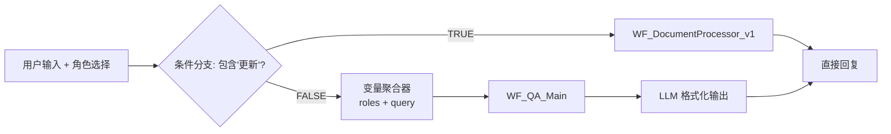
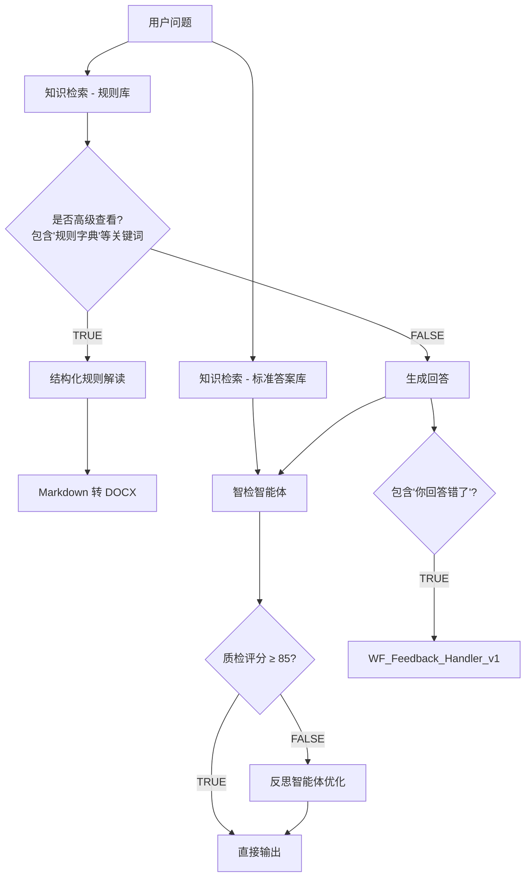
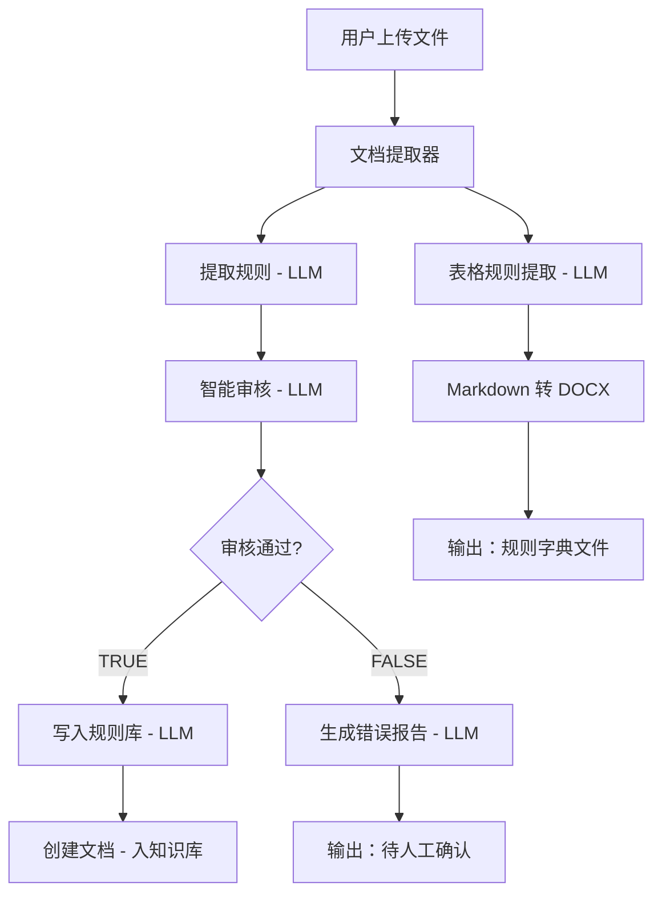
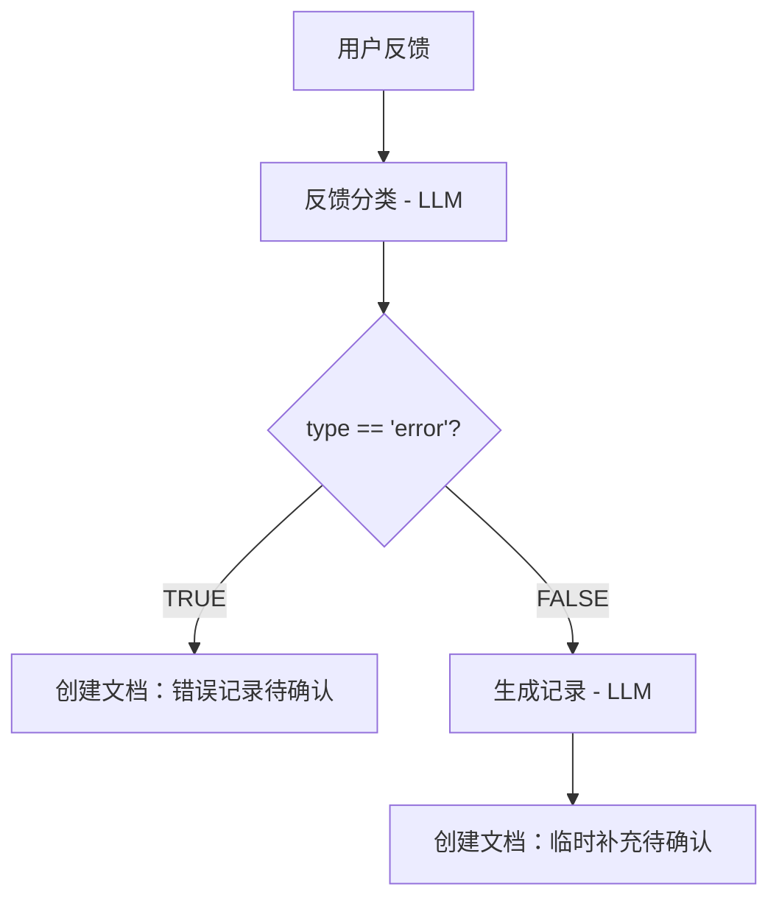

# Dify 工作流 vs Tools 实现对比分析

**生成时间**：2026-01-20
**目的**：确认从 Dify 固定工作流迁移到 LangGraph Tools 后，是否保留了原始设计思路和核心流程

---

## 1. Master_Router 主路由

### Dify 设计（固定流程）



**核心特点**：
1. **角色机制**：product_manager / tech_developer / sales_operations
2. **关键词路由**：通过"更新"关键词触发文档处理流程
3. **变量传递**：将角色信息传递给下游工作流

### Tools 实现

**位置**：`src/agents/agent.py` + `src/biz/agent_service.py` + `src/web/routers/chat.py`

**实现方式**：
```python
# agent_service.py (第66-72行)
if state is None or not state.get("values", {}).get("messages"):
    messages = [
        SystemMessage(content=self._system_prompt),  # 包含角色切换逻辑
        HumanMessage(content=message)
    ]
```

**角色切换**：通过 `config/agent_llm_config.json` 中的 `sp` (system prompt) 实现

**对比结果**：
| 功能 | Dify | Tools | 状态 |
|------|------|-------|------|
| 角色选择机制 | ✅ 通过开始节点变量 | ✅ 通过 SystemPrompt 动态切换 | ✅ **保留** |
| 关键词路由 | ✅ 条件分支节点 | ❌ **丢失**：由 Agent 自主判断调用工具 | ⚠️ **改变** |
| 固定流程 | ✅ 可视化固定流程 | ❌ **改为**：Agent 自主推理选择工具 | ⚠️ **改变** |

**影响分析**：
- **优点**：Agent 更灵活，可以根据问题自主选择合适的工具组合
- **风险**：❌ **丢失了你设计的确定性流程**，可能导致：
  - Agent 误判，该走文档处理却走了QA
  - 无法保证必须按照"检索 → 质检 → 反思"的固定顺序执行

---

## 2. WF_QA_Main 智能问答流程

### Dify 设计（固定流程）



**核心特点**：
1. **两路并行检索**：规则库（主要） + 标准答案库（质检用）
2. **强制质检流程**：每个回答必须经过智检智能体评分
3. **自动反思优化**：评分低于 85 分自动触发反思优化
4. **反馈触发机制**：通过关键词"你回答错了"触发反馈处理

### Tools 实现

**位置**：`src/tools/qa_agent.py`

**实现方式**：
```python
# _quality_check() (第83-111行)
def _quality_check(ctx, query, answer, reference) -> dict:
    """智检：评估回答质量，返回结构化评分结果"""
    # 输出：has_standard_answer, similarity_to_gold, score, critical_error, suggestion
    # ✅ 完全保留了 Dify 的质检逻辑

# _reflect_and_improve() (第114-147行)
def _reflect_and_improve(ctx, query, answer, suggestion, reference) -> str:
    """反思优化：根据质检建议改写回答"""
    # ✅ 完全保留了 Dify 的反思优化逻辑
```

**对比结果**：
| 功能 | Dify | Tools | 状态 |
|------|------|-------|------|
| 两路并行检索 | ✅ 规则库 + 标准答案库 | ❓ 需要查看完整流程 | ⚠️ **待确认** |
| 质检函数 | ✅ 智检智能体节点 | ✅ `_quality_check()` | ✅ **保留** |
| 反思优化函数 | ✅ 反思智能体节点 | ✅ `_reflect_and_improve()` | ✅ **保留** |
| **强制执行顺序** | ✅ 固定流程：检索→生成→质检→(分支)→反思 | ❌ **需要在 @tool 中手动调用** | ⚠️ **关键差异** |
| 评分阈值判断 | ✅ 条件分支节点（≥85） | ❓ 需要查看 qa_agent 完整实现 | ⚠️ **待确认** |
| 反馈触发 | ✅ 条件分支节点 | ❌ **丢失**：需要 Agent 主动调用 feedback_handler | ⚠️ **丢失** |

**影响分析**：
- **优点**：质检和反思的核心逻辑函数完整保留
- **风险**：❌ **关键差异**
  - 在 Dify 中，质检和反思是**强制执行**的固定节点
  - 在 Tools 中，这些函数存在，但**是否调用取决于 Agent 的判断**
  - 可能导致：Agent 跳过质检直接输出，失去质量保障

---

## 3. WF_DocumentProcessor_v1 文档处理流程

### Dify 设计（固定流程）



**核心特点**：
1. **并行双路处理**：
   - 路径1：提取 → 审核 → 入库（JSON格式）
   - 路径2：表格提取 → 导出DOCX（业务版规则字典）
2. **强制审核环节**：智能审核节点（approved: true/false）
3. **人工确认机制**：审核不通过时，输出"待人工确认"标记

### Tools 实现

**位置**：`src/tools/document_processor.py`

**实现方式**：
```python
@tool
def document_processor(file_path, role="default", runtime=None) -> str:
    """文档处理工具：解析文档并提取建账规则为结构化表格"""
    # 1. 读取文档
    doc_content = _read_document(file_path)

    # 2. 提取规则（单一LLM调用）
    # ❌ 没有看到审核环节
    # ❌ 没有看到并行双路处理
    # ❌ 没有看到入库逻辑
```

**对比结果**：
| 功能 | Dify | Tools | 状态 |
|------|------|-------|------|
| 文档提取 | ✅ 文档提取器节点 | ✅ `_read_document()` | ✅ **保留** |
| 规则提取 | ✅ 提取规则 LLM | ✅ LLM 调用 | ✅ **保留** |
| **智能审核环节** | ✅ 智能审核节点 | ❌ **丢失** | ❌ **丢失** |
| **并行双路处理** | ✅ 提取+表格两路 | ❌ **简化为单路** | ⚠️ **简化** |
| 入库工具 | ✅ 创建文档工具（Dify插件） | ✅ `save_rule_to_knowledge` tool | ✅ **保留** |
| 人工确认机制 | ✅ 输出节点标记 | ❌ **丢失** | ❌ **丢失** |

**影响分析**：
- ❌ **关键流程丢失**：
  - 没有了智能审核环节，所有提取的规则直接入库，缺少质量把关
  - 没有了"待人工确认"机制，高风险规则无法拦截
  - 简化了并行双路处理，失去了"规则字典"的 DOCX 导出能力

---

## 4. WF_Feedback_Handler_v1 反馈处理流程

### Dify 设计（固定流程）



**核心特点**：
1. **结构化分类**：error / supplement / clarity
2. **条件路由**：error类型走专门的错误记录流程
3. **自动入库**：分类后的反馈自动创建为知识库文档

### Tools 实现

**位置**：`src/tools/feedback_handler.py`

**实现方式**：
```python
@tool
def feedback_handler(user_feedback, last_answer, conversation_id, auto_notify=False, runtime=None) -> str:
    # 1. 分类反馈 (第119-163行)
    # ✅ 完全保留：critical / improvement / clarification / praise

    # 2. 保存反馈记录 (第190-197行)
    # ✅ 保留：保存到本地 JSON 文件

    # ❌ 差异：没有条件路由，没有自动入库到知识库
```

**对比结果**：
| 功能 | Dify | Tools | 状态 |
|------|------|-------|------|
| 反馈分类 | ✅ 结构化分类 | ✅ 结构化分类（略有不同） | ✅ **保留** |
| **条件路由** | ✅ error类型专门处理 | ❌ **简化为统一处理** | ⚠️ **简化** |
| 自动入库 | ✅ 创建文档到知识库 | ❌ **改为本地JSON文件** | ⚠️ **改变** |
| 通知机制 | ✅ 自动通知 | ✅ `auto_notify` 参数 | ✅ **保留** |

**影响分析**：
- ⚠️ **流程简化**：
  - 反馈不再自动入库到知识库，改为本地JSON文件
  - 没有了"error类型专门处理"的条件路由
  - 优点：更简单、更轻量
  - 风险：反馈数据与知识库隔离，难以形成闭环改进

---

## 5. 核心差异总结

### 从 Dify 固定工作流 → Tools 的架构变化

| 维度 | Dify 工作流 | Tools + LangGraph | 影响 |
|------|-------------|-------------------|------|
| **执行模式** | **确定性固定流程**<br/>节点顺序固定，条件分支明确 | **Agent自主推理**<br/>ReAct范式，工具调用由LLM决定 | ⚠️ **灵活性↑ 确定性↓** |
| **质检机制** | **强制执行**<br/>每个回答必经质检 → 评分 → 反思 | **可选执行**<br/>Agent可能跳过质检直接输出 | ❌ **质量保障减弱** |
| **审核机制** | **文档处理强制审核**<br/>智能审核节点 + 人工确认 | **无审核环节**<br/>提取后直接入库 | ❌ **安全性降低** |
| **条件路由** | **显式条件分支**<br/>通过关键词触发特定流程 | **隐式推理路由**<br/>Agent根据语义判断 | ⚠️ **可预测性↓** |
| **并行处理** | **可视化并行节点**<br/>如文档处理的双路并行 | **串行工具调用**<br/>一次调用一个工具 | ⚠️ **效率可能降低** |
| **反馈闭环** | **自动入库**<br/>反馈自动创建知识库文档 | **本地文件**<br/>与知识库隔离 | ⚠️ **闭环改进能力↓** |

---

## 6. 关键发现与建议

### ✅ 已保留的核心设计

1. **角色切换机制**：通过 SystemPrompt 实现，功能完整
2. **质检函数**：`_quality_check()` 完全保留了智检逻辑
3. **反思优化函数**：`_reflect_and_improve()` 完全保留
4. **反馈分类逻辑**：分类维度略有调整，但核心逻辑保留
5. **检索策略**：smart_retrieve、hybrid_retriever、reranker 等核心能力保留

### ❌ 丢失的关键设计

1. **固定执行顺序**：
   - Dify：强制"检索 → 生成 → 质检 → (评分<85?) → 反思"
   - Tools：这些函数存在，但**是否调用取决于 Agent**
   - **风险**：Agent 可能跳过质检，直接输出低质量答案

2. **文档处理审核机制**：
   - Dify：智能审核节点 + 人工确认标记
   - Tools：**完全缺失**
   - **风险**：错误或有风险的规则直接入库

3. **条件路由的确定性**：
   - Dify：关键词触发（如"更新"触发文档处理）
   - Tools：Agent 自主判断
   - **风险**：Agent 误判，该走文档处理却走了QA

4. **反馈入库的闭环改进**：
   - Dify：反馈自动创建为知识库文档
   - Tools：保存为本地 JSON 文件
   - **风险**：反馈数据无法直接用于改进知识库

### 🔧 改进建议

#### 建议1：恢复固定流程保障（高优先级）

**问题**：当前 qa_agent tool 包含质检和反思函数，但不保证执行

**解决方案**：在 `qa_agent()` 主函数中**强制执行**质检 → 反思流程
```python
@tool
def qa_agent(query, role="default", runtime=None) -> str:
    # 1. 检索
    results = _search_knowledge(query)

    # 2. 生成回答
    answer = _generate_answer(ctx, query, results, role)

    # 3. 【强制质检】
    quality_result = _quality_check(ctx, query, answer, reference)

    # 4. 【强制反思判断】
    if quality_result and quality_result.get("score", 100) < 85:
        answer = _reflect_and_improve(ctx, query, answer, quality_result.get("suggestion", ""), reference)

    return answer
```

#### 建议2：恢复文档处理审核机制（高优先级）

**问题**：document_processor 缺少审核环节，高风险规则直接入库

**解决方案**：添加 `validate_rules()` tool，并在文档处理流程中调用
```python
@tool
def document_processor(file_path, role="default", runtime=None) -> str:
    # 1. 提取规则
    extracted_rules = _extract_rules(...)

    # 2. 【强制审核】
    validation_result = validate_rules.invoke({"rules": extracted_rules})

    # 3. 【条件路由】
    if validation_result["approved"]:
        # 入库
        save_result = save_rule_to_knowledge.invoke(...)
        return f"✅ 规则已入库\n{save_result}"
    else:
        # 生成错误报告，待人工确认
        return f"⚠️ 审核未通过，待人工确认\n原因：{validation_result['reason']}"
```

#### 建议3：增强 Agent 的流程控制（中优先级）

**问题**：Agent 自主推理可能导致流程偏离设计意图

**解决方案**：
1. **在 SystemPrompt 中明确流程规范**
   ```
   当用户问题包含"更新"、"上传"、"入库"等关键词时，必须调用 document_processor 工具。
   当用户问题是知识查询时，必须调用 qa_agent 工具，并确保执行质检流程。
   ```

2. **使用 LangGraph 的条件边（Conditional Edges）**
   - 当前使用的是 ReAct Agent，可以考虑切换到更可控的 StateGraph
   - 通过条件边显式定义："检索 → 生成 → 质检 → (分支) → 反思"

#### 建议4：恢复反馈闭环改进（低优先级）

**问题**：反馈数据保存为本地 JSON，与知识库隔离

**解决方案**：
1. 在 `feedback_handler` 中增加入库逻辑
   ```python
   # 3. 如果是 critical 类型，自动入库
   if is_critical:
       save_rule_to_knowledge.invoke({
           "content": user_feedback,
           "metadata": {"type": "error_feedback", "conversation_id": conversation_id}
       })
   ```

2. 定期汇总反馈，生成改进建议

---

## 7. 总体评估

| 维度 | 评分 | 说明 |
|------|------|------|
| **核心逻辑保留度** | 🟢 85% | 质检、反思、分类等核心逻辑函数完整保留 |
| **流程确定性** | 🔴 40% | 从固定工作流变为 Agent 自主推理，确定性大幅下降 |
| **质量保障机制** | 🟡 60% | 质检和审核逻辑存在，但不强制执行 |
| **架构灵活性** | 🟢 90% | ReAct Agent 更灵活，可以处理更复杂的场景 |
| **系统安全性** | 🔴 50% | 缺少强制审核和人工确认机制 |

### 最终结论

**你的担心是对的！** 🎯

从 Dify 固定工作流迁移到 Tools 后，虽然保留了核心逻辑函数（质检、反思、分类等），但**丢失了最关键的流程保障机制**：

1. ❌ **质检不再强制执行**：Agent 可能跳过质检直接输出
2. ❌ **文档审核机制缺失**：高风险规则可能直接入库
3. ❌ **流程确定性下降**：Agent 自主推理可能偏离设计意图

**建议**：
- **短期**：按照"建议1"和"建议2"，在 tool 内部**强制执行**质检和审核流程
- **长期**：考虑从 ReAct Agent 切换到 LangGraph StateGraph，使用条件边显式定义流程

---

**文档生成时间**：2026-01-20
**作者**：Claude Sonnet 4.5
**版本**：v1.0
