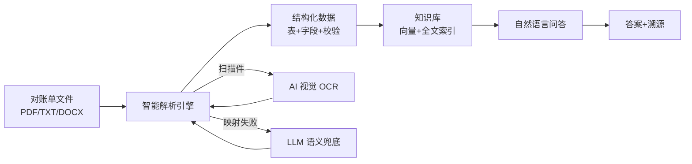

# 金融对账单智能解析与问答系统 — 能力说明书

> 版本: v1.0 | 日期: 2026-08-01 | 状态: 可演示

---

## 一句话定位

基于 AI 的金融对账单智能解析与问答系统：上传对账单，秒级提取结构化数据，自然语言追问即得答案。

---

## 核心能力

### 1. 多格式对账单解析

支持主流对账单格式，无需人工预处理：

| 格式 | 示例 | 解析方式 | 典型耗时 |
|------|------|----------|----------|
| TXT | 复熙混合25号对账单 | 规则引擎 | <100ms |
| PDF (文本层) | 嘉兴民安、博时传统 | 文本提取 + 规则 | <2s |
| PDF (扫描件) | LU 对账单 | AI 视觉 OCR | ~27s |
| DOCX | 新华操作流程 | AI 视觉 OCR | ~70s |

**解析率: 5/5 = 100%**（含扫描件）


### 2. 智能字段映射

不同券商/基金公司的对账单表头命名各异（"市值" vs "参考市值" vs "证券市值"），系统通过三级映射自动对齐：

1. **精确匹配**: 表头与标准字段名完全一致
2. **近义词匹配**: 内置 60+ 同义词表（如 "持仓数量" ≈ "股份余额" ≈ "持股数量"）
3. **LLM 兜底**: 当规则无法匹配时，调用大模型语义理解完成映射

映射结果覆盖 6 类标准表结构：资金资产汇总、证券持仓明细、交易对账单、表头信息、KV 网格、通用表格。


### 3. 自动勾稽校验

每份对账单解析后自动执行 4 项数据一致性校验：

| 校验项 | 说明 | 示例 |
|--------|------|------|
| 市值勾稽 | Σ(明细市值) ≈ 汇总资产市值 | 401,379,783.28 = 401,379,783.28 ✓ |
| 币种一致 | 明细与汇总币种匹配 | 人民币 ✓ |
| 日期格式 | 符合 YYYYMMDD / YYYY-MM-DD 等标准 | 20231031 ✓ |
| 静默错配 | 检测语义不等价的字段映射 | 无可疑映射 ✓ |

每项校验标注 `real_pass`（真实通过）或 `skipped`（数据不足跳过），杜绝"假通过"。

### 4. RAG 智能问答

解析后的数据自动入库，支持自然语言查询：

| 查询类型 | 示例问题 | 正确率 |
|----------|----------|--------|
| 资金查询 | "嘉兴民安的总资产是多少？" | ✓ |
| 持仓查询 | "复熙混合25号持有哪些证券？" | ✓ |
| KV 查询 | "博时传统产品的基金代码是什么？" | ✓ |
| 跨表查询 | "嘉兴民安的资金余额是多少？" | ✓ |
| OCR 查询 | "哪个样本通过 OCR 解析？" | ✓ |
| 元数据查询 | "哪个样本解析最快？" | ✓ |
| 勾稽查询 | "哪个样本勾稽校验全部通过？" | ✓ |

**测试集: 15/15 = 100% 正确率，响应时间 295ms**

### 5. 答案溯源

每条回答附带完整来源信息：

- 来源文档名（如 `sample_jiaxing_minan_20231031.pdf`）
- 来源表名（如 `p0_table_2 (资金资产汇总)`）
- 相关度评分（0-1）
- 原始字段内容（脱敏后）

用户可一键追溯到原始对账单的具体位置，满足审计合规要求。


---

## 性能数据

基于 5 份真实甲方样本、每样本 3 轮取中位数：

| 指标 | 数值 | 说明 |
|------|------|------|
| 非 OCR 解析 | <2.1s | TXT/PDF 文本层 |
| OCR 解析 | 27-70s | 扫描件，依赖视觉模型 |
| M2 问答响应 | 295ms | 检索 138ms + 生成 157ms |
| 并发支持 | 2 workers | FastAPI uvicorn |
| 知识库容量 | 17 embeddings | 4/5 样本入库 |

---

## 技术架构



**技术栈**: Python 3.11 / FastAPI / LangChain / PGVector / Qwen3 系列模型

---

## 部署方式

### 开发环境

```bash
# 一键启动
bash scripts/m1_serve.sh

# 访问
# M1 解析 + M2 问答: http://localhost:5050/m1
# API 文档: http://localhost:5050/docs
```

### 生产环境

```bash
# Docker Compose (M1 + PGVector + 代理)
docker compose up -d

# 健康检查
curl http://localhost:5050/health
```

详见 [docs/20_部署指南.md](20_部署指南.md)（Phase 5 产出）。

---

## 已知限制

| 限制 | 影响 | 缓解措施 |
|------|------|----------|
| OCR 延迟 27-70s | 扫描件解析较慢 | 异步处理 + 进度提示 |
| PaddleOCR ARM64 不可用 | 仅限 x86 部署 PaddleOCR | 使用 AI 视觉模型替代 |
| 单轮问答 | 不支持连续追问 | Phase 2 已规划多轮对话 |
| 5 样本验证 | 覆盖面有限 | 持续扩充测试集 |

---

## 下一步路线图

| 阶段 | 内容 | 状态 |
|------|------|------|
| M1 解析 | 多格式 + OCR + 字段映射 + 勾稽校验 | ✅ 完成 |
| M2 问答 | RAG 检索 + 答案溯源 | ✅ 完成 |
| M2 多轮 | 连续追问 + 对话历史 | 🔄 进行中 |
| 鲁棒性 | 边界 case + 编码检测 + 并发 | 📋 规划中 |
| 生产部署 | Docker + 监控 + 日志 | 📋 规划中 |
| 更多格式 | XLSX / 图片 / 邮件附件 | 📋 规划中 |

---

## 操作演示截图序列

完整演示截图见 [docs/experiments/2026-08-01_demo_sequence/](experiments/2026-08-01_demo_sequence/)

| # | 截图 | 说明 |
|---|------|------|
| 1 | 首页三面板 | 标准化表格 + KV 信息 + 复核校验 |
| 2 | Sample 解析 | 一键加载示例数据 |
| 3 | PDF 上传 | 拖拽/选择文件上传 |
| 4 | 复核面板 | 4 项勾稽校验结果 |
| 5 | M2 问答输入 | 自然语言提问 |
| 6 | M2 回答溯源 | 答案 + 来源文档 + 字段 |
| 7 | 全页概览 | 完整功能一览 |
| 8 | ZhikunCode | 多 Agent 协作界面 |
