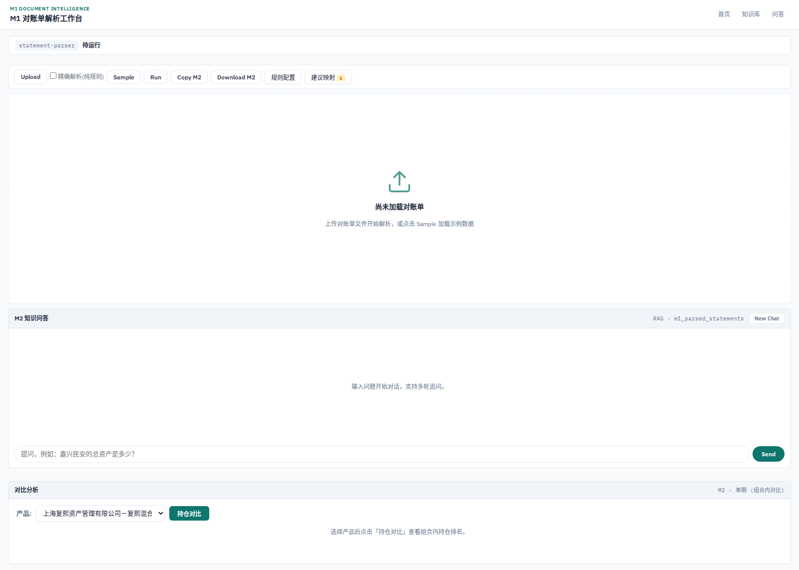
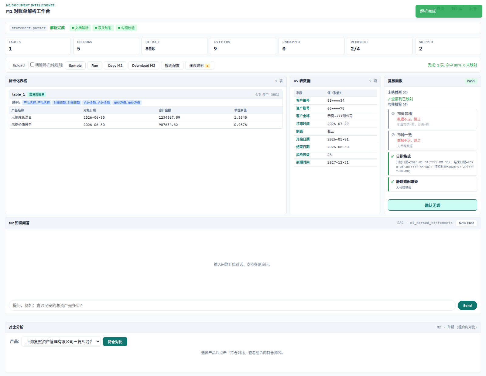
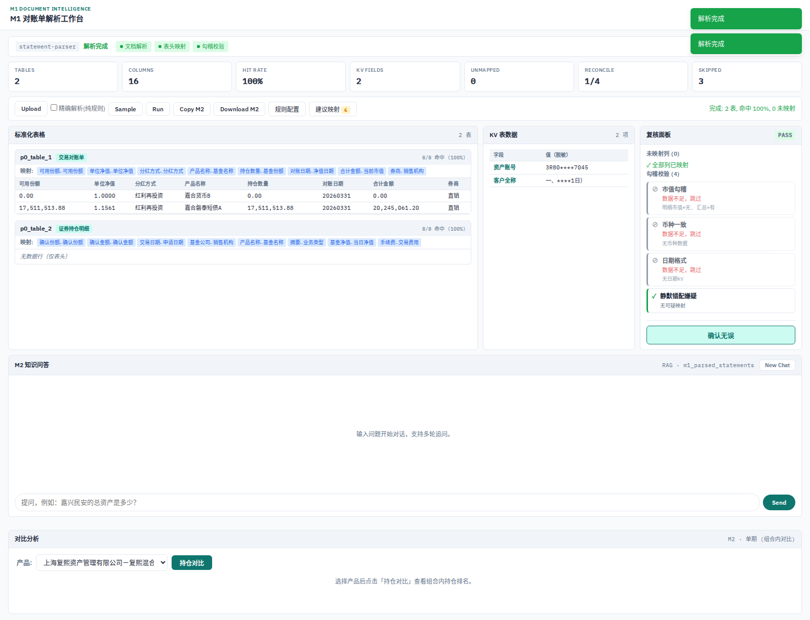
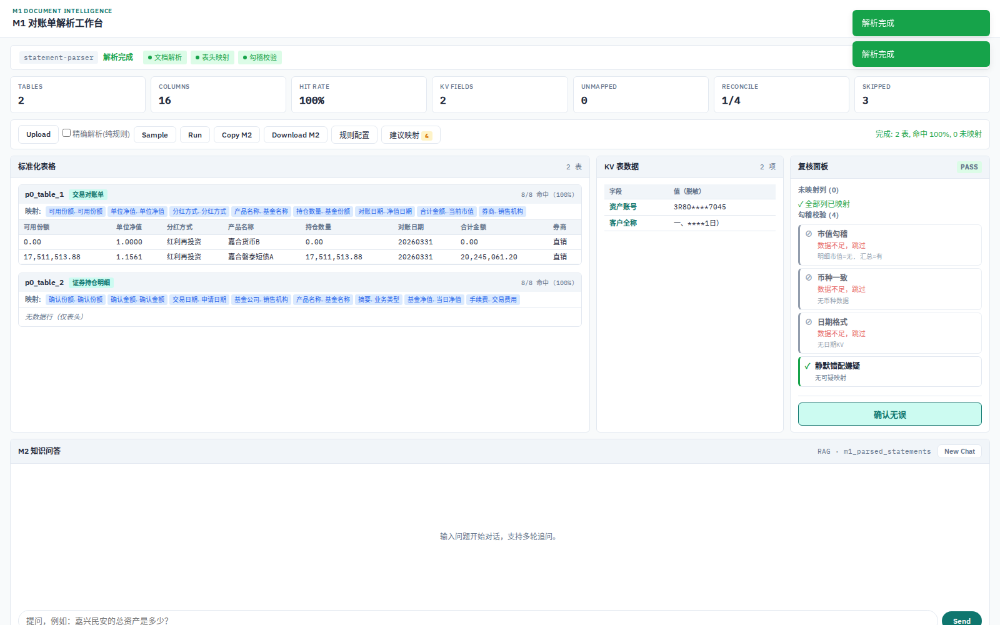
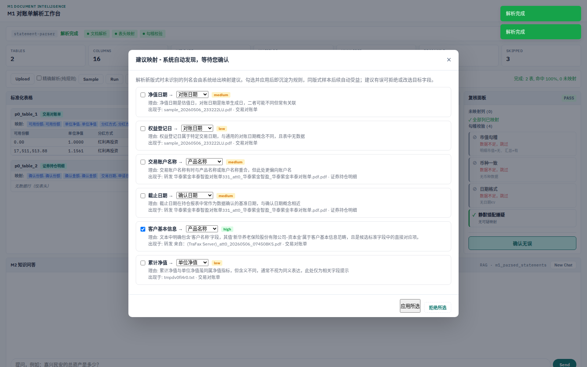
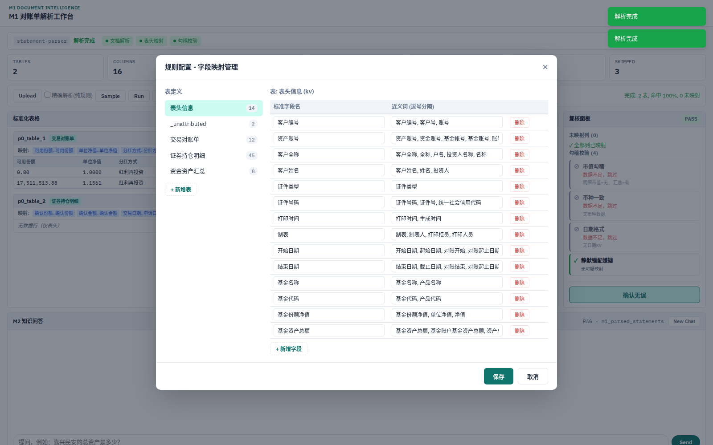
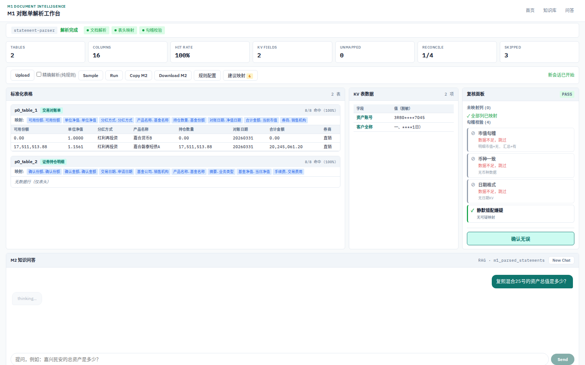
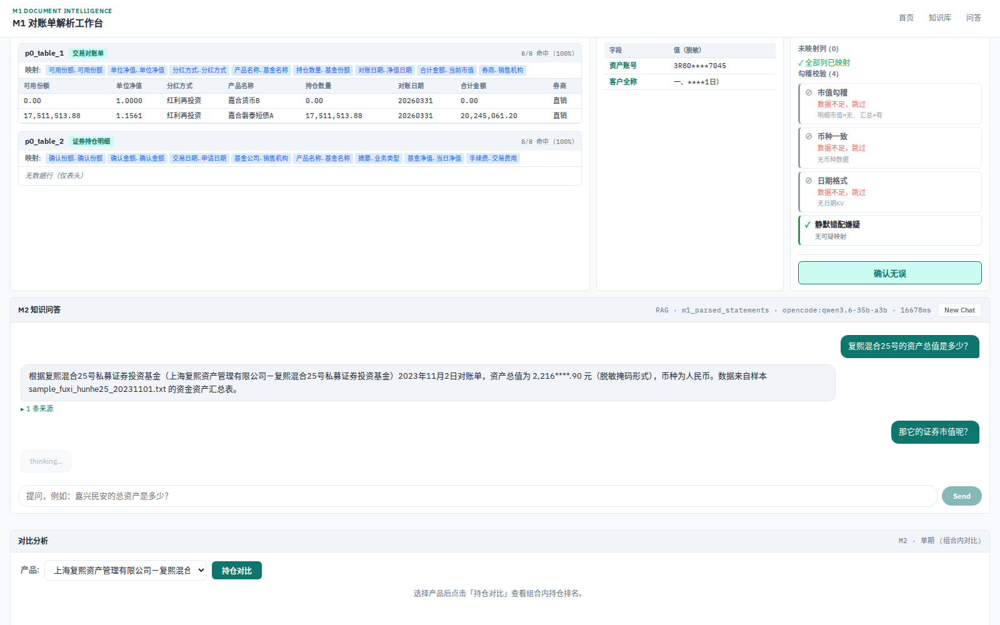
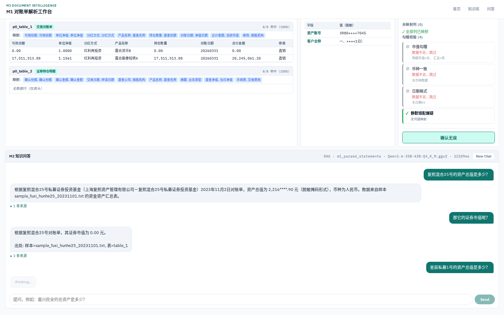
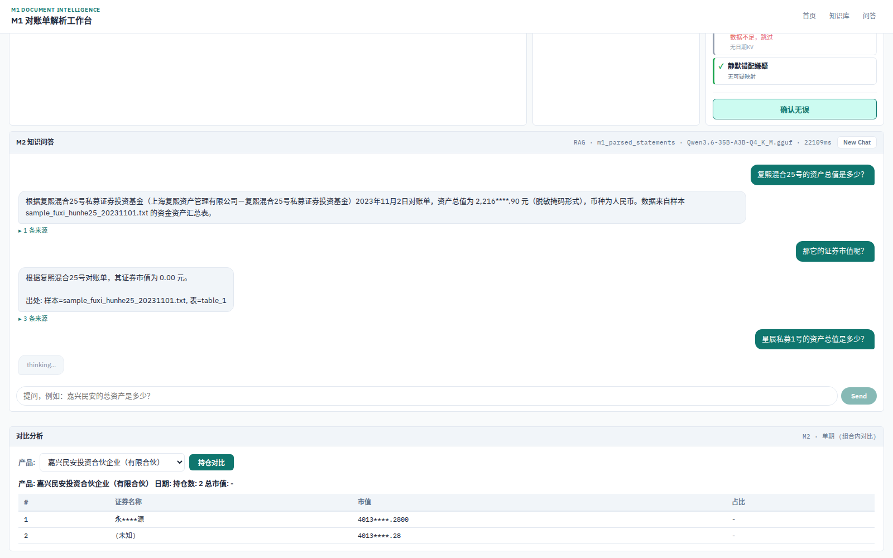

# AI 金融对账单智能解析与问答系统 — 阶段汇报

> 2026 年 8 月

## 执行摘要（30 秒）

本系统把多种格式的基金/证券对账单——含扫描件、传真件、邮件附件——自动解析为标准化结构，提供勾稽校验与带来源溯源的智能问答。首批甲方真实样本（15 个可解析源）产出 31 张标准表；经两轮规则沉淀，同版式样本字段命中率已达 100%，最难的扫描样本从 35.7% 提升至 100%。

| 关键数字 | 结果 |
|---|---|
| 同版式样本字段命中率（嘉合系列 8 份） | **100%** |
| 最难样本（华泰紫金，扫描传真件） | **35.7% → 100%** |
| 问答正确率（含拒答边界题，全部带来源） | **16/16** |
| 电子件解析速度 | **毫秒级** |

## 场景一：对账单接收与录入

邮件附件、PDF、TXT 直接上传即可解析；无文本层的扫描件与传真件自动转入视觉识别通道"看图识字"（图 3）。电子件毫秒级完成；扫描件为批处理口径，单份数十秒（见脚注 2）。非对账单类文档（如运营流程文件）会被识别并跳过入库，不污染问答检索空间。

## 场景二：数据质量保障

**智能字段映射**：不同券商/托管行的列名差异自动对齐到标准字段（图 6 可在线查看与维护映射规则）。对于系统尚未识别的列，系统主动给出"建议映射"候选——原列名、建议字段、置信度与理由一并呈现，贵方以勾选方式确认即可生效，无需了解规则细节（图 5，选择题面板）。

**勾稽校验**：自动执行市值勾稽、币种一致、日期格式、静默错配四项检查；源数据缺少对应字段时如实标注"数据不足，跳过"，不给出虚假的"通过"（图 4）。

## 场景三：业务问询

对已入库对账单自然语言提问，回答附来源文档与表名（图 7）；支持多轮追问，"其中…呢？"自动关联上文（图 8）；检索不到时明确回答"未找到"，不编造数字（图 9）。

问答提供两条链路，按场景选择：直连路约 2 秒/轮，适合快速交互；验证链路 15-20 秒/轮，答案经独立复核、溯源遵从度更高，适合关键数字场景。等待的时间不是空转，而是独立复核。

## 场景四：对比分析

组合内持仓对比支持产品简称查询（如"嘉兴民安"自动匹配全称），按市值排序并给出占比（图 10）。跨期对比在仅有单期数据时明确提示"需多期数据"，不伪造对比结果。

## 递进故事：系统如何越用越准

同一批样本，两轮复测对比：

| 指标 | 一轮 | 当前 |
|------|------|------|
| 嘉合系列（8 份同版式） | 93.8% | **100%** |
| 华泰紫金（扫描传真） | 35.7% | **100%** |
| TraFax 传真件（逐表） | [50 / 81.8 / 63.6]% | [50 / 81.8 / **100**]% |
| WaveFax 传真件 | 71.4% | **100%** |
| 国金 HTML 邮件 | 70% | **90%** |

每一次人工修正都被沉淀为可复用规则（同义词、上下文字段、版式重建），同类版式后续样本自动受益——这正是我们希望与贵方共建的节奏：贵方对字段口径的理解是递进的，系统把每一次理解都变成确定性的规则资产（二轮提升均经同批样本纯确定性复验，见脚注 3）。

## 诚实限制

1. 扫描件/传真件走视觉识别，单份数十秒（见脚注 2），适合批处理而非即时交互。
2. 跨期对比需要同一产品多期对账单；当前样本每产品仅一期，系统如实提示而非伪造对比。
3. 问答对"入库数据中不存在"的字段会明确回答未找到——这是设计目标：不编造数字。
4. 数值展示默认脱敏（如 4,013****.83），演示环境可配置关闭。

## 下一步与需要您支持的事项

**下一步**：① 多期数据接入后开通跨期对比（资产变动、持仓增减趋势）；② 映射规则自助配置与建议映射选择题持续运转；③ 更多文档类型与版式的持续适配（以贵方实际样本驱动）；④ 生产化部署与权限体系。

**需要您支持**：

- **同一产品的多期对账单**——解锁跨期对比，当前最高优先；
- **更多 .msg / 扫描件 / 传真件样本**——驱动版式适配，样本越多样系统越稳健；
- **业务侧字段规则表**——字段名、别名、口径的增量补充（现有 674 行映射表已发挥首批价值，规则表越完整，映射越确定）；
- **使用反馈**——哪些能力最有价值、期望的交付形态与时间节点，供我们排定路线图。

## 脚注

1. 问答题库口径演化：首版 15 题；08-05 修复 OCR 溯源题后 15/15；08-09 扩充至 16 题（12 基础 + 4 对抗：不可回答拒答、跨文档、OCR 溯源、多轮追问），AI 评审四维（忠实度/数值/引用/拒答）均分 5.0/5.0。正文统一按当前口径 16/16 表述。
2. 视觉识别延迟口径：早期样本冷启动实测 16-71 秒（随页数与版式变化），优化后近期冷启动实测 9.6-22.9 秒；相同内容重复解析命中本地缓存，秒级完成。
3. 二轮提升均基于同批样本的纯确定性复验（不依赖大模型即时判断），沉淀规则全部入库可审计。

## 附录 A：演示截图序列（2026-08-12 实拍）

**图 1｜系统首页：解析 / 校验 / 问答三面板**

**图 2｜内置示例解析结果**

**图 3｜上传甲方样本（嘉合）解析结果，字段命中率 100%**

**图 4｜复核面板：四项勾稽校验**

**图 5｜建议映射选择题面板：系统给出候选，勾选即生效**

**图 6｜映射规则在线查看与维护**

**图 7｜问答：带来源溯源的回答**

**图 8｜多轮追问：自动关联上文**

**图 9｜无数据时明确"未找到"，不编造**

**图 10｜持仓对比：简称查询 + 市值排序占比**

## 附录 B：系统实测验证摘要

| 验证项 | 结果 | 实测 | 说明 |
|------|------|------|------|
| 系统健康检查 | 通过 | 0.2s | 全部依赖组件正常 |
| 样本解析 ×5 | 4/4 成功 + 1 预期跳过 | 115.9s | 电子件毫秒级；扫描件约 35s；非对账单文档被正确识别并跳过入库 |
| 单轮问答 ×3 | 3/3 有答且带来源 | 4.8s | 无数据时明确回答"未找到" |
| 多轮追问 ×3 | 3/3 正确 | 5.3s | 总资产 → 其中证券市值 → 资金余额，上下文保持 |
| 跨期对比路由 | 正确 | 0.1s | 单期数据如实提示"需多期数据" |
| 问答批量验证 | 16/16 = 100% | — | 含拒答、跨文档、溯源、多轮四类边界题（见脚注 1） |

完整验证日志与截图原始序列可应要求提供。
