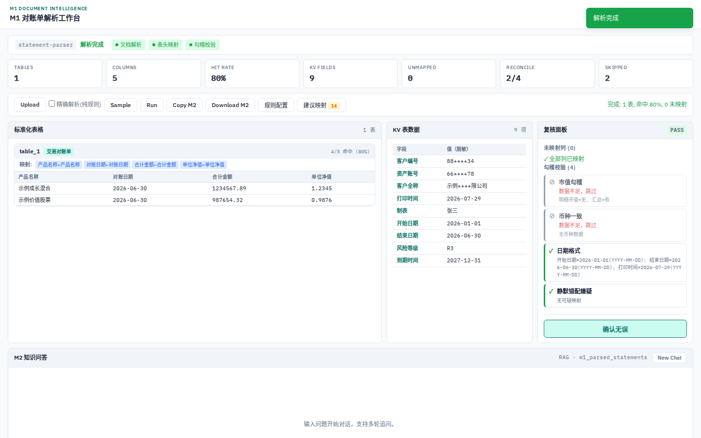
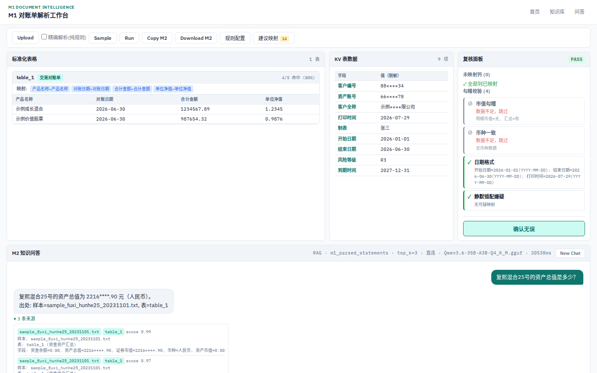
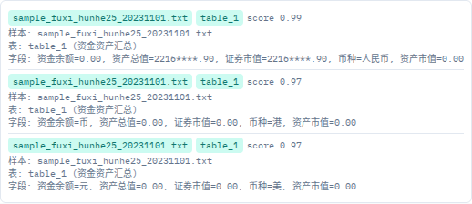
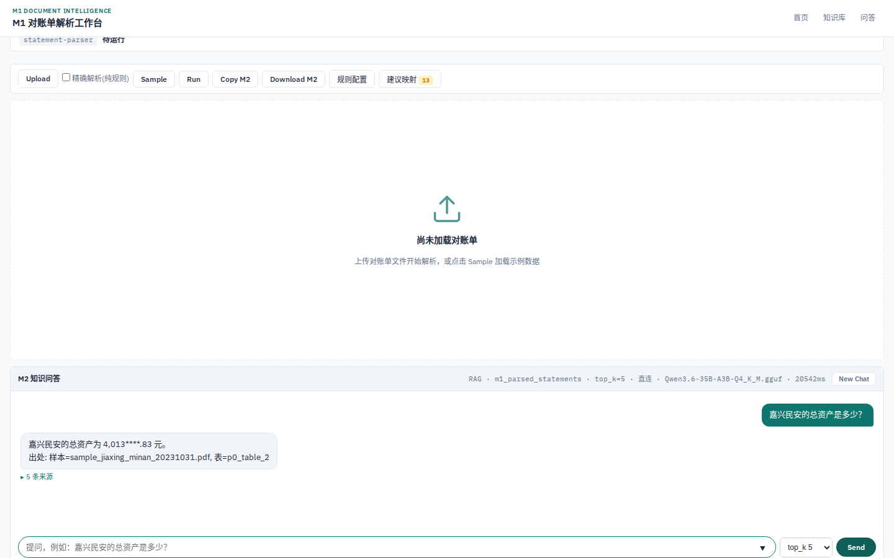
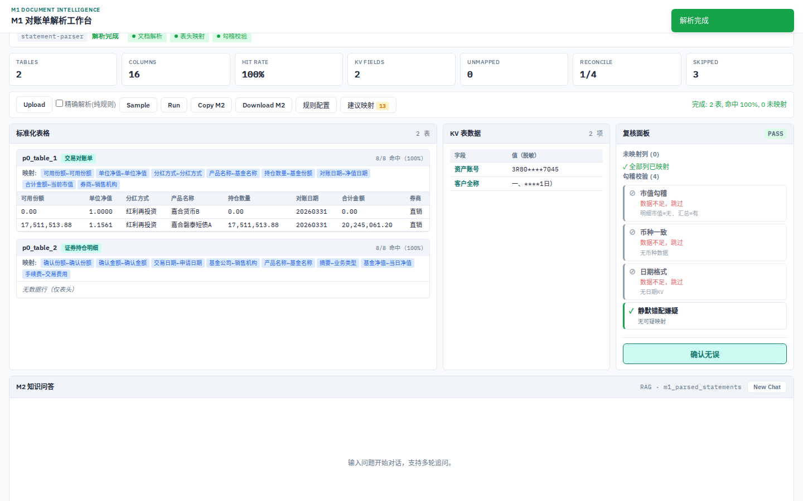
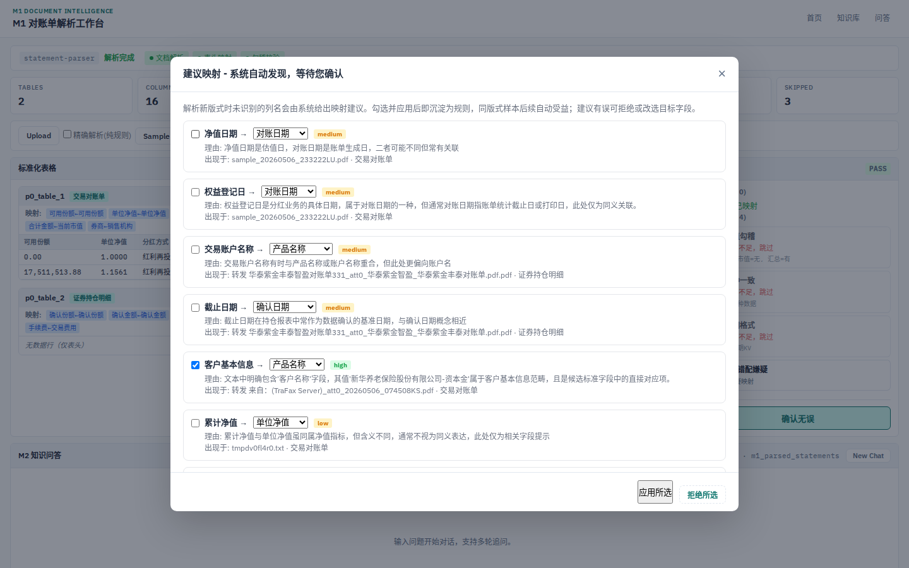
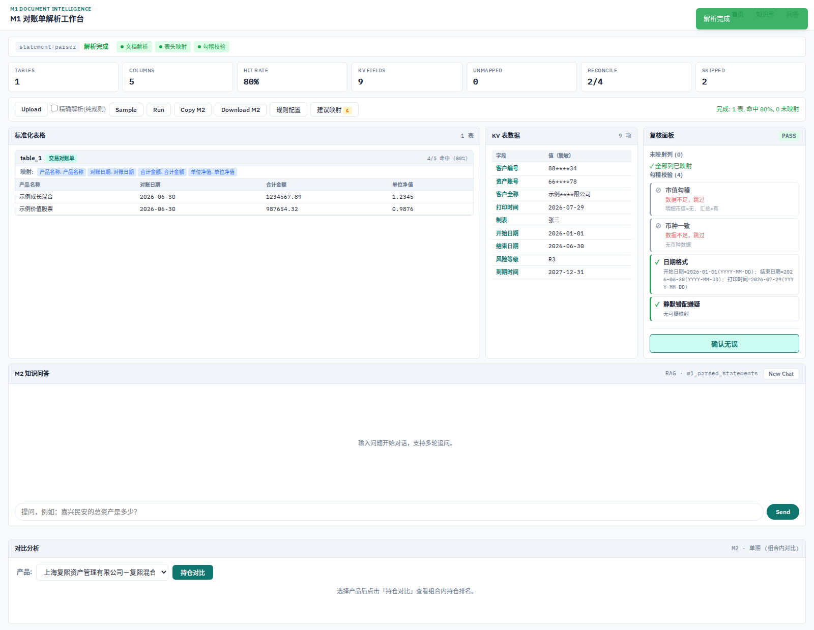
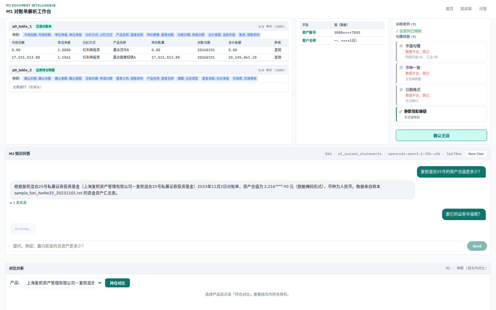
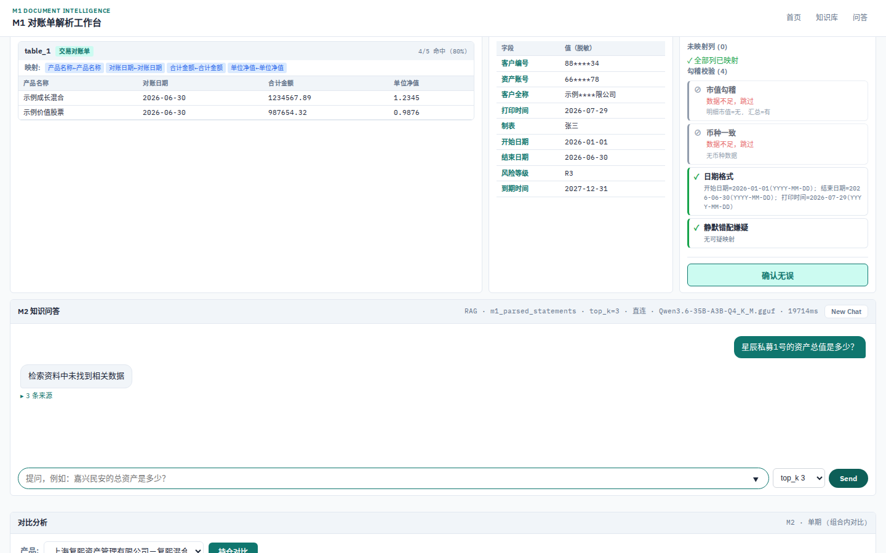
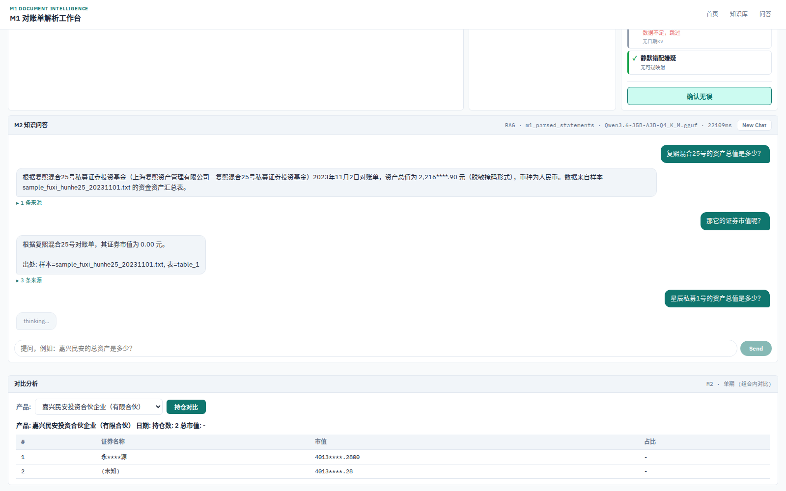

状态: 活跃 | 更新: 2026-08-13 | 取代/被取代: 无

# 科研进展汇报（导师版）

> 本文档为内部技术口径进展汇报，甲方版另附。可讨论双链路 / agent 验证 / 多 Loop 工程体系。
> 配套交付：本文档 docx 版（图片全内嵌、自包含）+ 演示视频 demo.mp4 + 截图原图目录。

## 一、系统定位与总体架构

**一句话定位**：基于 AI 的金融对账单智能解析与问答系统——把多格式对账单（电子件 / 扫描件 / 邮件附件）解析为结构化表格，完成字段智能映射与勾稽校验，并在其上提供带溯源、可多轮、会诚实拒答的 RAG 问答。

**总体架构（文字版）**：

- **解析层（M1）**：PDF/TXT/HTML 邮件/.msg 多入口；电子件走确定性解析管线（坐标重建表格结构）；无文本层扫描件走本地视觉模型 OCR 通道；LLM 兜底映射未覆盖表头，且每次成功兜底自动沉淀为映射建议（schema 自学习闭环）。
- **校验层**：勾稽校验（资产=负债+份额等恒等式）、未映射列清单、映射建议选择题面板（人工勾选 → 回归门禁验证 → 规则落库）。
- **问答层（M2）**：pgvector 向量检索 + 重排；双链路——直连路（约 2-3 秒/轮）与多 agent 验证链路（独立 agent 复核检索证据，12-20 秒/轮），快与准是菜单而非取舍。
- **工程体系**：多 Loop 协作（执行/验证/审计三条独立通道互相复核）、回归门禁与 eval 基线（确定性检验 + AI judge 四维评分）、文档与记忆治理（台账唯一、漂移机器检测）。
- **全部推理本地化**：视觉模型与问答模型均部署在本地算力上，数据不出域。

## 二、已完成功能清单

| 能力 | 说明 | 对应截图 |
|---|---|---|
| 多格式解析（含扫描件） | 电子 PDF/TXT/HTML 邮件/.msg；扫描件走视觉 OCR 全本地推理 | 图 4、图 6 |
| 智能字段映射 | 同义词规则库 + LLM 兜底 + 自学习建议沉淀 | 图 5 |
| 勾稽校验 | 恒等式校验，数据不足如实标"跳过" | 图 4、图 5 |
| 建议映射选择题面板 | LLM 建议 + 置信度 + 勾选应用/拒绝/改选，应用后自动回归验证 | 图 5 |
| RAG 问答带溯源 | 每个数字附样本/表名/相似度 score/原文片段 | 图 2、图 3 |
| 多轮对话 | 追问自动关联上文实体 | 图 8 |
| 诚实拒答 | 库中无数据明确说"未找到"，不编造 | 图 9 |
| 持仓对比 | 跨表/跨文档产品持仓对比（含简称模糊匹配） | 图 10 |
| 检索透明面板 | top_k 可选、sources score/field 展示、路由与耗时可见 | 图 1-图 3 |
| 快与准双链路 | 直连 ~2-3 秒/轮；验证链路 12-20 秒/轮，meta 如实标注 | 图 2' meta 标注与演示视频验证链路段 |

## 三、前端展示（重点节）

> 导师重点关注节。以下按"用户动线"组织截图序列，每张配看点说明。截图均为 1440×900 实机拍摄。

### 3.1 首页：三面板信息架构



**看点**：单页三面板布局——左"解析结果"（表格逐表展示）、中"表头信息"（字段映射明细）、下"复核校验"（勾稽 + 未映射列；单表样本如实显示“数据不足，跳过”）；右侧 M2 问答面板常驻。信息架构的设计意图是"解析-映射-校验"一条动线在一屏内闭环，减少页面跳转。输入行右侧的 top_k 选择器是检索透明面板的入口（见 3.4）。

### 3.2 问答带溯源：证据块设计



**看点**：本例走**直连路**（meta 行标注路由与耗时，本图 meta 为冷态首请求，热态秒级见战绩表；验证链路的证据块结构相同，agent 路无 score 时优雅降级为 field 标签）。sources 展开后每条证据含四个要素：样本编号、表名、相似度 score、原文片段。设计原则：任何数字必须可点击回溯到原始表格行，"无出处的数字不显示"。



**看点**：证据块特写。score 数值化展示让"检索质量"对用户可见——这是检索透明化的第一层：不只给答案，还给答案的证据与证据的可信度。

### 3.3 检索透明面板（本轮新增，重点）



**看点**：检索透明面板三要素——① top_k 选择器（3/5/8/10，用户可调检索条数）；② sources 的 score/field 标签（agent 路无 score 时优雅降级为 field 或"-"，不显示 undefined）；③ meta 行：`RAG · 集合名 · top_k · 直连/验证链路 · 模型 · 耗时ms`。本例 meta 为"直连 · top_k=5 · 20542ms"（浏览器冷启动首轮，含模型懒加载；热态直连约 2-3 秒）。**本图 meta 为冷态首请求 20.5s，热态复测 2.7s（战绩表口径）**。


**看点**：meta 行是"系统诚实性"的最小实现——每一问走哪条路、用多少检索、花了多久，全部可见。它同时是双链路叙事的载体：用户能亲眼看到"快"与"准"的区别，而不是听宣传。

**设计动机**：RAG 系统的黑盒感是用户信任的最大障碍。把检索参数与路由暴露给用户，既服务调试（研究者视角），也服务信任（业务视角）——"系统不藏东西"。

### 3.4 解析与复核动线



**看点**：上传即解析。电子件毫秒级出表，表数/字段命中/复核徽章同步刷新。


**看点**：复核区把"系统不确定的部分"也展示出来——未映射列清单是建议映射面板的输入。设计原则：不隐藏失败面，把不确定变成可操作的选择题。

### 3.5 建议映射选择题面板



**看点**：LLM 在解析兜底时产出的映射建议进入候选池，用户做选择题（勾选应用/拒绝/改选目标字段）；应用后自动跑全量回归门禁，命中率下降则自动回滚并提示。这是"把用户没想到的也解析出来端给他"理念的最小落地——甲方不需要懂 schema，只需要做选择。

### 3.6 补充序列



**看点**：零上传成本的体验入口。



**看点**："其中…"类追问自动继承上一轮产品实体。



**看点**：拒答是问答系统的信任底座。



**看点**：跨表持仓对比，支持产品简称模糊匹配。

### 3.7 演示视频

3 分 48 秒分段演示视频（demo_v2.mp4，随附步骤清单）：开场卡 → Sample 解析开场（三面板）→ 直连路快问快答 → 检索透明面板（top_k/路由/耗时）→ 嘉合上传 → 建议映射选择题面板 → 复核/多轮/诚实拒答 → 传真 OCR（8 倍速 + 烧录字幕）→ 验证链路（4 倍速 + 烧录字幕）→ 结束卡。等待段均倍速或烧录字幕，全片无超 10 秒无信息静帧。视频与截图互补：截图供慢看，视频供快懂。

## 四、战绩数字表

| 指标 | 数值 | 口径 |
|---|---|---|
| 嘉合客户对账单（电子件） | 字段命中 93.8%（一轮）→ 100%（规则沉淀后） | 同版式 8 份 |
| 最难样本（华泰紫金） | 35.7% → 100% | 纯确定性规则，LLM 调用归零 |
| 传真扫描件 TraFax | 50 / 81.8 / 81.8 | 逐表命中率 |
| 传真扫描件 WaveFax | 100% | 规则沉淀后 |
| RAG 问答 | 16/16 带溯源 | 确定性检验层 |
| AI judge 四维 | 4.94 / 5.0 / 5.0 / 5.0 | 忠实度/数值/引用/拒答 |
| 电子件解析延迟 | <2.1s | 非 OCR |
| 扫描件 OCR | 16-71s | 本地视觉模型 |
| 直连路 | ~2-3s/轮（热态） | 本轮实测含冷态 20.5s 一例 |
| 验证链路 | 12-20s/轮 | 本轮实测最佳 12.3s |
| 单元测试 | 334 passed / 15 skipped | pytest 无 PG 环境口径；PG 依赖 2 项（test_persistence×2）随环境翻转，含 PG 环境 336/13 |
| 向量库 | 137 embeddings，本地 embedding 模型 | pgvector |

## 五、已知限制与下一步（导师视角）

**已知限制**：
1. 扫描件 OCR 延迟高（16-71s），当前以等待提示 + 字幕叙事覆盖，未做异步任务化。
2. 验证链路在 18s 超时下约 77% 流量回落直连——"准"路当前成功率不足，正在做延迟根因治理（本地模型 slot 争用）。
3. 前端为单页原型形态，信息密度与任务管理（历史/多任务）弱于成熟工作台；改版设计已定方向（三栏任务工作台，参考腾讯 WorkBuddy），待实施。
4. 跨期对比需要同一产品多期对账单，当前样本不足。

**下一步**：
1. 前端改版一期（任务列表 + 执行过程分步可视化 + 产物面板）。
2. 验证链路延迟治理，把"准"路成功率提到可用水平。
3. 科研线：验证门控的记忆固化（VGMC）——把"LLM 建议 → 回归验证 → 规则落库"的工程实践抽象为可发表问题，前期文献调研已完成差异化判定。
4. 跨期对比、字段规则库扩充（随甲方多期数据到位）。

## 六、请导师把关清单

1. **前端展示评价**：三面板信息架构是否清晰？检索透明面板（3.3）的"暴露检索参数"设计是加分还是噪音？建议映射面板（3.5）的选择题交互是否易懂？
2. **甲方版报告审阅意见**：甲方版（另附）的叙事与数字口径是否稳妥？
3. **视频是否够演示**：demo_v2.mp4 分段结构（解析开场→直连快问→透明面板→嘉合→建议映射→复核/多轮/拒答→OCR→验证链路）是否覆盖关注点？需要补拍哪些环节？
4. **双链路叙事**："快与准是菜单"的表述是否成立？验证链路当前成功率不足的诚实披露方式是否合适？
5. **改版方向**：三栏任务工作台（左任务列表/中执行过程/右产物面板）是否符合业务直觉？

## 附录 A：资产取回命令（本机执行）

```powershell
# 导师预审版 docx（自包含，图片全内嵌）
scp jinrong-dev:~/wzh/projects/agents_final_tech/docs/31_导师进展汇报_预审版.docx D:\AIRcommend\

# 演示视频 + 步骤清单
scp jinrong-dev:~/wzh/projects/agents_final_tech/docs/experiments/2026-08-09_demo_video/demo.mp4 D:\AIRcommend\
scp jinrong-dev:~/wzh/projects/agents_final_tech/docs/experiments/2026-08-09_demo_video/steps.md D:\AIRcommend\

# 本轮新拍截图（检索透明面板等 8 张 + meta）
scp -r jinrong-dev:~/wzh/projects/agents_final_tech/docs/experiments/2026-08-13_advisor_package D:\AIRcommend\

# 08-12 批次截图（文档引用）
scp -r jinrong-dev:~/wzh/projects/agents_final_tech/docs/experiments/2026-08-12_docs23_screenshots D:\AIRcommend\
```

> 说明：docx 已内嵌全部图片，可单文件离线观看；截图目录与视频供原尺寸/动态查看。

## 附录 B：远程 live 演示速查

**三步流程**：
1. 本机跑 `powershell -NoProfile -File scripts\dev_remote_demo.ps1` —— 自动建隧道（GB10 :5050 → 本机）、自动开浏览器；本机 5050 被占自动切 15050 并在控制台明示。
2. 确认浏览器地址为 http://localhost:5050/m1（或控制台所示 15050），首页三面板渲染正常即隧道可用。
3. 屏幕共享此浏览器窗口，按本文档第三节序列演示。

**故障排查**：

| 现象 | 先查 | 处理 |
|---|---|---|
| 脚本报"SSH 提前退出" | 网络 / ssh key | 手动 `ssh jinrong-dev "echo ok"` 验证 |
| 页面 502 / 打不开 | GB10 侧 :5050 存活 | `ssh jinrong-dev "bash scripts/graph/status.sh"`；:5050 若 down 报主线程，不擅自重启 |
| 控制台提示改用 15050 | 本机 5050 被占 | 直接用 15050 地址，演示无影响 |
| 演示结束端口仍占 | 残留 ssh | 重跑脚本一次（启动自愈清理残留）或任务管理器结束 ssh.exe |
| 验证链路问题等待 12-20s | 预期行为 | 等待期讲双链路叙事（meta 行可见路由与耗时） |
| 报“SSH 提前退出 (code=255)”且提示改用 15050 | 5050 与 15050 同时被占 | 脚本报错退出（exit 1）不静默；释放任一端口后重跑 |

**安全口径**：仅本地转发（ssh -L），无 reverse forward、无 ngrok/frp，不做任何公网暴露；脚本退出即断隧道，异常强杀时下次启动自愈。

**演练基线（2026-08-13）**：穿隧道 health 200（embeddings=137 / provider=local）、GET /m1 200、静态资源 200、POST compare/positions 返回 2 持仓（73ms）、health 延迟 31-61ms。
