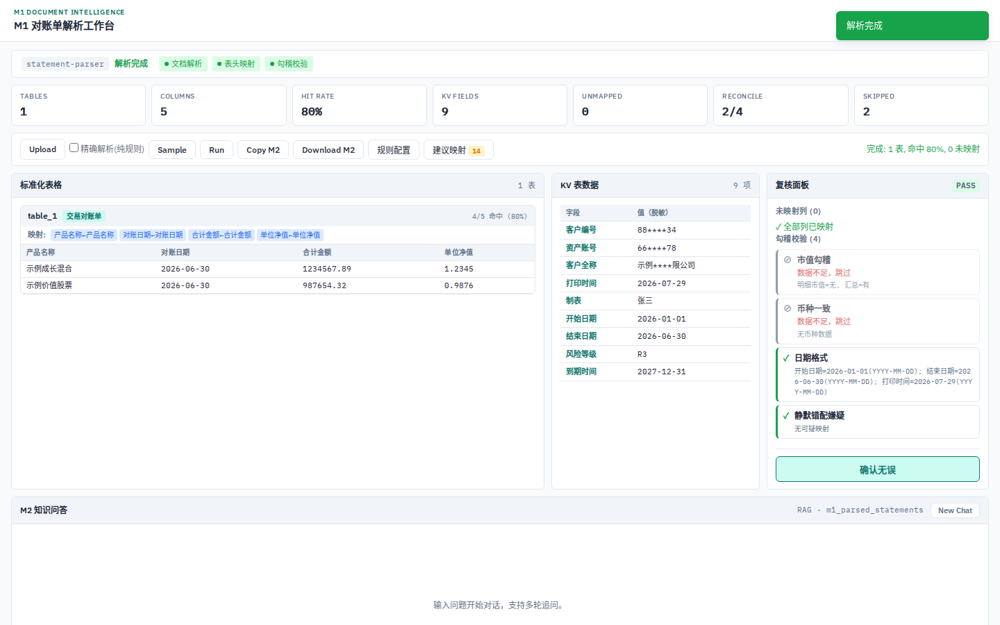
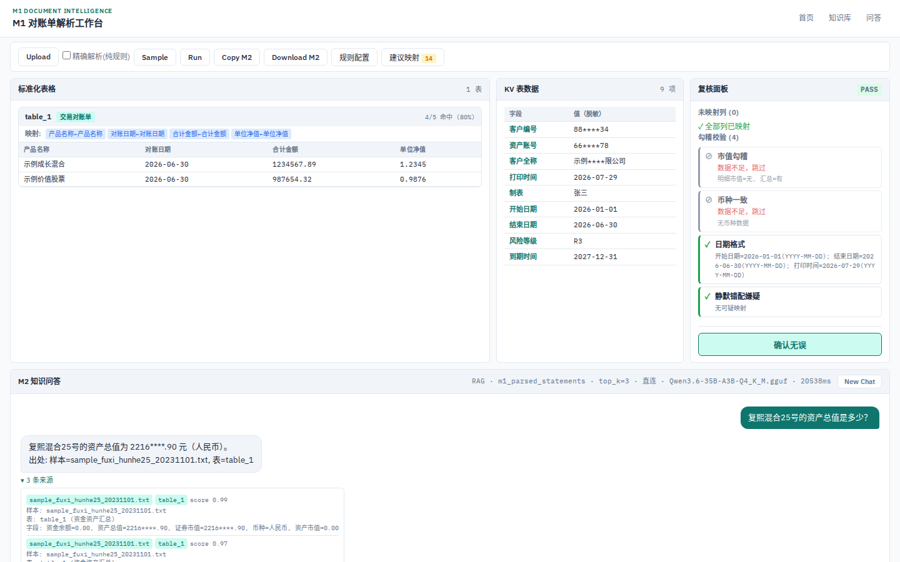
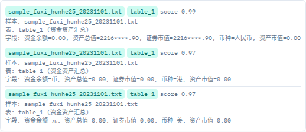
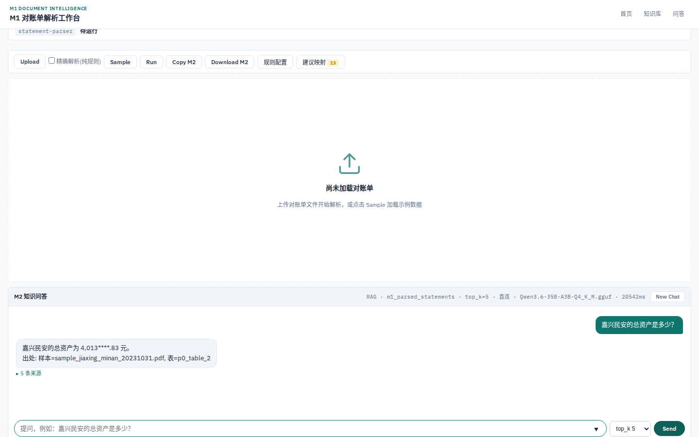
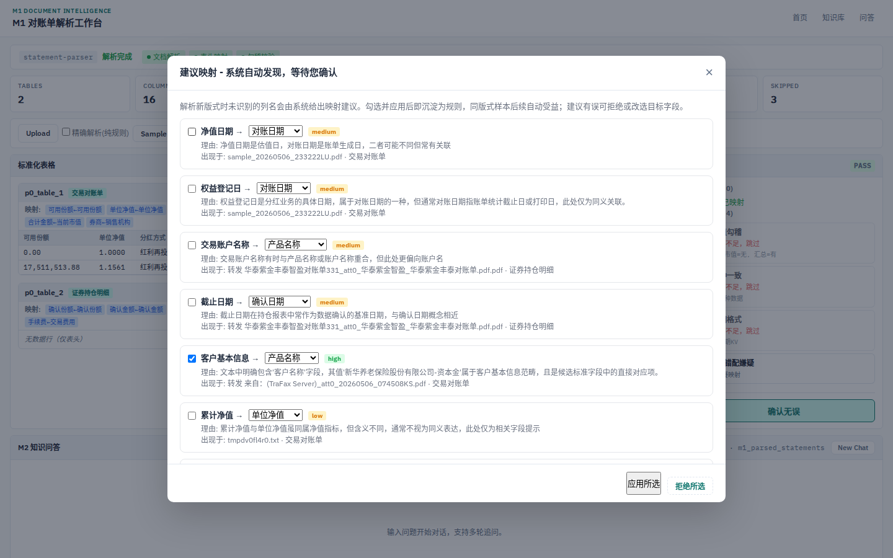
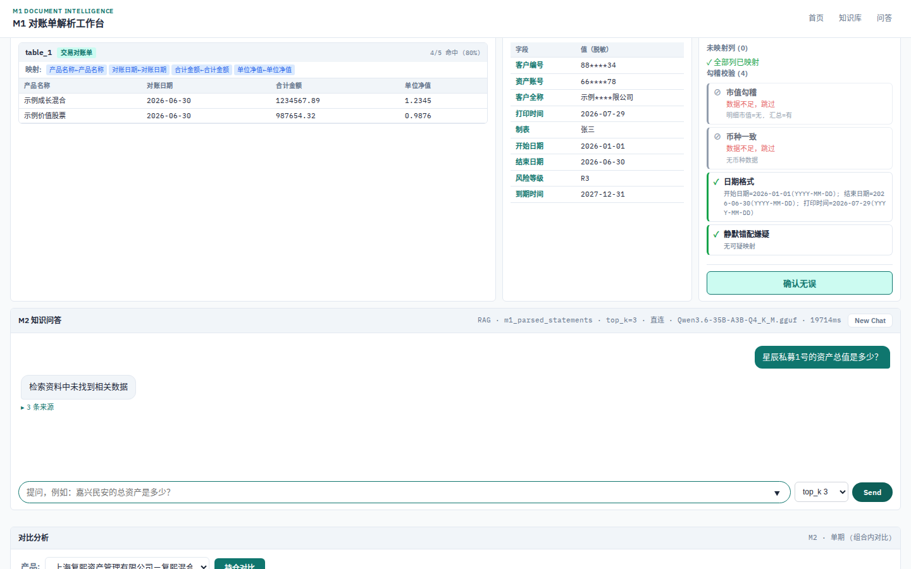

状态: 归档（日期即版本的汇报件: v2 = 2026-08-25 口径, 自包含, 不随代码更新） ── 前序状态逐字保留作轨迹 = 活跃 | 更新: 2026-09-11（09-11 neat 批（决策 22）**状态翻牌**: 活跃 → 归档; 正文零改动。**只核不改一条** = `docs/INDEX.md` 该行状态列此前记「待发送（用户亲发）」而本件自身记「活跃」⇒ 两处不一致, 本批两处一并翻为归档; 但**「是否已实际发送」在库内无任何记录**, 主线程不推断、不代填, 该事实缺口归用户确认; 前序 2026-08-25 保留作轨迹） | 取代/被取代: 取代 docs/31_导师进展汇报.md（08-15 版, 保留备查不删除）

# 科研进展汇报（导师版 v2）

> 本文档为 2026-08-15 → 2026-08-25 增量进展汇报，自包含。配套交付：本文档 docx 版（图片全内嵌）+ 演示视频 demo_v3.mp4。
> 数字口径均为实测：确定性/数值忠实度 08-25 实测；AI judge 四维评分为 08-26 重测实测（当日评测流程异常修复后重跑）。

## 一、系统定位与总体架构

**一句话定位**：基于 AI 的金融对账单智能解析与问答系统——把多格式对账单（电子件 / 扫描件 / 邮件附件）解析为结构化表格，完成字段智能映射与勾稽校验，并在其上提供带溯源、可多轮、会诚实拒答的检索问答；全部推理本地化，数据不出域。

**总体架构**：

- **解析层**：PDF/TXT/HTML 邮件/.msg 多入口；电子件走确定性解析管线；无文本层扫描件走本地视觉模型 OCR（光学字符识别）通道；LLM（大语言模型）兜底映射未覆盖表头，每次成功兜底自动沉淀为映射建议（自学习闭环）。
- **校验层**：勾稽校验（恒等式）、未映射列清单、映射建议选择题面板（人工勾选 → 回归门禁验证 → 规则落库）。
- **问答层**：pgvector 向量检索 + 重排；快与准双菜单——结构化查询（如持仓对比）毫秒级返回，复杂问题进入深度验证通道（独立验证代理逐条核对检索证据），超预算自动安全回落并记录原因。
- **工程体系**：多通道协作（执行 / 验证 / 审计互相复核）、回归门禁与评测基线（确定性检验 + 幻觉测试）、自愈与可观测（连接预检与回收、回落原因显式、九项自动巡检每 30 分钟全天候运行）。

## 二、本轮重点进展（08-15 → 08-25）

1. **快准双菜单生产化**：生产路由默认菜单模式——快档处理结构化查询（持仓对比 / 跨期对比类），准档（深度验证通道）处理复杂问题，由系统按问题自动路由。深度验证完成控制在预算内；偶发超预算时安全回落至快档，回落原因对用户与运维均显式可查。
2. **自愈与可观测**：数据库连接使用前预检、闲置定期回收，连接耗尽类故障被根治（08-23 发生过一次，08-25 修复后零复发）；异常回落原因显式暴露，不再静默降级；九项哨兵巡检每 30 分钟一次全天候运行，异常自动告警。
3. **判别力测试床（科研线）**：构造 9 类预构造缺陷场景，主动考察系统"辨错能力"——不只问系统会不会答，更问系统能不能分辨注入的错误；判别力指标 9/9，为"评测驱动的自学习闭环"提供可度量的评测底座。
4. **专利**：评测驱动自学习闭环相关方法已整理为专利交底书（完整修订版），08-22 已递交；权利要求覆盖"确定性规则工件 + 回归验证门"的自学习机制（引用已递交版本，不附全文）。
5. **质量基线刷新**：见第四节战绩表。

## 三、前端展示（沿用 08-13 实拍截图，界面本轮无改版）

> 以下截图序列与 08-15 版一致（界面未改版），看点说明按现行口径更新。截图均为实机拍摄。

### 3.1 首页：三面板信息架构

**看点**：单页三面板布局——解析结果、表头字段映射、复核校验在一屏内闭环；右侧问答面板常驻。设计意图是"解析-映射-校验"一条动线减少页面跳转。

### 3.2 问答带溯源：证据块设计

**看点**：每条证据含样本编号、表名、相似度、原文片段四要素；"无出处的数字不显示"。

### 3.3 检索透明面板

**看点**：检索条数用户可调（3/5/8/10）；每一轮问答的路由路径与耗时如实标注——系统的决策过程可见、可复核。

### 3.4 建议映射选择题面板

**看点**：系统把映射建议以选择题交给用户：原列名 / 建议标准字段 / 置信度 / 理由；应用前自动跑回归门禁，命中率下降自动回滚——最难样本 35.7%→100% 即此闭环。

### 3.5 诚实拒答

**看点**：检索不到即明确说明，不编造——只回答有出处的数字。

## 四、战绩表（现行口径，2026-08-25）

| 指标 | 数值 | 说明 |
|---|---|---|
| 确定性评测 | 16/16 通过 | 每日评测基线，修复后零漂移 |
| 幻觉测试（数值忠实度） | 9 题零幻觉 | 无一处数值未落地 |
| 快档（结构化查询） | 毫秒~秒级 | 持仓对比 11ms 实测 |
| 深度验证完成率 | ~19%（混合题型，08-22 实测） | 完成均在 31-45 秒内；未完成根因已定位（见 §5） |
| 嘉合同版式字段命中率 | 93.8% → 100% | 规则沉淀后二轮复测 |
| WaveFax 传真 OCR | 100% | 本地视觉模型看图识字 |
| 最难样本字段命中率 | 35.7% → 100% | 建议映射闭环 |
| 单元测试 | 384 passed / 13 skipped | 08-25 全量 |
| 向量库 | 137 embeddings，本地模型 | pgvector |
| AI judge 四维评分 | 忠实度 4.94 / 数值 5.0 / 引用 5.0 / 拒答 5.0 | 08-26 重测实测（当日评测流程异常修复后重跑） |

## 五、已知限制与下一步（导师视角）

**已知限制**：

1. **深度验证通道完成率现状**（对抗性测试 ~19%）：对抗性题型干净段 3.1%（08-26 干净段, 261 尝试）；根因已定位——问题上下文膨胀（约 27k tokens）使每一步处理耗时放大 3-4 倍，44% 的超预算请求截断时仍停留在第一步；提高超时预算经实验验证无效。
2. 扫描件 OCR 延迟高（16-71s），维持等待提示 + 字幕叙事，未做异步任务化。
3. 前端为单页原型形态，改版设计已定方向（三栏任务工作台），待实施。
4. 跨期对比需同一产品多期对账单，当前样本不足。

**下一步**：

1. **减 step + 上下文瘦身组合拳**（深度通道完成率的第一治理杠杆）：合并/裁剪作答步骤（典型轨迹 3-4 步 → 2 步），同时按需装载技能元数据、压缩历史，预期使大部分轨迹回到预算内；分阶段 A/B 验证，数据说话。
2. 深度验证 drafter 升级评估（等上游新版本发布后探针验证）。
3. 前端改版一期（任务列表 + 执行过程分步可视化 + 产物面板）。
4. 科研线：判别力测试床上继续 K 系列实验（题集/权重搜索），支撑论文与专利实施例。

## 六、请导师把关清单

1. **双菜单叙事**："快与准是菜单"在现行路由下的表述是否成立？
2. **完成率诚实披露**：深度通道 ~19% 完成率 + 根因与治理路线的披露方式是否稳妥？
3. **视频结构**：demo_v3.mp4 十段结构（架构→快档→透明→嘉合→建议映射→多轮/拒答→OCR→深度验证→自愈→战绩）是否覆盖关注点？
4. **科研线**：判别力测试床的"辨错能力"表述与专利权利要求范围，请定夺。
5. **改版方向**：三栏任务工作台是否符合业务直觉？

> 附录（内部操作卡）见内部全量版，不随发送版。
