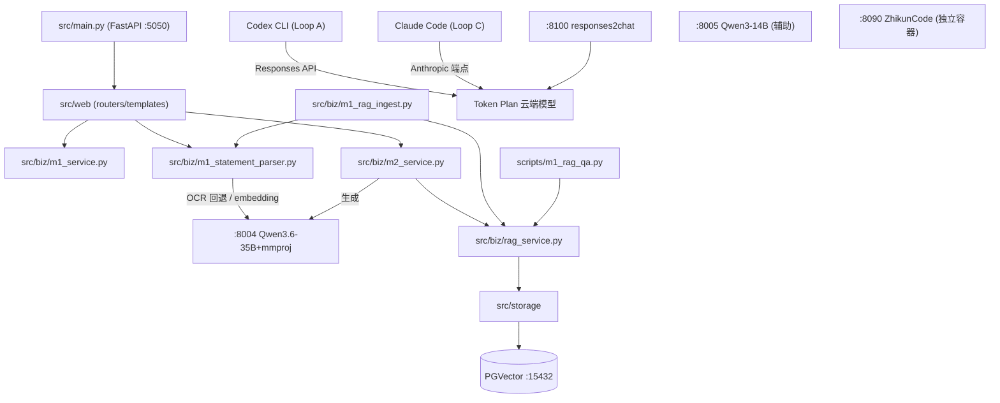

# Codebase Map (2026-08-04, Phase 1)

> 状态: 待刷新（入口路径已校正，规模统计仍为历史快照） | 更新: 2026-09-22 | 取代/被取代: 无

按 codebase-map skill 生成。仓库: agents_final_tech — 基于 AI 的金融对账单智能解析与问答系统 (M1 解析 / M2 RAG 问答 / Graph 多层 Loop)。

## Structure Overview

```text
agents_final_tech/
├── src/                      # FastAPI 应用主体 (~13.2k 行 Python)
│   ├── main.py               # 入口: FastAPI app, uvicorn main:app (:5050, workers 2)
│   ├── web/                  # 路由 + 模板 + 静态资源 (2877 行): m1/m2/pages/chat/kb 等 router
│   ├── biz/                  # 业务层: M1 解析/入库 + M2 RAG/对话服务
│   ├── storage/              # 存储层 (2048 行): PGVector/SQLAlchemy 模型 (langchain_pg_*) + S3/本地 provider
│   ├── tools/                # 工具集 (4131 行): 文档处理/检索/分割等 langchain 工具链
│   ├── utils/                # 通用工具 (1192 行)
│   ├── auth/                 # 认证中间件 (157 行)
│   ├── agents/               # agent 编排 (99 行)
│   ├── mcp_server/           # 知识检索 MCP (120 行, 未常驻)
│   ├── vision_mcp_server/    # 视觉 OCR MCP (274 行, 未常驻)
│   └── tabular_mcp_server/   # 表格分类 MCP (198 行, 未常驻)
├── scripts/                  # 运维入口 + 评测 + Graph Loop + 兼容 CLI
│   ├── m1_statement_parser.py   # 兼容 CLI，委托 src/biz/m1_statement_parser.py
│   ├── m1_rag_ingest.py         # 兼容 CLI，委托 src/biz/m1_rag_ingest.py
│   ├── m1_rag_qa.py             # 15 查询 RAG QA 评测 (gate >= 80%)
│   ├── m1_benchmark.py / m1_accuracy_eval.py  # 性能/字段正确率评测
│   ├── responses2chat_proxy.py  # :8100 Responses→Chat 协议代理
│   ├── vlm_server_8007.py       # VLM 服务 (代码就绪, Triton ARM64 阻塞未运行)
│   ├── qwen_harness_tools.py    # 千问平台工具 wrapper (web_search/code_interpreter/web_extractor)
│   └── graph/                   # Graph Engineering: loop_a/c 约束与 prompt, loop_b/d 脚本, sync_skills.sh
├── config/                   # m1_table_schema.json (可演进的表规则, 非冻结副本) 等
├── tests/                    # 28 个测试文件, 227 passed / 13 skipped (2026-08-03)
├── skills/                   # Skill source of truth (11: Phase 0 ×10 + Phase 4 jinrong-docs-sync), sync_skills.sh 分发
├── docs/                     # 38 篇文档 + experiments/ 36 篇 + architecture/ (本节)
├── deploy/                   # systemd/supervisord 配置 (仅文档化, 未 enable)
└── data/ models/ assets/ image/ dify/   # 数据/模型引用/静态资源/历史实验
```

## Entry Points

- `src/main.py` — FastAPI 服务 (:5050), `python -m uvicorn main:app --workers 2`, PYTHONPATH=src, 需 PGDATABASE_URL
- `scripts/responses2chat_proxy.py` — :8100 协议代理 (chat-only 云端模型接入 Codex CLI)
- `scripts/graph/graph_orchestrator.sh` — Graph Loop 编排 (start/stop/status/logs)
- `scripts/m1_rag_ingest.py` — RAG 入库兼容 CLI；实现在 `src/biz/m1_rag_ingest.py`
- `scripts/m1_serve.sh` — M1 服务启动脚本

## Module Dependencies



## Service Topology (GB10)

| 端口 | 服务 | 状态 (2026-08-07) |
|---|---|---|
| :5050 | M1/M2 FastAPI | healthy |
| :4096 | OpenCode serve sidecar (A0/A2 灰度, MCP 三件套为其 stdio 子进程) | healthy |
| :8004 | Qwen3.6-35B-A3B + mmproj (生成/OCR/embedding) | healthy |
| :8005 | Qwen3-14B 辅助 | healthy |
| :8007 | Qwen3-VL-8B VLM | 未运行 (Triton ARM64 阻塞; GGUF 路径已关闭) |
| :8100 | responses2chat 代理 | healthy |
| :15432 | PGVector (docker) | healthy |
| :8090 | ZhikunCode (docker, v1.2.1+7) | healthy |

## Graph Engineering (多层 Loop)

- Loop A 执行层: Codex CLI (deepseek-v4-flash-0731, 2026-08-06 起), 约束 `scripts/graph/loop_a_exec_constraints.md`
- Loop B 验证层: 纯 bash `loop_b_verify.sh` (冻结节点 + pytest + API 锚点), 常驻
- Loop C 审计层: Claude Code (qwen3.8-max), prompt `scripts/graph/loop_c_audit_prompt.md`
- Loop D 战略层: 主线程, `dispatch_log.md` 记录分发与验收

## 冻结节点 (红线)

- `tests/test_m1_service.py` (md5 锁定于 scripts/graph/frozen_hashes.txt)
- `~/wzh/m1_samples/m1_table_schema.json` (样本侧冻结副本; 可演进副本在 config/)
- `scripts/graph/frozen_hashes.txt` 本身
