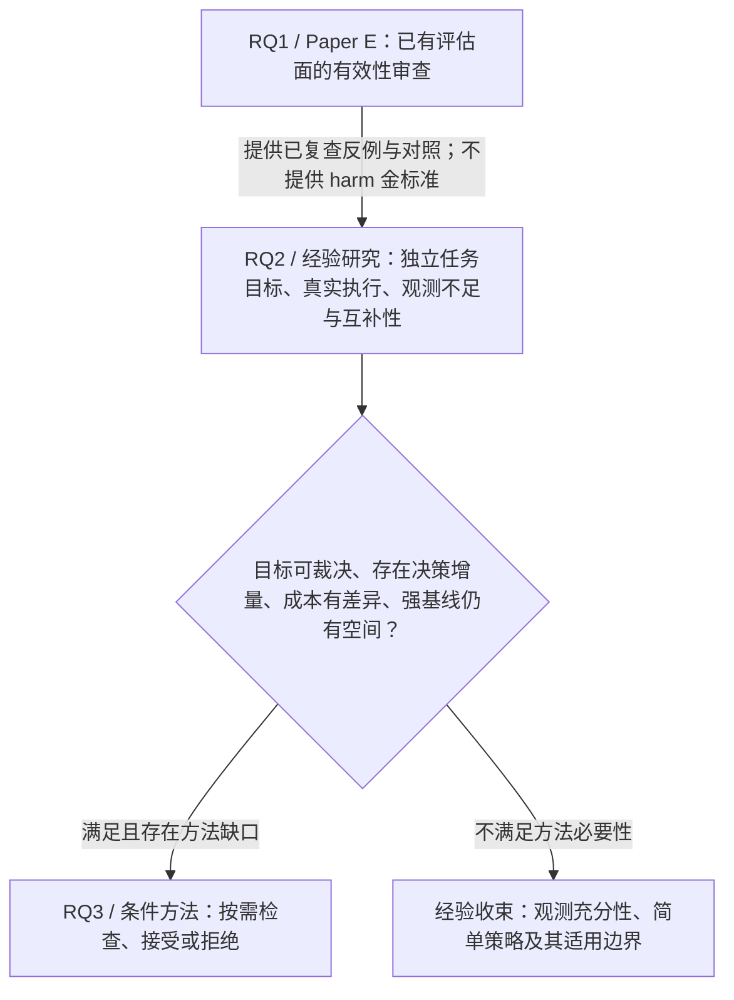

# 硕士大论文研究架构 v1：评估有效性、任务相关证据与可靠决策

> 历史方案注记（2026-10-12）：未来路线已由 [架构 v3](D:/AIRcommend/JinRongAgents/agents_final_tech/docs/research/THESIS_RESEARCH_ARCHITECTURE_v3.md) 与 [执行蓝图 v1](D:/AIRcommend/JinRongAgents/agents_final_tech/docs/research/THESIS_EXECUTION_BLUEPRINT_v1.md) 取代。下文保留当时建议，不控制新任务排期、RQ 命名或运行权限。

> 日期：2026-10-12。状态：`PROPOSED_RESEARCH_ARCHITECTURE / NOT_EXECUTED`。
> 时间窗：M0=2026-10；12 个月到 2027-10，18 个月到 2028-04。日期是研究规划，不是投稿承诺。
> 范围：重新设计大论文主线、章节依赖、最低证据与后续论文出口；不沿用 Evaluate–Distill–Evolve 作为必须完成的结构。
> 本轮仅新增本文档。未修改 Paper E、代码、冻结结果或既有授权；未运行实验、训练、judge 或服务探针。

## 1. 负责人决定：两个必做问题，一个条件性方法问题

**我推荐研究：在文档智能任务中，有限且有成本的中间证据，何时足以支持对输出正确性的判断？**

暂定大论文题目：**《面向文档智能系统的评估有效性与可靠决策研究》**。这里的“可靠”必须落实为已声明任务目标下的错误风险、接受覆盖率和检查成本，不能靠层级结构或框架名称定义。

研究不再按“评估—蒸馏—演化”安排三个对称阶段。推荐配置是：

1. **RQ1，已有经验研究：现有评估面实际测到了什么，又没有测到什么？** Paper E 独立承担这一问题。
2. **RQ2，未来主投入的经验研究：对独立任务目标而言，哪些观测不足是有害遗漏，哪些非响应是合理不变性？** 同时检验观测之间是否有真正互补的信息。
3. **RQ3，仅通过准入后启动的方法研究：在同一目标与风险约束下，如何减少获取观测和人工复核的成本？** 不预设要训练学生模型、使用 RL 或增加自增长规则。

**前两个问题构成必须交付的研究内核；第三个是争取的增量，不是凑齐大论文的义务。** 方法若没有必要性或新颖性，最终可以只有两个强问题，配以完整经验研究、强基线比较和明确边界。

本计划按一名硕士生、导师定期审查、可用 GB10 但重任务串行，以及有限人工裁决预算设计。学校是否要求特定数量论文或方法创新，应在 M2 前与导师确认；论文录用、学位程序与科学证据成立分别验收。

证据标记：**[E]** 已有项目证据；**[D]** 有明确前提的定义/推论；**[H]** 待检验假设；**[P]** 本文规划选择。规划数字与目标不是已取得结果。

## 2. 为什么这条主线比保留旧三阶段更合理

[E] 战略审查与作者级裁决已显示：分数差异可能仅来自尺度和阈值；低准确率仍可保留部分信息；未响应的变化可能合理；注入器改变的对象可能没有进入检测谓词；数值复算正确也可能没有测量目标能力。[S1][S2]

这些事实共同要求先回答“什么应当被判断为错误”和“证据是否能够支持该判断”。它们不蕴含学生训练必要性，也不蕴含自动修复或演化方法的存在。

因此保留的是**测量对象、目标与证据的关系**，不是既有阶段命名。训练只有在同任务、同预算比较证明它有额外作用后才是实现选项；平台只负责让结论可复查。

| 既有资产 | 在新大论文中的身份 | 不继承的 claim |
|---|---|---|
| Paper E 的冻结实证与 autopsy | 已有经验章节；提供具体反例、基线和测量边界 | 通用有害盲点、long-horizon 经验定律、hierarchy 定位能力 |
| multi-leaf / non-direct 响应表 | 观测碰撞和冗余的开发案例 | 满分自动证明自然故障定位；non-direct 完全无信息 |
| OCR/DR4/judge 分歧 | 独立目标研究的动机与开发案例 | 任一 oracle 已被证明正确；13/13 非响应是有害漏检 |
| FinQA 未重算 result 的失败迁移 | 执行对象检查的反例 | 有效跨流验证、已成立的 causal selection 方法 |
| B4 residual、schema-action、历史 repair | 仅在独立任务桥成立时作为探索性材料 | OCR 或数值任务的目标资格可直接认证 schema-action；多个 repair 就是统一方法 |
| Graph Loop、服务、技能与治理设施 | 工程支持和复现附录 | 独立研究贡献；平台复杂度等于科学深度 |

关闭的 PR-03、旧 causal MVP、旧 FinQA binding 和冻结 TAT-DQA 线路不在新计划内。新的受控研究要有自己的目标、对象与版本，不能通过改名将旧终态变成新方法证据。

## 3. 真正的科学依赖，以及哪些连接不成立



Paper E 到 RQ2 是**问题和对照的继承**：下一研究要对 Paper E 尚未裁定的任务后果作独立测量，不能把 E 的族标签当答案。它不是“E 已证明有害，因此再发明一个修复器”。

**不可省略的科学依赖是 RQ2→RQ3。** 后者的风险目标、错误标签、可购买观测、成本模型和必要性证据，都必须由前者建立。若删掉 RQ2，方法就无法说明优化的错误是什么、昂贵观测有什么用，或低风险数字是否循环定义。

| 依赖 | 前项必须输出什么 | 后项如何实际使用 | 不允许的叙事替代 |
|---|---|---|---|
| E→RQ2 | 冻结 score-only 对照、直接叶/codebook 对照、非响应案例与对象错配反例 | 构造预先声明的反例检验和负对照；评估新增目标证据是否改变原判断 | 换数据集再算相同族级可见性 |
| RQ2→RQ3：目标 | 独立参考目标、错误判据、UNKNOWN 政策、origin 谱系 | 定义训练/校准标签与最终风险终点 | 用 detector 不响应或注入族身份定义 harm |
| RQ2→RQ3：信息 | 与目标有关的碰撞/残差，以及新增检查可带来的非定义性增量 | 确定哪些检查值得购买，哪里应拒绝判断 | stage flag 满分、同一个分数换权重 |
| RQ2→RQ3：必要性 | 同成本/同风险强基线仍有稳定不足，且不足不是单 origin 驱动 | 决定是否开发新策略以及需要解决的最窄困难 | 基线未做好就训练；为 positive 换指标 |
| RQ3→综合结论 | 未见来源上的风险—覆盖—成本结果及失败边界 | 回答哪些观测确有决策价值，哪些可以删去 | 部署成功或软件验收替代科学效果 |

“自然阶段定位”“蒸馏”“自演化”均不是这条依赖链的必需节点。若任务正确性判断并不需要阶段定位，就停止把 M/R/N 分类当主要终点。

## 4. 先固定一个主任务，避免目标在章节之间漂移

### 4.1 默认任务选择

[P] **主任务优先选公开财报表格上的数值问答，限定到具有可独立复核答案及计算关系的子集。** 它与当前文档/表格系统相邻，又能把字段、单位、时期和算术错误落到真实任务后果。M2 前只允许一次有证据的任务收缩，例如退到单事实数值抽取；不能在数值 QA 与 schema-action 两条主线间长期摇摆。

每个研究单位至少包含：

```text
独立 origin / report 谱系
  → 文档、问题、允许的任务输入
  → 独立参考目标（答案、单位、时期/实体约束、必要的计算关系）
  → 冻结系统的真实执行与候选输出
  → 成对变换或执行故障及实际重执行
  → 不同路径的观测
  → 正确性裁决、检查决策及成本
```

参考目标来自原始材料与可复核计算，必要时双人独立判断和第三人裁决。公开数据的 gold 也要检查，不能因为写在 benchmark 文件中就免除目标审查。LLM judge 可作被比较的 oracle 或辅助意见，不能自动晋级为独立真值。

既有 95 表、118 注入及已分析 OCR 案例用于开发和反例解释；不能重新随机切分后称为新测试。新来源能否获得足够独立 origin、允许何种使用，属于 M0–M2 的待验证资格，不是本文已认证的资源。

### 4.2 必须拆开两种变化

| 操作 | 参考目标如何处理 | 真正测量什么 |
|---|---|---|
| 改变合法任务输入 | 重新确定该输入的参考答案；有些变化保目标，有些应改变目标 | 系统是否遵守相应任务关系；合法答案改变本身不是 harm |
| 向执行过程/中间载体注入错误 | 原任务目标保持固定，确认故障进入真实 consumer 并重算 | 系统输出是否偏离原参考目标；是否产生新增错误或恢复 |

需分别记录“目标保持/目标改变/无法裁定”和“输出正确/错误/无法裁定”。**语义有变化、输出有变化和任务受损不能互相代替。** clean 已错的样本也保留，分别报告 correct→wrong、wrong→correct、持续错误等转移，不能只选成功 clean 来美化结果。

### 4.3 同一对象贯穿两项未来研究

令 `x` 为任务输入，`y*` 为独立参考目标，`z` 为冻结系统实际输出，`L(z,y*)` 为预先声明的任务损失；观测集合为 `O_S(x,z)`。

[D] 相同观测意味着只读取这些观测的确定性规则不能区分两个实例；但只有目标所需判断不同，才构成任务相关不足。这是已知观测等价思想，不宣称新理论。有限样本中出现相同向量，不自动证明整个总体不可诊断；“近似碰撞”还需预先定义距离/噪声容差。

[P] RQ3 初期只允许对冻结执行结果作**只读检查**，输出 `accept / acquire / defer`；不同时学习生成答案或修复 pipeline。离线完整观测面板可以用于开发，但正式成本结果必须来自实际按需获取。若检查本身会重跑、修复或改变系统状态，就不能以离线 masking 代替策略效果，需要另立识别设计；本大论文默认不增加这条负担。

## 5. 章节架构与每章最低证据

推荐六章，工程材料进附录。章数服从研究内容；若 RQ3 未准入，合并相关基线分析，形成五章或六章的经验论文结构，不用工程章节填一个虚假的第三研究问题。

| 章节 | 科学身份与回答的问题 | 成立的最低证据 | 不足时的处理 |
|---|---|---|---|
| **第1章：问题与研究边界** | 确立总问题及 RQ1–RQ3，不算独立实验贡献 | 明确任务、适用总体、三个问题的依赖和既有工作差异；不以 long-horizon 泛化或 EDR 完整性作动机结论 | 收窄标题/问题；不靠增加章节补 scope |
| **第2章：任务、测量与研究设计** | 已知理论基础 + 共用研究设计；平台仅作支撑 | 独立目标、输入/执行对象、损失、UNKNOWN、origin、split、成本和统计单位可操作；区分 oracle 与部署可用检查 | M2 前缩到可裁决子任务；没有桥就不进入正式方法研究 |
| **第3章：Paper E——现有评估面的有效性审查** | **已形成实证资产的经验章节，回答 RQ1** | 冻结工件可追溯；落实作者级 claim 纠偏；分数/比较符/tie/分母一致；将构造结果与能力推断分开 | 删除不能认证的推断或估计，保留可复查窄结果；不要求补一个正结果 |
| **第4章：独立任务目标下的观测有效性** | 新经验研究，回答 RQ2；优先形成后续论文1 | 独立目标；真实执行；合理不变与任务相关错误双向对照；新的 origin 测试；正确分母与不确定性；跨实现 claim 必须有不同依赖路径的实现证据 | 可得有效 null/边界结果；若只是目标不可裁定，缩小目标，不能以筛查记录冒充完整实证章 |
| **第5章：成本受限的检查与选择性决策** | 条件方法研究，回答 RQ3；争取后续论文2 | 先满足 RQ2 的目标/信息/成本/必要性门；冻结可复用策略；强简单及现有方法基线；未见来源验证；实际执行成本；同风险和最低 coverage 比较 | 简单规则足够则停新算法；做充分性/成本边界分析并入第4章，或作清楚标注的经验章 |
| **第6章：综合结论与适用边界** | 跨研究归纳，不再创造新的实验 claim | 每项总论断可定位到前章证据；解释目标、观测与决策间哪些连接成立；明确外推边界和负结果 | 不把未来工作写成已完成统一框架 |
| **工程附录** | 复现支持，非独立科学问题 | 输入/结果 identity、真实入口、冻结配置、成本事件、独立复算和必要运行说明 | 不要求通用平台、调度器或全套产品服务 |

### 5.1 Paper E 如何自然成为已成立章节

**接纳的是已有证据支持的研究内核，不是声称现稿每句话都已成立。** 作者级裁决的修订尚未应用到稿件；入大论文前应绑定纠偏版本，但不为此重开大实验。[S2]

该章保留四类具体认识：

- 冻结 scored surface 的族级响应与 OCR-like 0/13 非响应；不能等同于已证实有害漏检。
- 当前单响应叶下的未舍入正仿射关系、记录分数的秩一致，以及退化 clean 面板没有由现行程序选定唯一部署工作点；不能把这些统称为对应 ROC 关系不可识别。
- full/direct 的构造性满分与 non-direct 对 M vs R/N 的部分区分；没有显示 hierarchy 超出直接 codebook 的定位性能。
- FinQA 的可复算 V/D/O 与未重算检测对象的错配；不是迁移成功或 detector 无能。

这是一章**对评估器自身的经验审查**。下一章增加的是独立任务后果与新测试，而不是把同一批边界案例换个名字。Paper E 不需要被追认为通用方法，才能在大论文中有独立地位。

## 6. RQ2：优先投入的经验研究应该怎样成立

### 6.1 要检验的假设

- **[H-A1]** 一部分 score-level 非响应对应合理任务不变性；也可能存在任务错误而现有检查不响应的情况。两者比例及条件都尚未知。
- **[H-A2]** 共享 normalization、表示或 reference 构造的检查可能共同失效；换 matcher/prompt 并不一定提供独立证据。
- **[H-A3]** 某些不共享该路径的检查能提供廉价终点/直接规则没有的信息，且该增量能改善任务相关判断。

这些是假设，不是从既有 OCR 或 codebook 结果推出的已知事实。H-A3 不成立时，经验研究仍可回答简单检查在什么范围内已经足够；不能据此直接开始方法训练。

### 6.2 数据与对照

[P] 采用两种分开报告的采样面板：

1. **按预先定义抽样框取得的任务面板**：冻结系统真实运行，保留全部 eligible 任务与自然发生的错误/正确案例。用于估计该抽样总体上的风险和 coverage。
2. **成对诊断面板**：包括目标保持变换、目标改变的合法输入，以及固定目标下的过程故障。用于检验机制和观测边界，不把人为配平的错误比例当部署 prevalence。

开发、校准、测试按共同 report/origin/template 谱系连通分量隔离；原表、问题、变体、注入和派生规则一起划分。分别测试未见 origin 下的已见机制，以及未参与设计的机制；换 seed 不算上述任一种外推。

至少比较：当前 score/normalizer 路径、直接局部规则、部署时可得到的终点检查，以及一个不共享关键失效路径的观察方式。若要声称“跨实现共同失效/改进”，需至少两个确有不同依赖路径的实现；如果只能获得一个，实现范围必须相应收窄。只是两个模型共享同一个 gold/normalizer，不足以认证独立性。

[P] 可行性 pilot 暂按 **12–20 个候选 origin、60–100 个成对任务**规划；它只判断目标可裁决、真实执行与来源可行性，不承担正式低风险或泛化 claim。正式样本量由主 estimand、cluster 结构、最小相关差异和所需精度决定，不继承旧“40 clusters”门槛。

### 6.3 主要终点与解释纪律

- **任务错误与检查遗漏**：在独立错误案例上的未检出，以及正确/合理不变案例上的误警；分别给分母。
- **目标相关碰撞**：哪些同观测/近似同观测状态需要不同正确性判断；范围限于已测样本与定义。
- **增量价值**：在同样本、同目标下，新增观测是否超过部署可用的终点与直接规则。开发、训练及校准分区的参考目标可按冻结规则使用；部署和最终测试时，逐任务参考答案不得成为策略可读的免费输入。
- **共同失效解释**：先用不同路径的检查定位差异；若要归因于 normalizer 等组件，应在匹配控制下干预该组件，不凭相关错误模式宣布机制。
- **不确定目标**：UNKNOWN、裁决分歧、失效执行与缺失观测完整披露。双人一致不是无偏真值；不能只保留一致案例。

正式运行前，必须把主要对比、最小科学相关差异 `δA`、可接受区间宽度 `hA` 和独立单位填入分析计划。若样本只能得到宽区间，应报告未决，不能将“不显著”当作等价或充分性。

RQ2 的最低完整产物是：一份可复核的目标/执行面板、一个可回答的主对比、有效不确定性、一个解释候选机制的对照，以及明确的适用域。它不以发现大量有害盲点或得到正结果为成立条件。

## 7. RQ3：方法必须从必要性出现，不从命名出现

### 7.1 方法准入的四个硬条件

只有下列条件全部成立，才给方法研究持续预算：

1. **目标成立**：RQ2 已提供独立正确性判断和可用的校准/测试设计；关键 UNKNOWN 不使主要风险对象无法解释。
2. **存在信息空间**：廉价检查确有稳定、任务相关的残差；新增检查能提供非定义性信息，且残差不只来自一个 origin。
3. **存在成本空间**：检查有实际成本差异或共享计算结构，能在真实按需执行中节省资源；从已算完的向量里删除字段不算节省。
4. **存在策略空间**：直接规则、固定顺序、成本匹配 random、greedy 和合适现有方法未解决主要问题；全检查与必要的诊断上界显示仍有 headroom。

若只满足前三项，应优先采用已有方法或简单规则。**“可以设计一个新策略”不是方法必要性证据。**

### 7.2 研究目标与候选机制

[P] 首选目标是在预先冻结的错误风险上限 `α` 与最低自主接受覆盖率 `κ` 下，降低实际检查/复核成本；或在同风险、同成本下提高 coverage。`α`、`κ`、实际有意义的成本差异 `δC` 与风险非劣界必须由任务后果和 pilot 成本决定，在最终测试前冻结，不能为了结果调整。

风险上限的校准与确认必须来自预定任务抽样分布，并保留其 origin 依赖与抽样条件；人为配平的诊断面板只认证相应压力条件，不能直接认证自然任务风险。

策略看到的是当前候选答案、已购买的检查结果、可用成本/缺失信息；选择继续检查、接受当前答案或转人工。初版保持生成器冻结，不把 repair、学生训练和获取策略一起优化。

**[H] 唯一值得进一步审查的窄缺口**是：如果真实检查存在共享计算、共同失效和互补信息，能否利用这些结构，在不牺牲已声明风险/coverage 的前提下，超过既有获取策略？这仍不是新颖性结论：相关性、非贪心获取和缺失数据已被 AFA 研究处理，必须确认本任务中有什么未被现有方法覆盖的必要结构。[L1][L2]

若没有该缺口，方法章可诚实写成“已有策略的适用性与比较”，但不能把组合使用 AFA、reject option 和校准称为新算法。若效果来自一个额外强检查，应将贡献归于观测，而不是选择器。

### 7.3 方法章节最低证据

| 方面 | 必须达到的底线 |
|---|---|
| 算法 | 输入、动作、停止/拒绝、目标、训练/校准规则、失败处理可复用；不含逐 case 补丁或测试标签调参 |
| 基线 | 最强廉价/直接规则；固定顺序；同成本 random；greedy；至少一个与已发现困难相匹配的现有 AFA/选择性预测方法；小规模可行时穷举；全检查基线 |
| 公平性 | 同生成器、同可购买检查、同目标、同调参预算；人工不是零成本/零错误 oracle；测试标签不可免费读 |
| 主效果 | 同风险和最低 coverage 下的成本优势，或预定同成本比较的质量/coverage 优势；配对区间支持预定的实际相关差异，而非仅一个 p 值 |
| 归因 | 分开新增观测、获取策略、拒绝规则与成本共享的作用；按检查/实现失败条件做消融 |
| 验证 | 未见 origin 与机制；至少一个未参与策略设计的实现验证才称跨实现方法；Paper A 的结果一旦被查看并影响检查、假设或策略选择，该面板即成为 RQ3 开发证据，方法最终确认测试须另行封存 |
| 实际成本 | 顺序获取真实运行，记录缓存/共享计算、墙钟、调用与人工时间；预计算面板只提供开发证据 |
| 风险含义 | 区分抽样分布上的经验风险、压力面板风险和数学保证；存在依赖/shift 时不得直接搬用 iid 校准保证 |
| 复算 | 独立实现复算主要数值；真实入口与数据 identity 能追溯；无效执行不混入能力结果 |

自主接受风险的分母是已接受任务，coverage 的分母是全体 eligible 任务；同时报告拒绝率、误警、漏检、未决目标、复核负担和总任务成本，避免以全部拒绝换“零风险”。全检查不是独立真值；使用标签的 oracle 仅能作为明确标注的诊断上界。

若接受集有 `nA` 项，其中已知错误 `e`、目标未决 `u`，未决项不能简单删除：接受集错误比例至少应呈现 `[e/nA, (e+u)/nA]` 的可行范围，再说明抽样不确定性。[D] 这不是分布外风险保证。

低风险数字要有精度预算。例如在独立 Bernoulli 接受单位、零错误的理想条件下，单侧 95% 上界为 `1−0.05^(1/n)`；要使上界不高于 1%，至少需 299 个独立接受单位。重复注入不是独立单位，真实 cluster 依赖下不能照搬这个数量。[D] 若资源不够，就选择更诚实的风险范围或经验 claim，不降低证据门槛来换方法名。

## 8. 文献给方法路线划出的边界

本轮定向核查截至 2026-10-12 的一手来源，只确认明显已有范式，不构成系统综述或 novelty 证明。方法立项前应精读与实际困难最相关的论文和实现，不需要为阅读数量设 KPI。

| 来源 | 已有内容与本项目不能冒领的部分 | 对规划的约束 |
|---|---|---|
| **[L1]** [Acquisition Conditioned Oracle for Nongreedy Active Feature Acquisition，ICML 2024](https://proceedings.mlr.press/v235/valancius24a.html) | 已研究有成本的动态特征获取及非贪心选择 | “greedy 忽略联合信息”本身不是新颖点；必须纳入适配的强对照 |
| **[L2]** [Learning-To-Measure: In-Context Active Feature Acquisition，ICML 2026](https://proceedings.mlr.press/v306/kobayashi26a.html) | 已研究有限标签、缺失数据及跨任务获取 | 少标签、逐项检查或不逐任务重训，均不能直接作为本项目创新 |
| **[L3]** [SelectiveNet，ICML 2019](https://proceedings.mlr.press/v97/geifman19a.html) | 接受/拒绝与 risk–coverage 已有成熟方法 | 加一个 defer 选项不是新方法；覆盖与风险必须一起比较 |
| **[L4]** [Evaluation of Active Feature Acquisition Methods for Time-varying Feature Settings，JMLR 2025](https://www.jmlr.org/papers/v26/23-1635.html) | 获取策略的离线评估涉及 no-direct-effect、混杂与支持条件 | 若获取改变后续状态，不能使用完整面板 masking 假装反事实效果 |
| **[L5]** [Learn then Test](https://arxiv.org/abs/2110.01052) | 已有将预测算法校准到风险目标的框架 | 现成校准可作对照/组件；本任务依赖结构和分布条件必须单独核查 |
| **[L6]** [Adaptive Submodularity，修订版](https://arxiv.org/abs/1003.3967) | 满足特定结构时，adaptive greedy 已有理论保证 | 先检查简单方法为何不足；不能未经证明就给复杂策略套最优性/近似保证 |

本文只提出“有资格研究的困难”，没有断言已有文献遗漏了本项目，也没有为方法起新名字。

## 9. 工程平台：支撑两项研究的最小能力，不单独算创新章

平台只需要六项：

1. 数据/origin 谱系、使用资格、参考目标及 UNKNOWN 台账。
2. 能完成真实 consumer 执行的薄 task adapter；一个主任务，之后最多增加一个验证实现。
3. 只读观测接口，说明每个检查读取什么、依赖什么、什么时候不可用。
4. 共用的 `acquire / accept / defer` 策略入口，以及增量成本事件记录。
5. 冻结配置、真实运行命令、输入输出 identity 和可归因结果。
6. 不依赖被审算法核心逻辑的关键数值复算与 claim–evidence 对应。

保留已有纯函数、runner 和工件格式中可直接复用的部分。研究实验不必须依赖生产 FastAPI、PG/RAG 后端、Graph daemon 或全套 skill 注册。只有真实失效阻碍选定实验时才补工程，不先重构全仓库。

[P] 工程时间上限：M0–M3 不超过投入的 20%，之后不超过 10%；超限时先缩实验接口/任务范围，而不是新增平台路线。工程能通过真实入口和复算验收，但不能据此宣布标签、方法效果或泛化已成立。

## 10. 12–18 个月安排：12 个月交出完整研究，18 个月用于补证与收束

**M12 的核心交付是已完成封存测试与复算的 Paper E/RQ2 经验研究及完整大论文初稿。** RQ3 只有完成自己的独立确认，才能进入这份初稿的成立结论；若尚未完成，就退出 12 个月核心交付，作为 M13–M15 的条件延伸，不能用“验证待补”占一个已成立方法章。新实现验证只在主张跨实现泛化时要求；单实现方法也仍需独立 origin/机制的确认测试。

| 时间 | 核心工作与交付 | 决策门 / 不满足时的处理 |
|---|---|---|
| **M0–M2：2026-10 至 12** | Paper E 采用经裁决的结论版本；选唯一主任务；检查来源、参考目标与真实执行；完成小 pilot 设计；保留后续未见来源 | **G1 目标可行性。** 目标或执行桥失败时只允许一次任务收缩，不扩模型与检查器；确认学校/导师的研究形式要求 |
| **M3–M5：2027-01 至 03** | 冻结 RQ2 目标/UNKNOWN/split/主对比；取得新成对执行与自然任务面板；建立廉价和不同路径检查对照 | **G2 测量成立。** 没有独立目标或有效执行就停止方法投入；若部分目标可裁决，限于该子任务，不能只保留有利样本 |
| **M6–M8：2027-04 至 06** | 完成 RQ2 主研究及其封存测试、碰撞/互补性与成本资格；独立复算；形成 Paper A 初稿 | **G3 方法必要性。** 按 §7.1 四条件裁决；最迟 M8 决定是否研究 RQ3，之后不再同时铺两个新方向 |
| **M9–M12：2027-07 至 10** | GO：一套最小候选方法与强基线、冻结校准/测试、实际按需成本验证；NO-GO：完成简单策略充分性/边界分析。大论文第1–4章与综合章完成 | **G4 主研究封口。** 方法至多两轮有界开发迭代；无机制增量就停新算法。M12 必须有完整经验结论；未完成独立确认的 RQ3 不进入核心结论 |
| **M13–M15：2027-11 至 2028-01** | 条件延伸的 RQ3 完成预留未见来源确认；跨实现 claim 才追加对应验证。或对已成立经验 claim 作有界补证、独立复算与写作 | **G5 延伸裁决。** 延伸前不宣称方法成立；泛化失败就收窄 claim，不能换测试集或恢复旧分支来救正结果 |
| **M16–M18：2028-02 至 04** | 审稿/导师反馈、复现材料、章节一致性和答辩论证 | **G6 最终收束。** 不开新主问题，不启动此前未获必要性支持的训练、在线学习或自动演化 |

这是依赖驱动的顺序，不是六段必须填满的实验量。M12 以后只有尚需确认的既定 claim，不再靠追加研究方向增加“完整性”。

资源优先级：前六个月以独立目标、数据与真实执行为主；方法 GO 后最多一条方法主线。单一 GB10 不并行重任务，实验规模由每次 pilot 的实测成本决定。不得把下载完成、模型更大或治理检查数量当进度。

## 11. 可能形成的 1–2 篇后续论文

### Paper A：独立任务目标下的观测有效性与共同失效——优先保证

**类型：经验研究 / 测试 oracle 与评估有效性。**

核心问题是不同检查何时混淆合理不变性与任务错误，以及互补检查能否改变判断。新贡献必须来自新目标证据、真实执行、独立 origin 与可归因对照；不是重发 Paper E 的 0/13 或满分 codebook。

最小可发表主张不是“发现更多 blind spots”，而是一个被独立目标和有效对照支持、会改变 evaluator 使用方式的结果。结果可以是共同失效、特定检查具有增量，也可以是有精度支持的简单检查充分性或范围边界。仅一个可修软件 bug、仅 judge 分歧或只有宽区间的 null，不自动满足这个要求。

Paper A 的实证主体计划在 M8 形成；论文投稿服从证据成熟度，不倒推结果。若研究只在单实现成立，题目与 claim 就限于单实现，不用增加第二数据集名称冒充外部验证。

### Paper B：同风险下减少检查成本的选择策略——条件性

**类型：方法研究；没有方法增量时不强行产出第二篇。**

只有 §7 的必要性和证据门槛成立，才争取提出可复用策略及其新机制。目标是相对强简单和合适现有方法的风险—覆盖—成本增量，不是再次证明阶段可分类。

Paper B 可复用 Paper A 的任务定义与已公开开发资产，但必须披露重叠；最终测试应是另行预留/新取得、未参与策略设计的 origin/机制。凡 Paper A 已被查看并影响 RQ3 检查、假设或策略选择的结果，都算方法开发证据；不能仅因未直接调参就将其再次称为独立确认测试。

若新策略没有超过现有方法，优先将结果并入经验研究和大论文。只有新的适用性/失败机制结论足够独立、且不重复 Paper A 时，才考虑第二篇经验论文。**计划争取 1–2 篇后续论文，不把“两篇”当硬性产量。**

## 12. 失败、负结果与收缩：哪些仍然是完整研究，哪些不是

| 情况 | 科学处置 | 大论文出口 |
|---|---|---|
| 目标明确，但当前观测出现任务相关碰撞 | 有效经验结果；验证增量观测，而非继续调聚合 | Paper E + 新目标经验章；满足条件才进方法 |
| 简单直接/终点检查已经足够 | 在已测总体和精度内报告充分性，停止新算法 | 两个强问题成立；成本/基线分析可并入经验章 |
| 更复杂方法无增量 | 区分无效、不精确与有证据的非劣/等价；按冻结计划报告 | 不 claim 新方法优越；大论文不失去已完成的经验内核 |
| 方法只在已见 origin 有效 | 泛化边界，不是换 seed 的理由 | 收窄方法范围，或作为经验失败结果；是否单独成篇看独立价值 |
| 部分目标 UNKNOWN | 保留分母和可行风险范围，收窄可裁决目标 | 可作契约/测量边界分析，不能声称所有有害遗漏被验证 |
| 到 M3 仍没有任何有效目标/执行桥 | 停数据扩张与方法开发，立即与导师重定一个可执行子任务 | **不能靠 SOURCE NO-GO、治理记录或平台截图填成新的实证贡献** |

学术上的收缩下限是：**纠偏后的 Paper E + 一项有独立目标、有效执行和充分精度的新经验研究 + 可复现证据与综合论证**。它是否满足本校学位要求要另行核对；不能用“规划有退路”掩盖第二项研究尚未做成。

## 13. 接下来应准备的研究包，本轮均不执行

这些是未来启动时的有界输入/产物，不是本轮给 GB10 Loop A 的运行授权。研究负责人负责目标与 claim，Loop A 负责可复现实现，独立审查负责质疑和复算；作者判断不能外包给软件 PASS。

| 包 | 输入与独立产物 | 预算边界 / 依赖 | 停止条件 |
|---|---|---|---|
| **T0：已有章节接纳卡** | Paper E + 作者级裁决 → 四类保留结论、版本/证据映射与未落实修订清单 | 1–2 人日文档核对；0 项目模型调用；不重跑旧实验 | 不能认证的推断不入大论文，不为其补正结果 |
| **T1：唯一任务与目标资格卡** | 新任务候选、来源/许可、参考计算 → 目标与两类干预定义、pilot 方案 | 2 周内完成设计；本轮不下载、不标注、不执行 | 无独立目标、无实际 consumer 或来源不足就收缩一次任务 |
| **T2：RQ2 冻结设计** | T1 资格 + E 的反例/基线 → origin/split、UNKNOWN、主 estimand/精度、对照和执行归因设计 | 依赖 T1；正式采集前完成 | 不允许按 detector 标签筛 harm，不允许旧变体冒充新测试 |
| **T3：方法必要性裁决** | RQ2 有效结果 + 实测成本 + 强基线 → §7.1 四项 GO/NO-GO | M6–M8，最多 2 周分析；不是训练包 | 没有目标、增量、成本或策略空间，任一缺失即不立新方法 |
| **T4：条件方法实验设计** | T3=GO → 单一算法、合适现有方法对照、校准/测试与真实按需执行方案 | 最多两轮开发；必须保留未见测试；本轮不实现 | 效果由更强观测或测试调参解释；缺少新机制则回到已有方法比较 |

本计划不追加新 registry、审批平台或多 Loop 自动研究系统。每个研究包只写回答当前决策需要的材料，避免规划文件本身成为下一轮负担。

## 14. 依据与最终边界

| 来源 | 本文使用方式 |
|---|---|
| **[S1]** [独立战略审查](D:/AIRcommend/JinRongAgents/agents_final_tech/docs/research/STRATEGIC_REVIEW_AND_NEXT_PLANS_v1.md:8) | 已有资产、停止方向、独立目标优先级及方法门槛；不继承其所有风险为最终科学结论 |
| **[S2]** [作者级科学裁决](D:/AIRcommend/JinRongAgents/agents_final_tech/docs/research/SANER_SCIENTIFIC_ADJUDICATION_v1.md:9) | Paper E 进入大论文时的科学边界；C2、部分信息、OCR、FinQA 与适用域 |
| **[S3]** [当前 Paper E](D:/AIRcommend/JinRongAgents/agents_final_tech/paper/saner_rene_manuscript_v1.md:15) | 已有研究的具体任务与工件；尚未应用作者级修订，不把全部当前表述视为已签署 |
| **[S4]** [多叶 signature ablation](D:/AIRcommend/JinRongAgents/agents_final_tech/docs/research/stage_e_multileaf_signature_ablation_v1.md:18) | 显式阶段签名、冗余与部分可区分性的开发案例 |
| **[S5]** [FinQA accepted mismatch autopsy](D:/AIRcommend/JinRongAgents/agents_final_tech/docs/research/finqa_v2_measurement_object_mismatch_autopsy_v1.md:8) | 真实执行对象必须进入检测量的研究设计反例 |
| **[S6]** [B4 residual memo](D:/AIRcommend/JinRongAgents/agents_final_tech/docs/experiments/2026-10-05_stage_d_necessity_residual_memo.md:1) | 只支持强基线必要性审查，不能替数值任务或 schema-action 提供缺失的目标桥 |
| **[L1]–[L6]** | §8 的定向一手文献核查；用于明确已有范式，不认证本计划新颖性或可行性 |

**我真正推荐的投入顺序是：把 Paper E 当一章已经拥有的经验资产；用未来半年的主要精力建立一个独立任务目标下的新经验研究；再由数据决定是否值得做一个成本受限方法。** 两个问题做深，比三阶段各做一点更适合作为这份硕士论文的研究主线。

本轮完成的是架构与准入设计。来源资格、正式样本量、目标可裁决性、检查增量、成本差异和方法新颖性都仍待验证；它们没有因写入计划而成为事实或实验授权。
