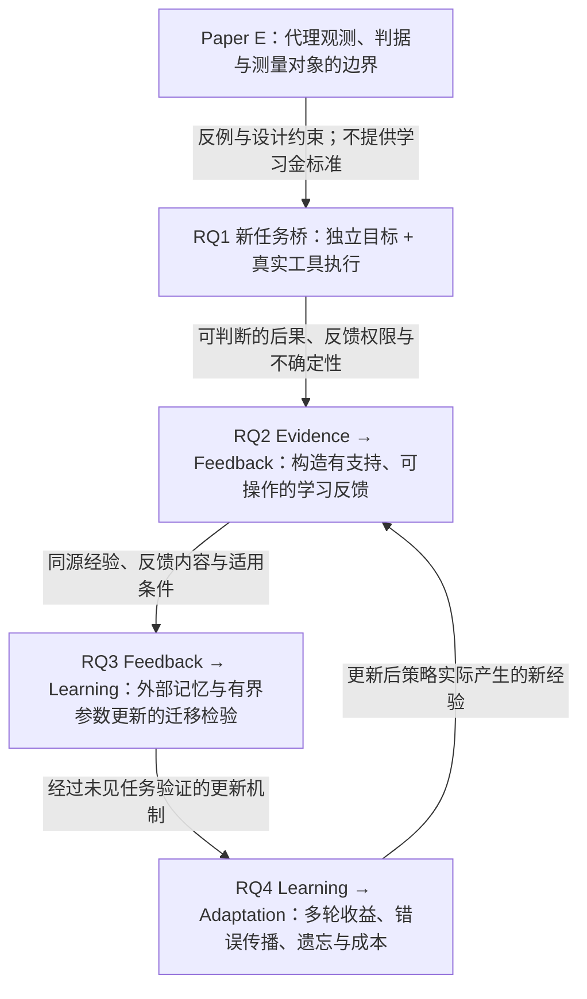

# 大论文研究架构 v2：证据引导的 Agent 经验学习与持续适应

> 历史方案注记（2026-10-12）：本版已收敛为 [架构 v3](D:/AIRcommend/JinRongAgents/agents_final_tech/docs/research/THESIS_RESEARCH_ARCHITECTURE_v3.md) 的三个 RQ，执行顺序见 [蓝图 v1](D:/AIRcommend/JinRongAgents/agents_final_tech/docs/research/THESIS_EXECUTION_BLUEPRINT_v1.md)。下文保留论证与近邻文献，不再控制未来排期或运行权限。

> 2026-10-12｜`PROPOSED / NOT_EXECUTED`
> 本文重新提出研究架构，保留 v1 和 owner memo 作为决策历史；未将新建议视为导师批准或执行授权。只新增本文，未修改稿件、代码、冻结证据或运行实验。
> 时间尺度：硕士核心 12–18 个月；后续 2–3 年延展。时间是规划窗口，不是成果承诺。
> 标记：**[E]** 项目现有证据；**[L]** 所引一手研究的报告；**[H]** 尚待本项目检验的假设；**[P]** 推荐的规划选择；**[X]** 更远期探索。文献结果不自动成为本项目结果。

## 1. 总标题与负责人判断

**推荐大论文题目：《面向工具型智能体的证据引导经验学习与持续适应研究》**。

英文工作题目：*Evidence-Guided Experience Learning and Continual Adaptation for Tool-Using Agents*。

**真正值得研究的问题是：Agent 如何把一次执行中获得的、不完备且可能有误的证据，转化为对未来任务有用、能够纠正的经验和行为能力？**

这里有四个不能互相替代的判断：本次结果是否正确；对行动的解释是否有支持；经验能否迁移；反复更新是否积累净收益。当前项目最有价值的基础，是已经暴露了第一、第二个判断容易被代理分数和实验构造混淆。下一阶段应研究这些混淆进入学习以后会发生什么，并主动寻找更有效的反馈与更新方式。

[P] **硕士主核改为“纠偏后的 Paper E + 一项真实的经验学习方法及其迁移、持续更新边界”。** 不再以完成评估经验研究作为默认终点，也不把方法无限期排在“评估全部做好”之后。先用一个任务建立足够的目标与执行桥，即可开始学习研究。

[P] Memory 是首选的可控学习载体；同时把**一个有界的参数后训练对照**纳入计划，用来检验同一批反馈能否变成脱离检索的行为能力。两条载体服务同一个科学问题，不建设两条独立大实验线。多轮持续适应是最终检验，开放式自改代码、全模型在线 RL、多 Agent 共同演化均不进入硕士核心。

相对 v1，真正改变的是研究终点与投入顺序：从“有限证据支持输出判断”推进到“有限证据支持未来行为改变”；保留独立目标与真实执行的约束，但将 RQ2/RQ3 的学习研究设为主要投入。v1 的按需检查与接受/拒绝可以成为反馈获取基线，不再承担唯一的方法出口。

## 2. 热点判断：进入已有研究的核心问题，而不是重新命名闭环

[L] 截至本次检索，外部记忆、程序归纳、可信更新和记忆到参数的转化已经有直接先行工作。下面只记录影响路线选择的邻近机制，不将摘要级检索当作完成新颖性审查。

| 一手研究 | 已覆盖的机制 | 对本项目的约束 |
|---|---|---|
| [ACE](https://arxiv.org/abs/2510.04618) | 利用生成、反思、整理持续更新上下文中的经验手册 | “反思→规则→检索→更新”本身不构成新方法 |
| [MemRL](https://arxiv.org/abs/2601.03192) | 冻结模型，以环境反馈更新 episodic memory 的效用并用于检索 | 记忆效用学习与无权重更新的适应已有先行研究 |
| [TrustMem](https://arxiv.org/abs/2606.25161) | 验证记忆状态转换的覆盖、保留和忠实性，并以偏好学习优化更新 | verifier、可信写入或偏好对不能单独当创新 |
| [Useful Memories Become Faulty](https://arxiv.org/abs/2605.12978) | 在其受控任务流中发现持续归纳可能退化，比较归纳安排与 episodic-only | “记忆会变坏”“保留原始轨迹”“门控归纳”不能单独当新发现 |
| [Memory Reward Inflation](https://arxiv.org/abs/2608.00017) | 分析自评分记忆的奖励膨胀、相关评判误差及纠偏信号 | 独立纠偏与错误反馈放大也已有直接研究 |
| [Procedural Memory Distillation](https://arxiv.org/abs/2607.01480) | 从跨 episode 经验形成程序记忆，再用其监督策略参数 | “Memory→Post-training”与二者共同更新不是空白 |
| [Agent Lightning v1.0](https://arxiv.org/abs/2608.17528) | 将实际 agent harness 纳入后训练交互，研究训练与执行接口 | 应保证训练与部署行为对象一致；不以自建训练平台作为创新 |

[P] 因此选择的主问题是**“对过去执行有支持”与“对未来学习有价值”之间的转换**。具体要分开测量：反馈是否真实、是否指向可操作行为、何时适用，以及进入实例记忆、程序知识或参数后能带来多大增量。

[H] 值得验证的核心假设是：**具有执行支持和明确适用条件的反馈，相比终点奖励或自由反思，能在同等经验与计算预算下产生更好的跨任务学习；但这种优势取决于反馈归因是否成立、经验是否独立及任务条件是否变化。** 这不是现有结果，也不是已认证的文献空白。若合适的现有方法已经解决它，论文应转为有解释力的比较或进一步收窄问题，不能换名字宣布创新。

## 3. 总体 scientific story 与真实依赖

**主故事：评价信号不天然是学习证据，经过验证的单次经验也不天然是可迁移知识。研究要建立从实际任务后果到反馈、从反馈到行为改变、从单轮改变到持续适应的证据链。**

| 科学连接 | 前项必须交给后项的对象 | 该连接不能用什么替代 |
|---|---|---|
| Evaluation→Evidence | 独立任务目标、实际消费/执行结果、观测错误与 UNKNOWN | checkpoint 分数、注入族身份、judge 自信程度 |
| Evidence→Feedback | 可支持的结果标签或局部纠错、适用条件、来源与不确定性 | 从最终成功直接推断每个动作都正确；未经执行的 repair 文本 |
| Feedback→Learning | 同一经验池下，更新后在新任务上的行为增量 | 摘要更漂亮、记忆更长、训练 loss 更低、同题重试成功 |
| Learning→Evolution | 连续任务中真实更新、后续收益、旧能力损失与总成本 | 版本号增加、静态日志反复训练、单轮提升外推为持续提升 |
| Evolution→新证据 | 更新后的策略重新交互所得经验，并重新检验其反馈资格 | 将旧策略日志当成新策略本应产生的轨迹 |

这条依赖不要求四个阶段对称，也不要求四篇论文。RQ2 可以在冻结 actor 上先研究反馈；RQ3 可用已经核验的最小经验池同步做载体对照，不必等 RQ2 独立发表。反馈构造、参数训练和流式更新分别使用开发证据，最终确认保持独立。

## 4. Paper E：第一阶段基础，边界必须原样带入后续

[E] Paper E 已有冻结数据与可复查诊断，但现稿的科学纠偏尚未执行。它可成为**测量有效性经验章节**；本架构不把它重新包装成 Agent 学习论文，也不要求新研究继续使用 RENE hierarchy。

| 科学裁决 | 后续必须吸收的约束 | 不能继承的结论 |
|---|---|---|
| non-direct 有部分信息，缺完整三类区分 | 分别看保留的信息和目标决策能力，避免以 aggregate accuracy 代替全部信息 | non-direct 完全无信息；hierarchy 已产生 direct codebook 之外的自然定位能力 |
| affine/ROC 等价与部署阈值未确定须拆开 | 区分结构推论、校准程序与实际决策增量 | clean-only 程序没选出唯一阈值，所以一切比较都不可识别 |
| OCR-like 0/13 是非响应；harm 未独立裁定 | 将合理 invariance、任务错误及 UNKNOWN 分开；披露已有单 judge 等价意见 | 非响应直接等于有害 false negative，或 13/13 已被独立证明无害 |
| FinQA 所读 result 没有随 op/args 等扰动重算 | 新任务必须真实消费并执行所改对象；执行结果与目标重新对齐 | 数值复算 PASS 已证明跨流检测迁移；未执行的 counterfactual 可用于训练偏好 |
| 现有经验范围是 staged document evaluator | Agent、跨 episode 状态与持续学习需要新证据 | 现有实验已验证 long-horizon Agent、误差累积或 self-improvement |

Paper E 对后续的价值是具体反例和对照资产，而不是通用 verifier。**后续方法即使有效，也不追溯修复 E 的原始适用域；E 即使没有发现有害 OCR 漏检，也不妨碍研究一般的反馈学习问题。** 新研究的动机不能依赖保住某个未经支持的旧 claim。

## 5. 研究对象：一个有真实选择与后果的工具型 Agent

[P] 默认选择**受限文档/财报表格数值问答 Agent**：选择证据和字段、解释单位与时期、调用计算工具、检查、引用并回答，必要时拒答。固定主 backbone、工具集合与单任务动作预算，保留可重置的环境和实际执行记录。

这是沿用项目领域资产，不是沿用旧 FinQA 构造。每个任务须有独立复核的目标；工具动作确实改变中间状态或答案，不能先有答案再生成一段“执行轨迹”。若单次直接作答或一条静态规则已足够，应承认不需要 Agent 经验学习。

任务中应存在可跨 episode 重用的行为结构，例如如何检查单位、时期和证据一致性；同时存在表面相似但规则不适用的任务。**合法的单位/时期表达变化与自然约定差异可以构成条件变化；人为错误单位、故障注入和工具接口变更须单列，不能统称自然任务漂移。** 主任务资格仍待后续核验，本文不认证现有数据已经满足。

**目标处理规则：合法任务输入改变后，独立重新确定该输入的参考目标，包括核实哪些变换应保持答案；过程故障注入保持原任务目标固定，并确认真实 consumer 重执行。** 不能用旧答案给合法输入变化生成错误反馈，也不能只改动作记录而保留未重算的结果。

两个底线：一是 episode 间确实复用经验并改变后续行动，否则只是静态 QA；二是主要收益出现在未见问题/来源，若只来自相同答案检索，则只能称缓存或实例复用。

[P] 先用一个任务检验主链，不同时铺 schema-action、网页浏览、代码 Agent 和通用规划。只有要 claim 跨任务族/跨环境迁移时，才需要相应独立确认任务。硕士阶段的域内结论可以明确限定，不能为了标题广泛而提前建第二个平台。

## 6. RQ1–RQ4

### RQ1：什么执行反馈足以成为 Agent 学习的证据？

**问题。** 检查信号、最终结果与行动归因之间哪些关系成立？哪些变化应保持不变，哪些实际错误未被看见，哪些根本无法裁定？

**角色。** 经验研究与后续学习的资格基础。Paper E 回答受限评估器的一部分；新任务只补足学习所必需的目标和执行桥，不无限扩张成另一套通用评估理论。

**最低证据。** 独立目标；工具真实执行；正确/错误/合理不变/UNKNOWN 分列；反馈器与独立结果的对应关系；若要给行动级反馈，须有相应行动证据。一次结果成功只支持结果标签，不能认证整个轨迹最优。既有 OCR、stage 或 B4 案例只能作开发反例，不能自动成为新任务金标准。

**成立边界。** 能回答“哪些信号可用、在哪些条件下可用”，即可让下一研究启动；不必先证明所有 feedback 都可靠。若独立目标或执行桥无法成立，停止下游学习 claim，允许一次任务收缩。

### RQ2：如何把执行证据构造成对未来行为有用的反馈？

**问题。** 同样的历史经验，怎样组织反馈，才能比仅终点奖励或自由反思更有效地指导新任务？“本次修复成功”何时可以推广为程序知识，何时只能保留实例？

**角色。** 第一项核心方法研究。原 Distill 的科学问题在这里重建：研究的是**证据到学习信号的转换**，教师模型只是可选实现。反馈可以是结果标签、行动纠错、具有适用条件的正反例或真实执行支持的偏好对，不默认选择某种 loss。

[H] **首选机制假设：** 相比无条件归纳成功经验，基于可区分竞争解释的执行对照，构造有适用条件的局部反馈，能减少错误推广并提升未来学习收益。一个修复在原任务成功，只是第一层支持；若要推广，还须在开发任务中检验相近条件下的支持与反例。不能将同一报告的重复变体当成多个独立支持。

[P] 候选方法聚焦**一个决策：哪些经验可提升为可复用反馈，以及应保留哪些条件**。以开发任务上的真实学习增量检验或学习该决策，不同时训练 judge、writer、retriever 和 actor。选择额外执行对照的预算必须计入成本。若普通条件检索、效用学习或现有可信归纳已覆盖问题，就采用它们，不另造框架。

**最低证据。** 固定经验池、actor 和学习器，仅改变反馈；比较终点反馈、未过滤但等量反馈、普通反思与适配的强方法。独立抽查反馈内容及局部执行支持；在未参与反馈构造的新任务上测量行为收益。比较同量经验和同成本配置，防止仅因筛掉困难样本或多用教师计算获胜。

**可 claim。** 有对照支持的反馈内容/选择带来学习增量；若只有反馈更准确而没有未来行为增益，只能 claim 反馈质量改进。若没有局部受控执行，只能说与结果相关，不能说已识别动作因果贡献。

### RQ3：同一反馈如何进入外部记忆或参数，并形成可迁移能力？

**问题。** 哪些经验适合保留为可检索实例或程序知识，哪些能通过后训练进入策略？一种载体有效是否预示另一种也有效？

**角色。** 方法研究与机制检验，负责证明 RQ2 的反馈具有实际学习价值。Memory 是首选主载体；参数后训练是计划内的有界对照，不能仅在标题里保留 Post-training。

[P] 推荐层次为：无更新/静态规则 → 朴素 episodic memory → 程序经验与既有强方法 → **一次小规模 SFT/adapter 对照**。使用同源经验，分别检验普通成功轨迹和 RQ2 反馈。若偏好对没有两条真实可比较的执行，不启动 DPO；若奖励资格未成立，不转向 RL。memory+参数联合更新仅在单独载体结果明确后考虑。

这不是证明参数学习必要的先验。其科学价值是检验反馈的跨载体有效性，以及检索收益是否能够内化。若资源核验允许，参数对照应进入硕士核心；若不允许，须明确取消参数层面的 claim，而不是用外部记忆结果替代。

**最低证据。** 同源数据和可解释的资源比较；无更新、静态 few-shot/简单规则、朴素 memory 与合适已有方法；固定反馈改变载体、固定载体改变反馈。至少区分精确重复、同结构新实例和所声称的更远迁移。参数臂须在移除原记忆后检验；记忆臂须排查答案命中、近重复和更多上下文的解释。

**可 claim。** 新任务上的更新收益及载体边界。冻结模型加动态 memory 可以构成非参数适应，但不是参数能力提升；SFT 训练成功也不等于跨任务迁移。若 Memory 与简单规则相当，停止复杂记忆方法；若参数臂失败，保留结果，不加模型规模来救“内化”叙事。

### RQ4：多轮经验学习何时积累收益，何时放大错误或遗忘？

**问题。** 当更新后的策略继续生成经验，并遇到有界条件变化时，收益能否保留？错误反馈和过度推广如何影响后续任务？

**角色。** 对已存活学习机制的持续适应检验。硕士完成有限任务流和多轮更新；更广泛的记忆—参数协同演化留作后续论文/博士问题。

[P] 先选一种明确的条件变化和一种与 RQ1 相关的反馈失效机制。自然失效用于检验实际相关性；人工噪声用于隔离机制，两者不互相替代。不铺满随机/相关/延迟噪声与所有环境变化的组合矩阵。

**最低证据。** 多轮真实交互，各实验臂维护自己的状态；无更新、只检索不继续写入、一次离线更新和持续更新对照；报告未来任务质量、旧任务保留、负迁移、适应速度和全生命周期成本。固定旧能力探针只用于评估；逐任务先决策、后获得允许的反馈。要 claim 误差传播路径，须有原始反馈到知识更新再到后续错误行为的可追踪证据及针对性使用/移除对照。

**可 claim。** 给定任务流与反馈权限下的持续适应，允许非单调变化。单轮有效、多轮无增量则收束为有限适应；若更新后没有重新交互，只能 claim 离线迭代学习，不能 claim 在线自我改进。

## 7. Distill 与 Evolution 的准确新含义

| 旧词 | 推荐科学对象 | 成立所需证据 |
|---|---|---|
| Distill | 从证据构造反馈、选择经验、形成可训练或可检索的监督 | 内容有支持，而且同预算下对未来行为有增量 |
| Memory | 外部的实例、程序或条件知识，使后续决策受经验影响 | 未见任务行为改变；收益超过缓存、静态规则与额外上下文 |
| Post-training | 从同源反馈更新策略参数或 adapter | 参数确实更新；去掉记忆后检验行为保留、迁移与副作用 |
| Evolution | 在固定任务权限和更新规则内，依据新交互经验持续适应 | 多轮真实更新、未来收益、旧能力和错误传播的共同测量 |

[P] 不再用 E-D-R/EDR 作为大论文品牌。Evaluation→Evidence→Learning→Evolution 只是需要证明的转换关系，不是一个因画出箭头就成立的新框架。

“Self-improvement”若使用，应写成**有外部可验证反馈、受限更新空间的 Agent 自我改进**。自动执行经验选择或更新，不意味着系统能自行产生真值、重写目标、改进学习算法或无限递归增强。外部记忆和参数都可回滚；二者在局部撤销、重新学习和恢复成本上的差异值得测量，不能绝对宣称参数不可逆。

## 8. 所有阶段共同遵守的证据门槛

1. **独立目标与反馈权限分开。** 最终目标用于确认效果；运行时允许什么反馈单独声明。若真实协议允许 episode 结束后获得 gold、专家或工具裁定，可在明确时序与成本的条件下研究外部反馈支持的在线适应；若反馈仅在模拟设置可得、部署不可得，则限于对应离线监督设置或上界。两者都不代表 Agent 自主产生真值，冻结审计任务的答案均不得反哺更新。LLM judge 与基础模型不同也不自动意味着误差独立。
2. **真值、行动归因与未来价值分开。** 正确答案不证明每步正确；修复成功不证明规则可推广；反复引用同一来源不产生独立支持。证据不足保留 UNKNOWN，不补成伪偏好标签。
3. **来源与时间隔离。** 同报告、同 origin、任务谱系及其变体整体分区；反馈构造、更新选择、校准与最终确认区分。用于选择规则的“未来开发任务”已经是训练/开发资源，不能再次当独立迁移测试。
4. **两种评估协议并存。** 冻结审计任务在出结果前后均不反哺更新；适应任务流允许决策完成后获取预先声明的反馈，用先预测后学习的表现评估。两种估计对象分别报告，不能一边用测试答案更新一边称为封存测试。
5. **分离机制与系统收益。** 同历史经验的离线对照用于隔离反馈/更新器；各臂真实交互用于检验闭环。前者不能替代后者，后者不同经验分布下的总效果也不能全部归因于反馈质量。
6. **预算不能靠一个数字“匹配”。** 基础模型、经验权限、教师/验证调用、token、工具调用、检索和训练成本均记录；分别做同经验、同计算或质量—成本曲线比较。更多正确反馈的收益与更有效使用同一反馈的收益分别归因。
7. **收益、代价和损失共同报告。** 任务正确性是主要终点，过程分数是解释量；风险、覆盖率、旧能力、更新成本及推理成本不能只挑一个。拒答/人工复核不是免费成功；UNKNOWN 影响区间，不得删去。噪声压力集不能推算自然部署风险。
8. **有效精度与新颖性都要验收。** 按独立来源/任务与运行重复估计不确定性；最小有意义收益和可接受回归在确认前定义。宽区间 null 不能证明等价。方法 claim 还需针对合适既有方法的必要机制增量，局部 heuristic 改进和新平台名称均不足。

## 9. 大论文章节、Paper E 与后续论文

四个 RQ 不要求四个独立研究章。推荐三个实质章节：基础经验章、反馈与学习方法章、持续适应及边界章；工程系统放复现附录。

| 章节/论文 | 科学身份与问题 | 最低成立证据 | 与其他部分的关系 |
|---|---|---|---|
| **基础章 / Paper E** | 测量有效性经验研究，对应 RQ1 的已有部分 | 落实作者级裁决；冻结结果、对象边界、部分信息与非响应解释一致 | 提供反例和设计约束；不承担学习有效性或 Agent 外推 |
| **新核心章 / 后续 Paper A** | RQ1 的最小 Agent 桥 + RQ2/RQ3：证据反馈怎样改善跨任务学习 | 独立目标、真实执行；一个明确机制；反馈与学习器分离；强基线、未见任务及成本；计划内有界参数对照或明确删去参数 claim | 大论文主要新增贡献；应先写成一个完整问题，不按模块拆薄论文 |
| **适应章 / Paper B 候选** | RQ4，必要时深化 RQ3：经验何时持续有用，何时须纠正或撤销 | 核心方法已有独立效果；真实多轮更新；保留、失配、负迁移及成本；相对已有持续学习方法有新结论 | 若只是 Paper A 的有限压力检验，合并发表；只有独立机制和充分证据才另成一篇 |
| **复现附录** | 数据谱系、工具环境、轨迹与训练/评估接口 | 足以复查实际消费、执行、反馈和更新行为 | 工程支持，不计作第四个科学贡献 |

**目标是 1 篇强的后续学习论文，争取第 2 篇持续适应论文；不承诺两篇录用。** Paper E 与新论文共享动机不等于复用同一结果充当新贡献。硕士核心至少要有真实学习与独立行为验证；若方法不胜基线，只有精度充分、机制清楚的比较与边界结论才可能形成有效章节，不能以平台验收或失败日志替代研究。是否满足学位要求由导师判断。

## 10. 12–18 个月主线与 2–3 年延展

| 时间 | 优先完成的科学工作与裁决 | 范围控制 |
|---|---|---|
| **M0–3** | 收好 Paper E 的科学表述；选定唯一 Agent 任务并核验独立目标、执行与反馈权限；建立简单学习基线，同时形成 RQ2 的最小反馈样本与假设 | 不等 RQ1 完整论文后才开始学习；桥不成立只允许一次任务收缩；核实参数对照的资源可行性 |
| **M4–6** | 固定经验与学习器，检验反馈内容/选择是否有未来价值；用真实开发任务识别最窄的未解决残差 | 对近邻方法做机制级比较；只保留一个主要方法假设与一个主要可训练决策 |
| **M7–9** | 完成主载体的迁移验证与有界参数后训练对照；按证据选择主载体，必要时由 memory 转为参数路线，但不双线扩张 | 参数对照回答内化问题；不接着自动升级全模型 RL、联合训练或新 backbone 搜索 |
| **M10–12** | 完成独立确认及有限多轮适应，形成 Paper A 和大论文完整主核 | 若 RQ4 尚不足，只收单轮/有限适应结论；不给博士扩展预支证据 |
| **M13–18** | 复核存活机制的条件变化、保留与恢复边界，完成论文与答辩；决定 Paper B 是否有独立问题 | 不再启动新平台或第二主领域；没有独立机制就合入 Paper A |
| **后续至第 2 年 [X]** | 沿 RQ3 研究经验留在外部记忆与进入参数的分工：在相同证据下比较收益、推理负担、条件知识保留和撤销成本 | 前置：主学习链成立、参数更新可测；不是默认 memory 已优于参数或必须融合 |
| **第 2–3 年 [X]** | 沿 RQ4 研究记忆与参数共同变化时的纠错、再学习及跨环境迁移；进一步处理不完备/相关反馈 | 前置：单独载体和有限更新已理解；扩大 horizon、开放环境或多 Agent 每次只增加一个实质困难 |

博士延展性来自同一问题在更弱反馈、更远迁移和更难撤销的知识载体上仍然存在，而不是将热门词逐年加进标题。以上是有科学前提的延展，不是对未来 2–3 年热点排名的保证。

## 11. 永久删除的旧 claim，以及可以保留的资产

以下是建议永久退出本研究主线的科学表述；历史文件与终态记录保留，不删除、不篡改。本文不是复活旧分支的执行授权。

| 永久删除/撤回的主张 | 可以保留什么 |
|---|---|
| RENE hierarchy 天然优于 direct/codebook，并能从构造签名证明自然故障定位 | 现有结构消融、冗余与部分信息结果 |
| matched-FPR 的一个退化校准程序使 affine/ROC 比较普遍不可识别 | 明确前提下的结构等价与部署规则未确定的事实 |
| OCR-like 非响应就是有害 blind spot；FinQA 已认证有效跨流程检测迁移 | 非响应观测、等价意见及 measurement-object mismatch autopsy |
| staged document 实验已经支持 long-horizon AI/Agent 的一般经验结论 | 对更长程任务的研究动机，等待新的实际轨迹证据 |
| 评估分数可直接当可信 reward/偏好；Evaluate–Distill–Evolve 必然胜于直接学习 | “证据如何成为反馈”作为待研究问题；现有基线、日志与失败经验 |
| repair 数量、写入规则或版本增长等于 self-improvement；能力应逐轮单调提升 | 有界更新、独立未来任务收益、回归与恢复的实测定义 |
| 旧 PR-03、causal MVP、FinQA binding、TAT-DQA 等闭线换名即可成为现成方法基础 | 历史代码与终态证据，仅作反例、开发参照或复现资产 |

不永久删除 Memory、后训练或适应研究本身。删除的是未经支持的优势与必然性，以及从旧失败载体直接继承有效性的做法。新的研究要有新的对象桥和独立证据。

## 12. 风险、停止条件与负责人裁决

| 风险 | 明确停止/收窄条件 | 保留下来的合法结论 |
|---|---|---|
| 任务桥失败 | 无法独立裁定目标，或所谓动作不真实影响 consumer；一次收缩后仍失败，停止该学习任务 | 对象/反馈不可识别的有限诊断；不能宣称方法有效 |
| Feedback 无增量 | 同经验、合理同预算下不优于终点反馈/普通反思，且精度足以排除有意义收益 | 反馈构造的边界；停止复杂构造，不自动加 teacher |
| 没有 Agent 学习需求 | 直接作答、静态规则或简单检索已解决；收益仅在精确重复出现 | 简单策略适用范围；停止程序学习或自适应 claim |
| 方法缺乏新颖性 | 合适既有方法解释了全部增量，候选只是接口/命名变化 | 比较与机制实证；是否足以成篇另审，不强造算法 |
| 参数内化失败或成本不合理 | 去掉检索后收益消失、迁移不足、回归或训练成本超过预定容忍 | Memory 有效不等于参数有效；停止参数扩张，保留比较结果 |
| 持续更新无价值或有害 | 不优于一次离线更新/冻结 memory，或错误传播、旧能力损失不可接受 | 有限适应的收益与边界；停止持续/递归改进 claim |
| 工程吞噬研究 | 新服务、harness 或治理模块不能直接解释哪个研究对照需要它 | 复用最小执行/训练接口；工程平台不另立研究目标 |
| 确认证据不足 | 独立来源太少、近重复无法排除、区间过宽或测试已反哺选择 | 明确未定，停止扩大 claim；不以“没有显著差异”宣布等价 |

[P] **推荐继续投入的三件事：** 把 Paper E 收成准确的基础章；主动研究执行证据到反馈的转换；用 Memory 和一个有界参数对照检验真实迁移，再验证有限持续适应。

必须由导师/owner 裁定：是否采纳 v2 替代 v1 的默认终点；唯一任务与反馈权限；方法新颖性及学位最低要求；参数对照资源；风险/回归容忍与停止或转向；独立成篇、最终 claim 与投稿。Agent 可在后续授权后实现已定对照和报告结果，不能自行改目标、换测试集挽救结果或宣告主张成立。

这套架构把真实学习与适应作为研究目标，也给失败留出诚实出口。它最终要回答：**什么经验值得变成知识，进入何种载体才有用，以及不断学习为何有时改进、有时变坏。**

## 13. 本地依据

- [战略审查 v1](D:/AIRcommend/JinRongAgents/agents_final_tech/docs/research/STRATEGIC_REVIEW_AND_NEXT_PLANS_v1.md)
- [SANER 作者级科学裁决 v1](D:/AIRcommend/JinRongAgents/agents_final_tech/docs/research/SANER_SCIENTIFIC_ADJUDICATION_v1.md)
- [大论文研究架构 v1](2026-10-19_THESIS_RESEARCH_ARCHITECTURE_v1.md)
- [Owner 决策备忘录 v1，尚未批准](D:/AIRcommend/JinRongAgents/agents_final_tech/docs/research/OWNER_RESEARCH_DECISION_MEMO_v1.md)

本地证据边界以作者级裁决为准；本文的反馈方法、参数对照、持续适应和博士延展均为待验证规划。近期文献仅用于约束研究定位，尚未完成足以宣称新方法空白的系统排查。
