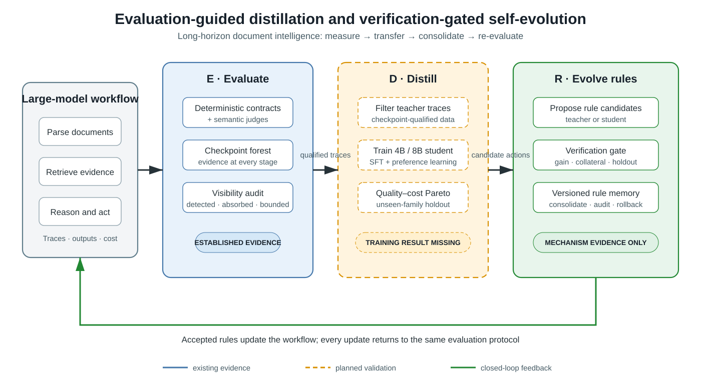

# 小论文—大论文统一科研叙事 v2

> 状态：当前工作口径 | 更新：2026-09-22
> 用户校准：小论文原始方向包含“大模型流程评估、小模型蒸馏、自学习规则进化”三部分。

## 1. 一句话故事

本文研究如何把长流程大模型系统的中间过程变成可测量、可迁移、可安全积累的能力：先用分层检查点评估流程，再把 checkpoint 筛选的规则动作蒸馏给小模型，最后由确定性验证门控制规则固化与版本化回滚。三阶段闭环是待验证目标，不是现成结果。

近期术语限定为“动作策略蒸馏”或“规则候选蒸馏”：`research/vgmc_exp1.py` 记录的是动作事件，不含完整推理轨迹。学生只做候选提出与验证预筛，不替代最终确定性验证门；完整过程推理蒸馏留作将来具备相应证据后的扩展。分层权威见 `docs/research/README.md`，任务顺序与阶段门唯一见 `docs/handoff/2026-09-22-paper-research-next-phase.md`。

## 2. 三阶段方法

### Stage E：Evaluate — 大模型流程评估

- 对象：解析、字段映射、检索、数值推理、引用、拒答等长流程中间态。
- 方法：确定性契约优先、语义 judge 补充、分层检查点聚合、缺陷注入与可见性分析。
- 输出：带 checkpoint 证据的成功/失败轨迹、缺陷家族标签、置信边界和成本。
- 当前证据：成熟。95 张公开表、118 个受控注入、阈值/匹配器/种子/matched-FPR 审计均已落仓。

### Stage D：Distill — 评估引导的小模型蒸馏

- 对象：8B 主学生的规则候选提出和验证预筛；4B 仅用于训练链 smoke test，不作论文主臂或参数量消融。
- 方法候选：以 checkpoint 过滤可追溯动作事件；核验门标签与真实正确性后构造监督/偏好数据，先做去重与离线可学性探针。
- 输出目标：动作策略，以及质量—成本/风险—覆盖对照；最终规则接受仍由确定性门决定。
- 当前证据：尚未闭环。已有 4B/8B/14B 零样本能力矩阵、蒸馏文献核验和 60 条 DPO 偏好对，但没有学生模型训练、蒸馏基线或训练后评测。60 对均偏向 skip，A3 仅为条件臂；14B 既有异常尚未归因。

### Stage R：Evolve — 验证门控的规则自学习进化

- 对象：小模型或大模型提出的 schema/工具规则候选。
- 目标方法：gain–collateral 双门加独立 gate-validation，接受后写入版本化外部规则记忆，按冻结的回归条件回滚；sealed test 仅终评。
- 输出目标：可审计的规则增量和下一轮系统行为。
- 当前证据：机制级成立、功效未闭合。对抗建议 7/7 被拒，扩展碰撞候选 5/5 被拒；碰撞体制出现方向性收益，但现有总体下游效应未达到强结论标准。独立验证门与长期版本回滚的完整对照仍待实验。

## 3. 研究问题与主张边界

| RQ | 问题 | 当前可写主张 | 还缺什么 |
|---|---|---|---|
| RQ1 | 如何获得可诊断、可复现的长流程评估信号？ | 分层证据和可见性谱能揭示协议盲区；不主张层级聚合有更高检出率 | 第二数据流或第二 scorer |
| RQ2 | checkpoint 筛选能否改善小模型规则动作学习？ | 只能提出方法和数据构造；现有小模型矩阵不是蒸馏结果 | 8B 主学生、A1/A2 双口径、条件 DPO、独立 sealed 未见家族 |
| RQ3 | 蒸馏或推理得到的经验能否安全积累？ | 门控机制能拒绝已构造的有害候选；不主张已获得稳定显著净收益 | 强门控基线、功效分析、版本回滚和长期曲线 |
| RQ4 | 三阶段闭环是否改善质量—成本—风险权衡？ | 当前只能作为总假设和系统设计 | 统一端到端实验与消融 |

## 4. 小论文定位

### 目标题目

*From Evaluation to Self-Evolution: Verification-Guided Distillation and Rule Consolidation for Long-Horizon Document Intelligence*

### 建议贡献结构

1. 一个把长流程 checkpoint 证据转成蒸馏数据和安全更新信号的统一框架。
2. 一套判别力感知的流程评估方法，用于过滤教师轨迹并揭示不可见缺陷。
3. 一种 verification-gated 双层知识迁移：规则动作策略进入小模型参数，稳定经验经确定性门进入可回滚规则记忆。
4. 一个同时报告质量、成本、缺陷可见性和回归风险的闭环评测协议。

其中贡献 1–4 是目标结构，不是当前均已完成的结果。若没有最小蒸馏实验，稿件只能作为研究计划或将 Stage D 降为 future work；不能以“三阶段完整方法”投稿。

## 5. 最小可交实验闭环

### 蒸馏 MVP

- 先审计数据，再在开发侧跑 always-skip、deterministic matcher、lexical/fuzzy、confidence-only、简单分类器，回答“为什么需要小模型，而不是一条确定性规则”。数据/可学性/门基线通过后才申请训练窗口。
- 学生：4B 仅训练链 smoke；8B 主实验。现有 14/16、15/16 是零样本结果，不能替代规则动作评测。
- 数据：提取 checkpoint 筛选的动作事件；门接受不等于正确，冲突与 gate_fooled 必须单列核验。
- 训练臂：A0 zero-shot、A1 unfiltered SFT、A2 checkpoint-filtered SFT、A3=A2+DPO（双向偏好及功效达标才运行）。
- A1/A2 两种公平口径都报：自然数据量（实际可用规模）和 size/token/group-matched（匹配样本数、训练 token、独立 uid/家族分布）；不能把减量收益写成过滤质量收益。
- 四层边界：proposal/train（含内部 uid-dev 调参/早停）→ gate-validation（冻结门做接受/回滚）→ sealed test（冻结系统只读终评）→ future replay（未来独立 uid 批次）。各层 uid 隔离，sealed test 不参与接受、阈值或 early stopping；旧开发证据不得改名充当未见测试。
- 指标：action macro-F1、目标字段 exact match、有害动作接受率、最坏家族、H/ACC、成本与有效动作覆盖。按 uid 聚类估区间及功效。
- 继续三阶段稿须同时具备足量独立数据、非劣成立、相对简单基线的必要性以及闭环成本/风险收益；`PILOT_ONLY`、失败或回归就拆出成熟评估稿，具体门以执行计划为准。

### 规则进化 MVP

- 七类对照：no gate、gain-only、collateral-only、confidence-only、fixed dual gate、独立 gate-validation 增强门、rollback-versioning。
- 输入：相同候选序列，但各臂维护自己的规则状态，逐步重算 gain/collateral；不能照搬旧臂日志分数当成另一臂的反事实结果。
- 指标：有害固化、有效规则保留、碰撞列 ACC、验证次数、回滚次数、累计成本；sealed test 与 future replay 只读评估冻结快照。
- 最小成功门：相对强基线的风险/成本收益与预注册安全容差成立；若只能证明拒绝，则 Stage R 只写安全机制，不能写持续提升。

## 6. 论文图表计划

| 编号 | 图表 | 作用 | 状态 |
|---|---|---|---|
| Figure 1 | Evaluate–Distill–Evolve 总架构 | 30 秒讲清完整论文 | `paper/figures/fig_evaluate_distill_evolve_v1.svg` 已生成 |
| Figure 2 | 缺陷可见性谱 | 证明评估器盲区 | 已有 |
| Figure 3 | 蒸馏质量—成本 Pareto | 证明小模型迁移价值 | 待蒸馏 MVP |
| Figure 4 | 规则学习曲线与有害固化率 | 证明安全进化 | 部分数据已有，需统一强基线 |
| Table 1 | 三阶段消融 | 区分评估过滤、蒸馏和门控贡献 | 待 MVP |

## 7. 与大论文的关系

小论文验证最小完整闭环；大论文分别扩展三阶段：评估的跨数据流外部效度、蒸馏的多学生/多教师与泛化、规则进化的长期安全性和学习门。视觉补盲只作为评估阶段的条件扩展，不再与三条主线并列。

## 8. 当前稿件使用说明

`paper/teacher_review_draft_v1.md` / `paper/teacher_review_draft_v1.docx` 是 Stage E 的成熟证据子稿，可作为评估章节或拆稿保底；它不再代表完整三阶段方向。24–48 小时内部方向包使用该子稿与当前故事 Markdown；统一论文初稿须等实验过门。`paper/research_story_v2.docx` 和 Figure 1 是概念展示件，不覆盖本次收窄后的执行口径，Word 需先重生成核对。

专利公开状态未确认，不投稿、不上传预印本、不公开核心代码；内部方向包不代表已获公开许可。
