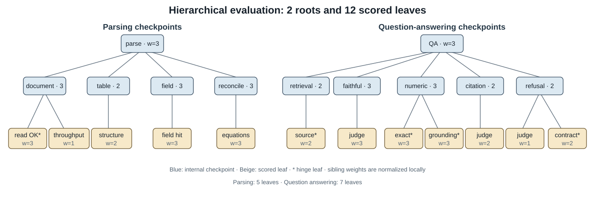
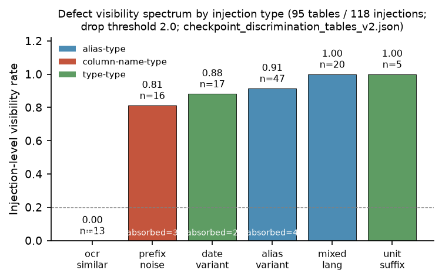

# Discriminability-Aware Evaluation of Long-Horizon Document AI Pipelines via Hierarchical Checkpoints and Defect Visibility Analysis

> Internal teacher-review version, 2026-09-22. Author and affiliation are to be filled in. Do not distribute, submit, upload to arXiv, or publish code before the patent-status gate is cleared.

## Abstract

Long-horizon document intelligence systems combine parsing, schema mapping, retrieval, reasoning, and answer generation. Their evaluation commonly reduces the entire pipeline to final-answer correctness. This hides two different outcomes: a defect may be detected by an intermediate checkpoint, or it may be silently absorbed while the final output remains unchanged. We present a discriminability-aware evaluation framework that treats the evaluation protocol itself as an object of study. The framework organizes deterministic contracts and leakage-protected semantic judges into hierarchical checkpoint trees, retains evidence at every checkpoint, and measures defect visibility under controlled perturbations. On a frozen public tabular corpus containing 95 tables and 118 synthetic header-drift injections, checkpoint-level analysis makes 96 injections visible, but visibility is strongly type-dependent: character-level OCR-like perturbations remain invisible in all 13 cases across five thresholds. Protocol-level results vary sharply on the same corpus: end-to-end, flat, and hierarchical expert-weight aggregation detect 112, 85, and 13 injections, respectively. After false-positive-rate matching, flat and hierarchical scores are affinely equivalent on this corpus, showing that the raw gap is caused by threshold placement rather than better discrimination. These results support a deliberately narrow conclusion: hierarchical structure provides evidence decomposition, not better detection sensitivity in the current setting; additional localization value remains unestablished because only one scored leaf varies with the injected input. We argue that evaluation reports for long-horizon systems should pair aggregate scores with per-family visibility profiles, explicit validity boundaries, and reproducible evidence chains.

## 1. Introduction

Document intelligence systems are increasingly implemented as pipelines rather than single predictors. A financial document may be decoded, segmented into tables, mapped to a canonical schema, checked for arithmetic consistency, indexed for retrieval, and finally queried by a language model. Each stage can fail independently, while later stages may compensate for or conceal an earlier error. Final-answer accuracy therefore cannot reveal whether the system followed a reliable path.

This creates a second problem that is easier to overlook: the evaluation protocol may itself be unable to observe particular defects. If a perturbed header is normalized back to the original field before the first measured checkpoint, every downstream score can remain unchanged. A correct final answer then has at least two explanations—the pipeline was robust to the perturbation, or the evaluation was blind to it. A single end-to-end score cannot separate these cases.

We study this problem through controlled fault injection. A frozen public tabular corpus contains 95 tables and 118 synthetic header perturbations across six families: alias variation, mixed language, unit suffix, date variation, OCR-like character substitution, and prefix noise. We evaluate each perturbation at two levels. Checkpoint-level visibility records whether any measured intermediate state moves. Protocol-level detection records whether an aggregated score crosses a calibrated threshold. The distinction is essential: the same corpus contains 96/118 visible injections, while flat and hierarchical protocols detect 85/118 and 13/118, respectively.

Our goal is not to introduce a stronger detector. Instead, we ask whether an evaluation protocol can characterize its own blind regions and disclose how its structure changes the interpretation of a result. This leads to three contributions:

1. We formulate a hierarchical checkpoint framework that combines deterministic contracts, leakage-protected semantic judges, explicit missing-evidence policies, and per-check evidence retention.
2. We define a defect visibility profile that separates detected, silently absorbed, and equivalence-dependent perturbations by defect family rather than collapsing them into one mutation score.
3. We audit the protocol itself through threshold sensitivity, seed variation, cross-matcher checks, matched-false-positive-rate comparison, and weight-search controls. The audit exposes a negative but actionable result: hierarchy provides evidence decomposition, but no discriminability gain at matched false-positive rate on the current corpus; its additional localization value cannot yet be established.

This positioning keeps the empirical claim commensurate with the evidence. We do not claim universal coverage, superior hierarchical detection, a formal geometric “blind cone,” or significant downstream gains from the gated self-improvement case.

## 2. Related Work

### 2.1 Meta-evaluation

Machine-translation challenge sets such as ACES evaluate whether a metric can distinguish genuine errors from acceptable variants [Amrhein et al., 2022; Amrhein et al., 2023; Moghe et al., 2024]. Contextual metric meta-evaluation extends this view to local, context-dependent correctness [Deviyani and Diaz, 2025]. More recent studies show that rankings can change with protocol axes, prompt subsets, seeds, or the property a metric is intended to measure [Kendiukhov, 2026; Du et al., 2026; Ross et al., 2024]. We adopt the same meta-evaluation principle but focus on a prior question: whether a long-horizon protocol can observe an injected defect at all.

### 2.2 Process-level and hierarchical evaluation

Process-oriented benchmarks diagnose intermediate behavior in tool-using and web agents rather than scoring only final success [Fan et al., 2026; Chung et al., 2026]. GTA-2 represents a task as recursively aggregated checkpoints [Wang et al., 2026]. Our aggregation follows this structure, while adding deterministic contracts, explicit missing-evidence behavior, and controlled injections that expose the evaluator's sensitivity by defect family.

### 2.3 Mutation testing and fault injection

Mutation testing and metamorphic testing introduce controlled changes to measure whether a test or metric notices them [Cho et al., 2025]. AgentChaos applies programmatic fault injection to agent systems [Tan et al., 2026]. These traditions usually summarize each mutant as killed or surviving. We retain a third outcome—silent absorption—and report outcomes per family. We also separate an evaluator blind spot from an invalid mutant whose intended harm is not observable at the scored layer.

### 2.4 Reliability of semantic judges

LLM judges are useful for open-semantic qualities but exhibit position, verbosity, self-preference, and perturbation sensitivity [Zheng et al., 2023; Li et al., 2025a; Li et al., 2025b]. We therefore reserve deterministic checks for contractible properties, use a judge only for semantic dimensions, hide injected ground truth from the judge prompt, and report the judge's resolution and sample limits explicitly.

## 3. Method

### 3.1 Checkpoint forest

We model the pipeline as two checkpoint trees. The parsing tree covers document ingestion, table structure, field mapping, and arithmetic reconciliation. The QA tree covers retrieval grounding, faithfulness, numeric correctness, citation quality, and appropriate refusal. Together the trees contain 12 scored leaves.

Each leaf receives a score in [0,10]. Contractible properties use deterministic checks; semantic properties use a 0–5 judge score mapped to [0,10]. Sibling weights are normalized locally before bottom-up aggregation. Missing evidence is explicit: the parsing tree assigns 0, whereas the QA tree assigns a neutral 5. Hinge leaves affect the stability verdict, not the missing-evidence score. Every leaf stores its evidence and degradation reason.

For node n with children C(n), the recursive score is

\[
S(n)=\sum_{c\in C(n)} \frac{w(c)}{\sum_{j\in C(n)}w(j)}S(c).
\]

For a leaf, S(n) is the mapped contract or judge score. A tree is stable only when at least 90% of its leaves exceed the selected threshold and every hinge leaf scores at least 7. The implementation is deterministic once the evidence artifacts are fixed.

### 3.2 Visibility outcomes

For an injected defect d, we distinguish three outcomes:

- **Detected:** the defect changes measured evidence and the protocol score crosses its detection threshold.
- **Silently absorbed:** the injected state changes, but normalization or matching removes the difference before a measured checkpoint can expose it.
- **Equivalence-dependent:** the perturbation's harmfulness changes under the chosen equivalence criterion, so the evaluator observation is reported without declaring either criterion ground truth.

The defect visibility profile reports visibility separately for each family. This preserves information lost by a single mutation score and distinguishes a missing checkpoint from a genuinely robust stage.

### 3.3 Evaluating the evaluator

We compare four protocols on frozen evidence: end-to-end roots, a flat leaf average, hierarchical expert weights, and hierarchical searched weights. We measure table-level detection, injection-level detection, mean separation between clean and perturbed states, worst-family behavior, localization, and evaluation cost. Because raw thresholds can manufacture differences, we also compare flat and hierarchical protocols at matched false-positive rates calibrated on clean tables.

The audit further varies the injection seed, visibility threshold, matching algorithm, and scoring normalization. A semantic-judge arm is evaluated separately and never substituted for deterministic evidence when a contract exists.

## 4. Experimental Setup

### 4.1 Corpus and perturbations

The study uses a frozen public tabular base and contains no client data. It includes 95 tables and 118 synthetic injections across six header-drift families. Each injected record preserves its source table, family, seed, changed field, and expected observation surface. The primary threshold grid is

\[
\Gamma=\{0.2,0.3,0.5,0.7,0.9\}.
\]

The OCR-like family contains 13 single-token, lowercase Levenshtein-distance-one substitutions with unchanged column values. These properties are mechanically recomputed before interpretation.

### 4.2 Baselines and controls

The protocol baselines are end-to-end scoring, flat leaf scoring, and hierarchical scoring with expert weights. Weight-search controls include equal weights, expert weights, 30 random trials, greedy coordinate ascent, particle-swarm optimization (PSO), and a minimax objective. Assignment controls compare greedy matching with Hungarian global assignment and include a positive solver test.

### 4.3 Statistical discipline

We freeze inputs and decision criteria before reading each result. Confidence intervals are reported on table-level clustered units where available. Seed sensitivity uses three injection seeds. Matched-FPR comparison recalibrates each protocol on clean tables within every bootstrap replicate. Null and adverse findings are retained rather than relabeled as improvements.

## 5. Results

### 5.1 Visibility is strongly defect-type dependent

Checkpoint-level analysis makes 96/118 injections visible, but the aggregate hides a large family effect. OCR-like perturbations are invisible in 0/13 cases across all five thresholds. Other families range from 0.81 to 1.00 visibility at the primary setting.

The blind family remains the same under four edit-distance matcher configurations. However, the ordering of visible families is not invariant: changing the score normalization causes five class flips, all within the date-variation family, whereas switching from greedy to global assignment causes no flips. Thus, the existence of a blind family is stable within the tested matcher family, but the full ranking is protocol-dependent.

The harmfulness label is also criterion-dependent. An instance-level oracle rejects all seven members previously placed in a type-level equivalence class. Across eight paired comparisons, five disagree, and the disagreements align with criterion kind—canonical-form preservation versus reader-referent recoverability—rather than appearing as random case-level noise. We therefore report the evaluator's blindness directly while treating whether that blindness is harmful as a boundary question.

### 5.2 Protocol structure changes raw detection counts

Table 1 compares the three transferable protocols. Hierarchical scoring is not a more sensitive detector at the frozen threshold.

| Protocol | Scored units | Tables detected | Injections detected |
|---|---:|---:|---:|
| End-to-end | 2 roots | 95/95 (1.0000) | 112/118 (0.9492) |
| Flat | 12 leaves | 75/95 (0.7895; 95% CI [0.6947, 0.8737]) | 85/118 (0.7203) |
| Hierarchical, expert weights | 12 leaves | 20/95 (0.2105; 95% CI [0.1263, 0.2947]) | 13/118 (0.1102) |

The raw flat–hierarchical gap does not establish inferior ranking quality. At matched false-positive rate, the two protocols are affinely equivalent on the current corpus because only one scored leaf varies with the input. A 2,000-replicate table-cluster bootstrap yields a protocol-difference confidence interval of [0,0]. The raw gap is therefore a threshold-placement effect. Under this construction, hierarchy supplies decomposable evidence but cannot demonstrate additional localization value until more than one leaf varies.

### 5.3 Sensitivity and reproducibility

The identity of the fully blind family is stable across the threshold grid. Absolute between-family range contracts at high thresholds, as expected when one changed header contributes at most 1/n for a table with n canonical headers. The literal preregistered range criterion fails at 0.7 and 0.9 and is reported as failed.

Across three injection seeds, flat table-detection rates are 0.7895, 0.7835, and 0.7556. Their spread is 0.0339, and the pooled estimate is 0.7766 with a 95% interval of [0.7270, 0.8227]. The seed-42 run reproduces the frozen artifact byte-for-byte.

Judge calibration covers 120 leaf-state cells. The preregistered per-dimension bound on the 0–5 scale is met with a maximum observed difference of 0.5. On the derived 0–10 root scale, control roots differ by at most 0.22, while individual leaves can move by as much as 7.0. Agreement is therefore an aggregate observation, not evidence of cell-level interchangeability.

### 5.4 Weight search produces an informative null

PSO and greedy coordinate ascent reach the same mean separation of 1.432574. PSO repeats the result on all five seeds but requires 7,650 evaluations, compared with 67 for greedy search. A minimax variant improves worst-case separation to 0.35714 while reducing mean separation to 1.25605. We therefore do not claim PSO superiority. The result instead shows that objective choice matters more than optimizer sophistication in the present search space.

### 5.5 Evaluation-driven rule consolidation is a mechanism case

As a compact feedback example, evaluation findings generate candidate schema-rule repairs. A gain–collateral gate screens each candidate before deterministic consolidation and regression verification. The gate rejects all 7 adversarial high-confidence mappings and all 5 candidates in the expanded-collision regime. In the first arm, every rejection is triggered by insufficient gain; the collateral path activates only after collision expansion.

This is not an efficacy claim. At the current corpus size, the downstream correctness effect is not significant: the table-level change is 0.05 with an interval containing zero, and the column-level comparison is 7/40 versus 4/40 with exact McNemar p=0.375. The case motivates, but does not answer, the thesis-level question of when suggestion reliability, collision exposure, and per-collision harm make gated consolidation valuable.

## 6. Discussion and Limitations

The main finding is methodological. Aggregate evaluation can hide both system defects and evaluator blind spots. A checkpoint forest makes evidence decomposable, while a visibility profile shows which defect families are observable. Yet structure alone does not guarantee sensitivity: on the current corpus, flat and hierarchical protocols are equivalent after calibration.

Four limitations bound the claim. First, the evidence comes from one public tabular corpus with synthetic perturbations; no cross-domain generalization is claimed. Second, the OCR-like family is blind under the evaluator, but whether each perturbation is harmful depends on the equivalence definition. Third, the semantic boundary analysis uses one judge on 28 cases; mixed-language and unit-suffix families receive no calls in that window. Fourth, matching competition reduces the oracle correctness ceiling from 0.952381 to 0.597015 under shared-header overlays, while global assignment changes no decision, locating the problem in score construction rather than allocation.

A second dataflow and a second scorer were preregistered but are not reported. The transfer corpus lacks the table layer required to define per-family constructible sample counts, so the transfer arm was deferred rather than silently replaced. The criterion-relativity claim consequently remains limited to the current evaluator and corpus.

## 7. Conclusion

Final correctness is not evidence that every step in a long-horizon document pipeline is reliable, and a single evaluation score cannot reveal whether the evaluator is blind to a defect family. We introduced a hierarchical checkpoint framework and a defect visibility profile that preserve intermediate evidence and expose silent absorption. On 118 controlled injections, visibility and detection depend strongly on defect family and scoring protocol. The most important result is negative but useful: hierarchical structure improves decomposition, not matched-FPR discriminability, in the current setting. Long-horizon evaluations should therefore report the protocol's own sensitivity, validity boundaries, and reproducible evidence chain alongside aggregate system performance.

## References

- Amrhein, C., Moghe, N., and Guillou, L. ACES: Translation Accuracy Challenge Sets for Evaluating Machine Translation Metrics. arXiv:2210.15615, 2022.
- Amrhein, C., Moghe, N., and Guillou, L. ACES: Translation Accuracy Challenge Sets at WMT 2023. arXiv:2311.01153, 2023.
- Chung, J., Byun, J., Vineet, V., and Kim, S. J. Where Did It Go Wrong? Process-Level Evaluation of Web Agents with Semantic State Tracking. arXiv:2606.15673, 2026.
- Cho, S., Ruberto, S., and Terragni, V. Metamorphic Testing of Large Language Models for Natural Language Processing. arXiv:2511.02108, 2025.
- Deviyani, A., and Diaz, F. Contextual Metric Meta-Evaluation by Measuring Local Metric Accuracy. arXiv:2503.19828, 2025.
- Du, S., Liang, P., Shen, Y., et al. On the Stability of Prompt Ranking in Large Language Model Evaluation. arXiv:2606.24381, 2026.
- Fan, S., Ye, X., Huo, Y., et al. AgentProcessBench: Diagnosing Step-Level Process Quality in Tool-Using Agents. arXiv:2603.14465, 2026.
- Kendiukhov, I. Quantifying Ranking Instability Across Evaluation Protocol Axes in Gene Regulatory Network Benchmarking. arXiv:2603.03493, 2026.
- Li, Q., Dou, S., Shao, K., Chen, C., and Hu, H. Evaluating Scoring Bias in LLM-as-a-Judge. arXiv:2506.22316, 2025.
- Li, S., Xu, C., Wang, J., et al. LLMs Cannot Reliably Judge (Yet?): A Comprehensive Assessment on the Robustness of LLM-as-a-Judge. arXiv:2506.09443, 2025.
- Moghe, N., Fazla, A., Amrhein, C., et al. Machine Translation Meta Evaluation through Translation Accuracy Challenge Sets. arXiv:2401.16313, 2024.
- Ross, C., Hall, M., Romero Soriano, A., and Williams, A. What Makes a Good Metric? Evaluating Automatic Metrics for Text-to-Image Consistency. arXiv:2412.13989, 2024.
- Tan, G., Sun, Z., Shi, J., et al. AgentChaos: Chaos Engineering for Agent Systems via Programmatic Fault Injection. arXiv:2608.06790, 2026.
- Wang, J., et al. GTA-2: Benchmarking General Tool Agents from Atomic Tool-Use to Open-Ended Workflows. arXiv:2604.15715, 2026.
- Zheng, L., Chiang, W.-L., Sheng, Y., et al. Judging LLM-as-a-Judge with MT-Bench and Chatbot Arena. arXiv:2306.05685, 2023.
