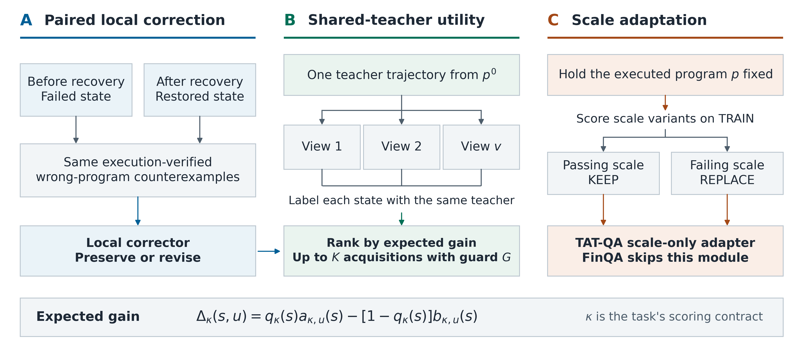
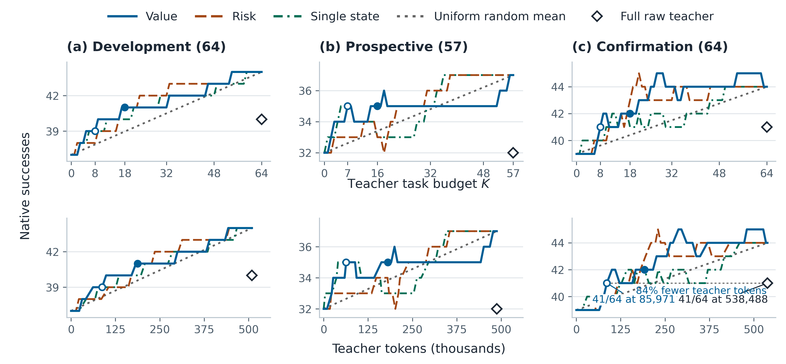
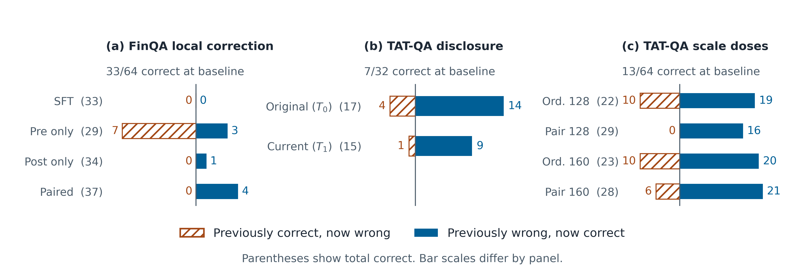

# Learning to Correct and Escalate from Shared Execution-State Feedback

> v5 research draft · 2026-11-19. Advisor-review v4 is archived at Git commit `79000372`. [Complete results and costs](results/IJCNN_EXPERIMENT_TABLES.md) and [implementation evidence](results/FINQA_CORRECTION_METHOD.md).

## Abstract

A valid financial program can return an incorrect answer by using the wrong quantity, period or scale. We train a local corrector by allocating counterexample supervision before and after a verified recovery. On an internal FinQA holdout, the paired allocation improves ordinary supervised fine-tuning from 34/64 to 39/64, recovering six answers and harming one. For escalation, we reuse one teacher trajectory from the initial state to label interventions across multiple executed local states. Ninety-six trajectories supply 252 training views. The multi-state model gains one to two successes over an update-matched single-state control at the primary budgets in three FinQA panels. On the internal holdout, eight guarded acquisitions reach 41/64 using 16.0% of the teacher tokens of full unguarded acquisition (41/64). Full acquisition with the same guard reaches 44/64. On a new single-operation FinQA panel at eight acquisitions, ordinary correction with Value reaches 14/64, compared with 11/64 for paired correction with Value and 10/64 for ordinary correction with Risk. On 32 new TAT-QA tables, ordinary and paired scale adaptation both improve guarded outputs from 18/32 to 21/32 using the same six teacher programs.

## Index Terms

Agentic question answering, numerical reasoning, selective escalation, execution feedback, few-shot adaptation.

## Introduction

Financial document questions require programs that bind quantities to the right periods, scopes and units [1, 2]. Execution can expose a syntax error and return intermediate values. A program that uses the current period as the base for a growth rate can still execute cleanly, and a revision can overwrite a correct base. We ask how supervision from executed programs can improve error recovery while preserving correct answers and limiting teacher calls.

CCT trains for both revision and preservation [3], and CARE uses verifier-scored hard negatives [4]. For local correction, we construct wrong alternatives by reverting edits from the same verified recovery. We compare where to apply their auxiliary loss while holding supervised targets and total auxiliary weight fixed. For escalation, CIR estimates the effect of intervention through paired continuations [5]. We compare several realized local states against one fixed-input teacher trajectory per source, so additional views require no additional teacher runs for that source.

FinQA supplies the main tests of **where to allocate counterexamples** and **how much supervision one teacher trajectory can supply**. We also test the scope of the approach on TAT-QA, whose answer scale is predicted separately [2]. FinQA and TAT-QA can respond differently to fixed scale rules [6]. Our transfer experiments therefore keep arithmetic fixed and compare ordinary scale fitting, paired KEEP-or-revise supervision and a public rule. Figure 1 shows how each intervention uses execution feedback.

## Related Work

**Correction and preservation.** SCoRe trains self-correction through online reinforcement learning [7]. CRINGE contrasts desired and undesirable tokens [8], and partial masking in synthetic teacher trajectories changes the supervision assigned to mistakes [9]. CCT combines training examples in which an initial answer should be maintained or revised [3]. CARE selects semantically near wrong rollouts and verifies reflected repairs [4]. We apply an auxiliary contrast to executable but wrong programs derived from the same recovery, and compare whether it is placed before, after or on both sides of that recovery.

**Budgeted intervention.** AutoMix selects when to use a stronger model [10], RASER predicts the value of additional retrieval [11], and DARS estimates model capability from repeated observations [12]. CIR compares intervening and continuing from the same execution state to learn recovery value [5]. Our label varies the realized local state within a source and reuses one teacher outcome generated from the initial snapshot. This design isolates the supervision gained from viewing additional local states with a fixed teacher trajectory.

**Scale adaptation.** TAGOP predicts the answer scale alongside the answer [2]. Thokal finds that deterministic multiply- and divide-by-100 rules have dataset-dependent effects on financial QA [6]. We fix the arithmetic program and compare a public scale rule, supervised scale fitting and paired KEEP-or-revise training under the same scorer.

## Method

### Executed state and intervention value

For public input $x$, the executor returns validity and values $E(p,x)$. State $s$ contains $x$, initial program $p^0$, local answer $L$ and both public execution records. Under contract $\kappa$, the host grades correctness with $C_\kappa$. Let $L'_u$ denote the answer after intervention $u$.

$$
\begin{aligned}
\Delta_\kappa(s,u)
&=\mathbb E[C_\kappa(L'_u)-C_\kappa(L)\mid s,u] \\
&=q_\kappa(s)a_{\kappa,u}(s)
  -[1-q_\kappa(s)]b_{\kappa,u}(s).
\end{aligned}
\tag{1}
$$

Here $q_\kappa$ is local error probability, $a_{\kappa,u}$ is recovery conditional on error and $b_{\kappa,u}$ is damage conditional on correctness. The expected change is the difference between the probabilities of recovery and damage, as in paired intervention evaluation [5]. Local revision, teacher acquisition and scale correction share this accounting. KEEP has zero gain.

### A. Paired local correction

Each recovery provides a failed state $s_i^-$ and a verified state $s_i^+$ from the same source. Reverting successful edits creates candidate counterexamples. We keep the alternatives that execute and return wrong results. Correct episodes provide preservation targets. At the first differing token under an identical prefix, we contrast logits $z^+$ and $z^-$. Let $\ell(s_i^\pm)$ average $\operatorname{softplus}(1+z^- -z^+)$ across such positions, with empty sets contributing zero.

$$
\mathcal L_i^A=\mathcal L_{\mathrm{CE},i}
+\lambda\big[\rho\ell(s_i^-)+(1-\rho)\ell(s_i^+)\big].
\tag{2}
$$

Ordinary SFT uses $\lambda=0$. The pre-only, post-only and paired arms use $\lambda=0.1$ with $\rho=1,0,0.5$, respectively. The positive loss is averaged over supervised tokens within a source. The counterexample terms reuse the positive forward pass. The comparison uses 88 source groups, 147 positive targets and 54 groups with counterexamples. All four arms share initialization, target masks, 264 updates and 441 forwards.

### B. Utility from one teacher trajectory per source

Teacher $T_0$ reads the initial snapshot $(x,p^0)$, so one trajectory $t_i$ can label multiple executed local programs $L_{iv}$. Controller $G$ retains the local result if the teacher fails completion or validity checks, or differs only by a terminal factor-of-100 conversion on the same parsed core (and the same TAT-QA scale). Otherwise $G$ adopts the teacher answer.

$$
r_{iv}=C_\kappa(G(L_{iv},t_i))-C_\kappa(L_{iv})\in\{-1,0,1\}.
\tag{3}
$$

A separate utility adapter learns the short JSON outcome for damage, unchanged correctness or recovery. Token-mean likelihood is averaged over views within each labeling source and over labeling and positive replay sources. The 252 distinct local views are nested within 96 teacher trajectories. Forty-five sources have labels that change across views, and 121 groups contribute positive replay. Repeating one actual local state per source in the single-state control matches the multi-state arm's 434 updates and 894 forwards.

At inference, Value ranks states by $\widehat P(r=1\mid s)-\widehat P(r=-1\mid s)$ from one prefill's three renormalized logits. Risk ranks by predicted local error. Each acquires the top $K$ outcomes and applies $G$. Full-teacher controls use raw outcomes or apply $G$ to every task. The disclosure diagnostic reruns the teacher as $T_1$ with the current program, scale and feedback.

### C. Scale adaptation with fixed arithmetic

We score each fixed TRAIN program with the five TAT-QA scales (none, thousand, million, billion and percent). Eligible pairs contain passing $\sigma^+$ and failing $\sigma^-$. The observed scale determines one state and a scored counterfactual the other. Pair supervises KEEP on the passing state and $\sigma^+$ on the failing state, contrasting $\sigma^-$ on both with a margin of 1 and weight 0.1. Ordinary uses the annotated scale on both states with matched inputs, updates and next-token cross-entropy. The comparison varies KEEP, execution-derived targets and the margin. Both leave incomplete or invalid submissions unchanged. Equivalent representations can be retained under the same program and scorer.

## Experimental Protocol

**Native runs.** OpenCode's Qwen3-8B BF16 GGUF actor shares a parent checkpoint with the HF readout. Q/V LoRA uses rank 8, alpha 16, dropout 0 and learning rate $2\times10^{-4}$. Native episodes use seed 17, temperature 0.2 and caps of 32,768 context tokens, 8,192 output tokens, 12 requests and 300 seconds. The teacher endpoint is `deepseek-v4-flash`. Success requires normal completion, a valid program and a matching executed answer. FinQA canonicalizes to five decimals. TAT-QA uses official arithmetic exact match (EM) with predicted scale. References remain host-side.

**FinQA.** DEV64 and early confirmation53 are disjoint company/year groups from an official test snapshot. Forward57 uses TRAIN sources unused at execution time. Final confirmation64 is an internal holdout from official TRAIN. Primary budgets for DEV64, forward57 and confirmation64 are 18, 16 and 18, with lower budgets 8, 7 and 8. Policies share teacher outcomes and their costs count only their own selections.

**Combination comparison.** We cross ordinary and paired correction with the frozen Risk and Value policies on Forward57. Each policy ranks the programs from its own correction arm and uses the same guard with one shared teacher program from the initial snapshot. We then lock a separate 64-case official TRAIN panel by hash, taking one task per company/year after excluding prior groups and duplicate tables. The primary budget is eight teacher acquisitions and the secondary budget is 18. Each selected case receives one teacher run shared by the policies that select it. This panel contains 64 single-operation references, whereas Forward57 contains only multi-operation references. Selection precedes reference inspection and uses public metadata.

**TAT-QA.** Direct transfer uses two 32-table official-dev panels (development and forward). The 48-table disclosure follow-up compares $T_0$ and $T_1$ in randomized order on the same top 14 Value selections. Its mixed policy assigns $T_1$ to the lower-risk seven and $T_0$ to the rest. Scale adaptation uses hash-ordered TRAIN prefixes of 32, 64 and 96. On the 112 exposed tables, we maximize the smaller margin over the joint rule and Ordinary, preferring smaller prefixes on ties and defaulting to 32 if no dose beats both. Locked C3 confirmation uses 64 disjoint official-dev tables. Teacher acquisition at $K=18$ requires at least three more successes than each scale comparator.

**Adaptive extension.** After the original comparison, the TRAIN prefix expands to 128 and 160. Both doses reuse fixed programs on the 112 exposed and previously scored 64-case panels. Eligibility for $K=18$ requires 23 successes and at least three more than each scale comparator. We choose the qualifying dose with the most paired successes, favoring the smaller dose on ties. Frozen Value and Risk then select from the same adapted states. A fresh $T_0$ call uses the original snapshot for each task in their union, and both policies apply $G$.

**New-table scale recheck.** We select 32 previously unused official DEV tables by excluding table identifiers and normalized table contents covered by TRAIN or prior experimental plans. We freeze local Pair128 outputs and the Risk ordering. The six leading $T_0$ outcomes are a prefix of the same nine-outcome pool. The ordinary and paired adapters from the 128-table fit receive identical teacher programs and inputs before $G$. Each adapter was trained on the same 68 groups with 136 updates.

**Uncertainty and cost.** Paired 95% intervals use 20,000 source-level percentile-bootstrap draws. They condition on the training fits and realized teacher outcomes, assume independent source groups and are unadjusted across comparisons. We report teacher tokens separately from local generation, training and classifier forwards. Each teacher-token comparison specifies its reference policy and budget.

## Results

### A. Local correction recovers and preserves

**Table 1. Matched local correction on FinQA DEV64. Recovery and harm are relative to Ordinary SFT.**

| Training | Native successes | Recovery / harm |
|---|---:|---:|
| Ordinary SFT | 33/64 | 0 / 0 |
| Pre-recovery only | 29/64 | 3 / 7 |
| Post-recovery only | 34/64 | 1 / 0 |
| Paired | 37/64 | 4 / 0 |

Paired supervision yields three additional successes over the post-only arm, with no losses in that comparison (+4.7 percentage points, paired 95% interval [0.0, 10.9]). Both preserve all 33 answers correct under Ordinary SFT, whose correctness mask matches the first pass. A half-weight pre-only arm reaches 32/64, and equal-weight positive-state SFT reaches 31/64. In the final confirmation, Pair improves 34 to 39, with six recoveries and one harmful revision relative to ordinary SFT (+7.8 points [0.0, 15.6]). Earlier confirmation53 and forward57 have unchanged local totals at 30 and 32. In one DEV64 recovery, Pair replaces a valid but incorrect growth base of 398.0 with the correct prior-period 442.9. A TRAIN diagnostic finds that 19/29 valid errors require at least two available edits for correctness. Joint correction and utility training in one adapter reaches 34 locally and 40 with escalation on DEV64. Separate adapters reach 37 and 41.

### B. Budgeted utility and its limits

**Table 2. Native success by panel and acquisition budget. Bold budgets are primary. All raw is the unguarded teacher.**

| Panel | K | SFT | Pair | Value | Risk | Single | Random E | All raw | All + G |
|---|---:|---:|---:|---:|---:|---:|---:|---:|---:|
| FinQA DEV64 | 8 | 33 | 37 | 39 | 38 | 39 | 37.9 | 40 | 44 |
| FinQA DEV64 | **18** | 33 | 37 | 41 | 41 | 40 | 39.0 | 40 | 44 |
| FinQA forward57 | 7 | 32 | 32 | 35 | 33 | 35 | 32.6 | 32 | 37 |
| FinQA forward57 | **16** | 32 | 32 | 35 | 33 | 33 | 33.4 | 32 | 37 |
| FinQA confirmation64 | 8 | 34 | 39 | 41 | 40 | 40 | 39.6 | 41 | 44 |
| FinQA confirmation64 | **18** | 34 | 39 | 42 | 43 | 41 | 40.4 | 41 | 44 |
| TAT-QA development32 | **9** | 5 | 7 | 11 | 13 | -- | 10.4 | 19 | 19 |
| TAT-QA forward32 | **9** | 12 | 9 | 11 | 10 | -- | 10.7 | 15 | 15 |

With the same teacher sources, the multi-state arm gains 1, 2 and 1 tasks over Single at the three FinQA primary budgets. On confirmation64 its lead over Single has a paired 95% interval of [-4.7, 7.8] points. The full pipeline gains 12.5 points over unassisted SFT [4.7, 21.9]. Risk reaches 43 versus Value's 42 at the primary confirmation budget. Value leads Risk by 1, 2 and 1 tasks at the lower budgets. Uniform sampling has expectation $B+K(R-H)/N$ for $B$ correct local answers and a pool with $R$ recoveries and $H$ harmful revisions. On confirmation64 the exact random central 95% intervals are [37, 42] at $K=8$ and [37, 44] at $K=18$. An original random draw also reaches 41 at $K=8$. These ranges describe selections from the observed pool.

Value's 41 at $K=8$ costs 85,971 teacher tokens, 16.0% of the 538,488 consumed by full unguarded execution. At $K=18$ the 42 successes cost 192,213 tokens (35.7%). This reduces teacher tokens by 84.0% and 64.3%, respectively. Full teacher with $G$ reaches 44. The random draw that reaches 41 uses 92,790 teacher tokens with no classifier. On confirmation64 local first-pass and Pair execution process 513,140 and 262,576 provider tokens, respectively. Value adds 64 prefills processing 107,988 input tokens. Figure 2 shows both acquisition counts and teacher tokens across budgets.

**What the shared labels measure.** Of the 45 sources with changing labels, 41 adopt the same teacher candidate in every view. For these sources the label changes with local correctness while teacher correctness stays fixed. The additional views thus supervise the value of replacing different local states with an already realized teacher outcome. At the primary budgets on DEV64 and forward57, the original three-state model reaches 41 and 35. The four-state model with execution feedback reaches 39 and 35, while the matched static variant reaches 41 and 36. The forward improvement for the static variant is +1 task with a paired 95% interval [0.0, 5.3] points. Within each four-state model, changing from risk to net utility ties on DEV64 at the primary budget. On forward57 at $K=16$ it yields two extra recoveries with feedback and one with static inputs, with paired intervals spanning zero in both comparisons. At $K=7$ the feedback model loses one success under net utility.

**Disclosing local progress.** On 32 TAT-QA development contexts, $T_0$ and $T_1$ recover 14/25 and 9/25 wrong local answers and damage 4/7 and 1/7 correct answers. The retrospective mixed strategy reaches 20 with all 32 acquisitions and ties $T_0$ at 11 under the original $K=9$ selection. On the separate 48-table follow-up, fixed $T_0$, fixed $T_1$ and the frozen mixed strategy reach **14, 14 and 13** at $K=14$. The paired interval for $T_1$ minus $T_0$ is [$-6.25$, 6.25] points.

### C. Scale transfer under a changed answer contract

The direct-transfer decline from 12 to 9 on forward32 includes three identical programs with a missing percent scale. Public structured percent completion improves the corresponding SFT/Pair/Value results to 13/12/14. For the scale study we use a stronger public rule adding table magnitude and program structure. Across the 112 exposed contexts it recovers 15 answers without damaging any originally correct ones. This rule and ordinary adaptation provide strong controls for the learned intervention.

The original prefixes receive 22, 60 and 98 updates per arm. Exposed-panel margins are -5, +1 and -2, making 64 the primary dose before confirmation. At that dose, direct transfer, the rule, Ordinary, Pair and Pair with replay yield 25, 40, 40, 41 and 48 exact matches across the 112 exposed cases. On the locked cohort, Pair improves by four over the rule (14 wins, 10 losses) and trails Ordinary by two (zero wins, two losses). Replay reduces harms from 10 to 6 and recoveries from 18 to 14, leaving the result at 21. The secondary 96-table setting gives three more successes and no losses against Ordinary. The primary dose does not cross the acquisition gate, so this confirmation adds zero teacher calls.

**Table 3. Scale adaptation on the locked 64-table panel. The 128 and 160 doses reuse this panel adaptively. Raw transfer is 13 and the joint rule is 17 (4/0) at every dose. Parentheses give recovered / harmed.**

| TRAIN tables | Pairs | Ordinary | Paired |
|---|---:|---:|---:|
| 32 | 11 | 19 (19/13) | 20 (19/12) |
| **64 (primary)** | 30 | 23 (19/9) | 21 (18/10) |
| 96 | 49 | 20 (19/12) | 23 (21/11) |
| 128 (adaptive) | 68 | 22 (19/10) | 29 (16/0) |
| 160 (adaptive) | 87 | 23 (20/10) | 28 (21/6) |

On the reused 64 cases, the 128-table paired model reaches 29 versus 22 for Ordinary. It recovers three fewer answers and harms ten fewer relative to raw transfer. Both adaptive doses satisfy the extension gate, which selects 128. Pair128 preserves every initially correct answer on the reused 64 cases and on the earlier 112 contexts.

**Rechecking the same teacher programs on new tables.** At $K=6$, the guarded teacher scores 18/32 without scale adaptation and 21/32 with either adapter. Each adapter recovers three answers and harms none relative to the guarded teacher at that budget, and each wins one case against the other. At $K=9$, the guarded teacher, public rule, Ordinary and Pair score 18, 19, 22 and 22 out of 32. Each learned adapter wins two cases against the other. The paired adapter removes spurious percent scales in its two wins, and the ordinary adapter supplies omitted percent scales in its two wins. Both budgets use nested selections from the same teacher pool. The six adapted acquisitions yield 21/32 versus 18/32 for nine unadapted acquisitions, with 48,628 versus 77,045 teacher tokens (36.9% fewer). The paired scale adapter reads 4,396 local input tokens for the six programs. This comparison holds the local starting solution, teacher program, case selection and guard fixed at each budget. It measures post-acquisition scale adaptation with fixed arithmetic.

**Guarded acquisition after adaptation.** On the reused 64 cases at $K=18$, Value and Risk improve Pair128 from 29 to 35 and 37, respectively, with zero harms. They use 158,152 and 173,185 teacher tokens. The batch cap prevents one Value-exclusive teacher attempt, so the guard retains its wrong local result. A recovery on that case would yield 36.

A scale-only route can bypass target adaptation on FinQA and reuse the original 37/64 source policy. A fresh native DEV64 run with 121 FinQA TRAIN replay groups reaches 34/64, with three previously correct answers becoming wrong and no new successes. The final FinQA confirmation remains sealed. Adapter bypass preserves the deployed source path, while the tested joint replay configuration shows residual interference. Formation for the original 96-table sweep uses 373 local requests and 1,392,702 reported tokens, separate from adapter training.

### D. Matched combination comparison

**Table 4. Matched FinQA factorial. Entries are correct answers (recovery/harm relative to the corresponding local baseline). Ord denotes ordinary SFT.**

| Cohort, K | Ord+Risk | Ord+Value | Pair+Risk | Pair+Value |
| ---: | ---: | ---: | ---: | ---: |
| Fwd 7 | 33 (1/0) | 34 (2/0) | 33 (1/0) | 35 (3/0) |
| Fwd 16 | 34 (3/1) | 34 (3/1) | 33 (2/1) | 35 (4/1) |
| New 8 | 10 (3/0) | 14 (7/0) | 9 (5/0) | 11 (7/0) |
| New 18 | 16 (9/0) | 21 (14/0) | 13 (9/0) | 18 (14/0) |

Both local arms start at 32/57. At $K=7$, the complete policy improves on Ordinary + Risk by two answers (+3.5 points, paired interval [0.0, 8.8]) and uses 63,222 rather than 98,995 teacher tokens (36.1% fewer). At $K=16$, the complete policy leads by one answer (+1.8 points, $[-3.5, 7.0]$) and uses 180,994 rather than 188,578 teacher tokens. The difference in routing gains between the local arms is +1 at $K=7$ and +2 at $K=16$, with intervals that include zero. This comparison on the exposed forward panel identifies a low-budget operating point for prospective evaluation.

The shared first pass uses 434,410 local model tokens. Ordinary and paired correction add 225,521 and 225,772 local model tokens, respectively. The Ordinary + Risk and Pair + Value readouts process 83,186 and 88,057 input tokens. Teacher usage counts selected episodes from the historical pool. The comparison adds 114 local classifier forwards on ordinary outputs.

**Locked single-operation panel.** The host reproduces all 64 reference answers. The first pass, Ordinary and Pair reach 8, 7 and 4, respectively. Eighteen of the 53 valid, incorrect first-pass answers agree with the reference after a factor-of-100 or factor-of-1,000 change. At the primary $K=8$, Pair + Value reaches 11 versus 10 for Ordinary + Risk (six wins, five losses; +1.6 points $[-7.8, 12.5]$) using 66,763 versus 53,905 teacher tokens (23.9% more). At $K=18$ it reaches 18 versus 16 (+3.1 points $[-7.8, 14.1]$) using 154,603 versus 143,708. Ordinary + Value leads at both budgets with 14 and 21 answers. Value increases recoveries over Risk with either local correction. At $K=8$, the routing gain on paired outputs minus that on ordinary outputs is $-2$ answers ($[-12.5, 4.7]$ points).

The new panel uses 500,430 shared first-pass tokens, 260,129 tokens for ordinary correction and 259,948 for paired correction. The primary comparison uses 98,645 versus 104,181 classifier input tokens (Ordinary + Risk versus Pair + Value). The shared evaluation pool uses 66 requests and 297,764 teacher tokens for 36 distinct tasks. Each policy accounts for only its own selections.

## Discussion and Conclusion

The fixed-weight controls show that the location of the counterexample loss matters on FinQA DEV64, and the internal confirmation cohort shows a net local gain from paired correction. Shared teacher trajectories supply supervision across local states at a fixed number of teacher runs. The matched four-arm comparison finds a low-budget gain for the complete policy on Forward57. On the new single-operation sources, Value increases recoveries with either local correction, and the strongest policy uses ordinary correction. The full policy's small gain over Ordinary + Risk comes with higher teacher usage on these sources.

TAT-QA tests the role of scale under a different output contract with arithmetic fixed. On the initial locked cohort, ordinary adaptation leads paired adaptation at the primary dose. Paired adaptation at the selected 128-table dose improves on its matched ordinary control on the reused cohort by reducing damage. On the new teacher-output cohort both adaptation methods improve guarded results and reach the same totals at the tested budgets, with different answers recovered. These findings distinguish scale verification after acquisition from the separate choice of local correction and routing policy.

## Acknowledgment

An OpenAI Codex assistant [13] assisted with organization and wording in the abstract and main sections of this advisor-review draft. The experimental claims are drawn from the recorded runs and scoring receipts.

## References

[1] Z. Chen et al., “FinQA: A Dataset of Numerical Reasoning over Financial Data,” EMNLP, 2021. [Primary record](https://aclanthology.org/2021.emnlp-main.300/).

[2] F. Zhu et al., “TAT-QA: A Question Answering Benchmark on a Hybrid of Tabular and Textual Content in Finance,” ACL, 2021. [Primary record](https://aclanthology.org/2021.acl-long.254/).

[3] Z. Yang et al., “Confidence v.s. Critique: A Decomposition of Self-Correction Capability for LLMs,” ACL, 2025, pp. 3998–4014. [Primary record](https://aclanthology.org/2025.acl-long.203/).

[4] Y. Wang et al., “CARE What Fails: Contrastive Anchored-REflection for Verifiable Multimodal Reasoning,” CVPR, 2026, pp. 11976–11986. [Primary record](https://openaccess.thecvf.com/content/CVPR2026/html/Wang_CARE_What_Fails_Contrastive_Anchored-REflection_for_Verifiable_Multimodal_Reasoning_CVPR_2026_paper.html).

[5] S. Xiao et al., “When Harnesses Lose the Signal: Causal Evaluation of Recovery in LLM Agents,” arXiv:2610.00372, 2026. [Primary text](https://arxiv.org/abs/2610.00372).

[6] A. A. Thokal, “What Deterministic Verification Actually Fixes in Financial QA: A Diagnostic Analysis of Rule Heterogeneity Across Datasets,” FinNLP, 2026, pp. 193–200. [Primary record](https://aclanthology.org/2026.finnlp-1.16/).

[7] A. Kumar et al., “Training Language Models to Self-Correct via Reinforcement Learning,” 2024. [Primary text](https://arxiv.org/abs/2409.12917).

[8] L. Adolphs et al., “The CRINGE Loss: Learning what language not to model,” ACL, 2023, pp. 8854–8874. [Primary record](https://aclanthology.org/2023.acl-long.493/).

[9] Y. Chen et al., “Training LLM-Based Agents with Synthetic Self-Reflected Trajectories and Partial Masking,” 2025. [Primary text](https://arxiv.org/abs/2505.20023).

[10] P. Aggarwal et al., “AutoMix: Automatically Mixing Language Models,” NeurIPS, 2024. [Primary text](https://arxiv.org/abs/2310.12963).

[11] Y. Li, Z. Yan, and T. Käfer, “RASER: Recoverability-Aware Selective Escalation Router for Multi-Hop Question Answering,” Findings of IJCNLP-AACL, 2026, pp. 4295–4311. [Primary record](https://aclanthology.org/2026.findings-aacl.219/).

[12] G. Lai et al., “From Sampled Outcomes to Capability Distributions: Rethinking Supervision for LLM Routing,” 2026. [Primary text](https://arxiv.org/abs/2606.06924).

[13] OpenAI, “Codex,” 2026. [Tool documentation](https://openai.com/codex/).

## Writing provenance

The comparison tables and implementation notes linked above carry primary source definitions, exact saved counts, and raw-artifact locators. Equation (2) follows `finqa_state_learning.prepare_paired_states` and `finqa_learning.edit_contrast_loss/contrast_weight`. Equation (3) follows `finqa_acquisition_learning`. The post-recovery auxiliary interval uses `paired_state_closure_control_v1`. The dose study uses the frozen selection, all three fixed-program evaluations, the in-budget acquisition gate, and the source-retention receipt in `scale_adaptation_c3_v1`.

The [IEEE review PDF](ijcnn_ieee/main.pdf) is generated from this Markdown. With Pandoc available, run `python ijcnn_ieee/build_ieee.py --tectonic <executable>` in this directory. If needed, pass `--ieee-class <path-to-official-IEEEtran.cls>`. The build consumes the vector figures under `ijcnn_ieee/figures/`.

### Adaptive extension evidence

Training, local outcomes and the separate $K=18$ teacher comparison are recorded under `scale_adaptation_c3_v1/adaptive_extension_v1/`. The original 64-table primary dose remains fixed. Teacher scores use the frozen union and original guard, including a retained local output for the budget-censored attempt. This provenance is excluded from the IEEE PDF.

The new-table teacher pool and matched scale adapter comparison are recorded under `teacher_scale_confirmation_v1/`. The four-state readout control is recorded under `completion_head_v1/four_state_readout_check_v1/`. Both are indexed in the [experiment tables](results/IJCNN_EXPERIMENT_TABLES.md).
