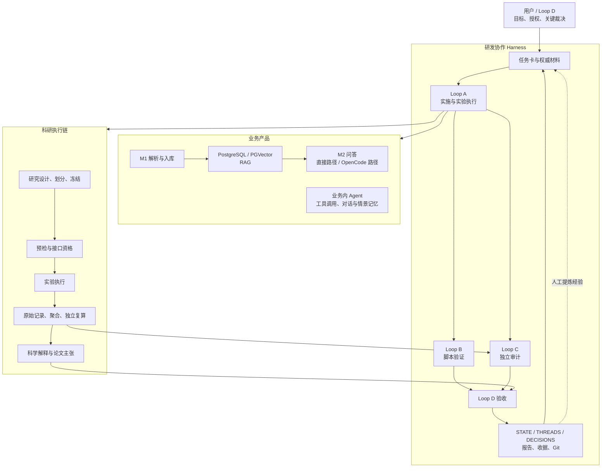
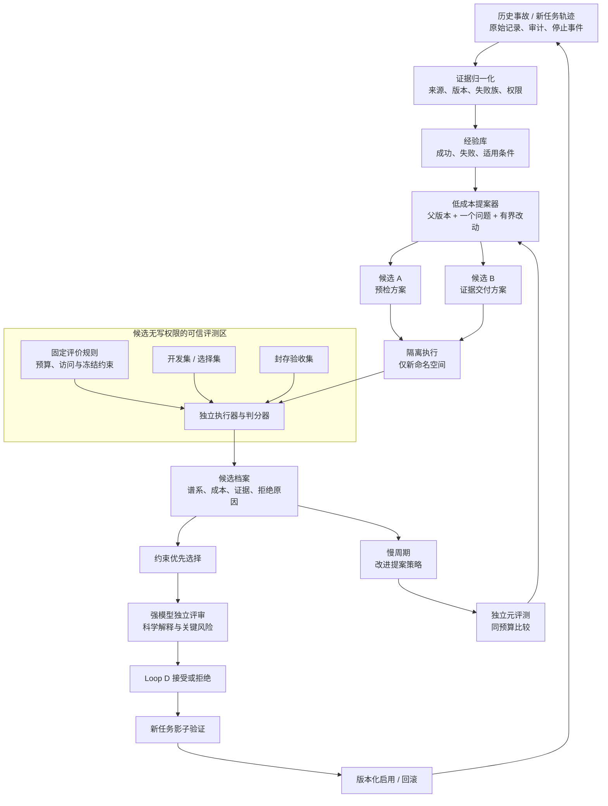
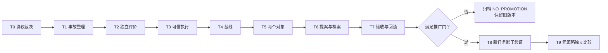

**建议把首轮 RSI 定义为“科研可靠性改进器”：利用历史失败，持续改进实验预检与证据交付流程。首批只改进两个对象——运行链路预检方案、证据到结论的交付方案。**

你已经具备 A/B/C/D 分工、冻结节点、独立审计、预检和证据绑定。真正需要补齐的是：**把失败转化为独立回归案例，把候选改进与旧版本公平比较，再让通过验证的版本成为下一轮起点。**

本次只读取了笔记、项目文档、相关代码、测试及事故记录，没有修改文件、运行实验或访问项目模型端点。以下现状基于本地仓库 `7406b3c` 附近的快照；GB10 当前运行状态未核验。笔记作为方法参考，其中的效果数字不作为本项目收益预测。

---

**一、决策者摘要**

| 项目 | 建议 |
|---|---|
| 首要目标 | 减少正式实验中的可预防工程失败，以及证据完整但科学解释不成立的交付 |
| 首批对象 | ① 实验链路预检方案；② 证据、验证层级与主张的交付方案 |
| 实施方式 | 复用现有 Graph Loop，增加小型候选档案、独立挑战集和版本选择机制 |
| 执行分工 | 低成本模型整理案例、生成候选、实现和运行；确定性程序判分；强模型只做评审与关键设计裁决 |
| 首要风险 | 改进器与评测器共享错误假设，制造“更容易通过”的验证体系 |
| 第一项工作 | 从已有事故提取独立案例，测出旧流程能发现什么、漏掉什么；暂不生成优化方案 |
| 成功标准 | 新版本发现更多真实缺陷，同时不增加合法任务误拦，证据可独立复算、版本可回滚 |
| 首轮规模 | 建议 8–12 个执行人日、最多 4 个候选；这是规划估算，不是已验证工期 |
| 适用边界 | 小步离线试点；已关闭实验只作历史案例；正式接入新实验另有任务授权 |

**可靠的负结果、正确的停止决策，都属于有效科研产出。不能把“实验跑通率”“正结果数量”或“审计 PASS 数量”作为 RSI 的主要奖励。**

---

**二、项目现状：已有闭环，但还没有统一的自改进机制**

项目实际包含业务产品、业务内 Agent、科研实验和研发协作四个部分。

图中是职责关系，不代表这些步骤已经全自动串联。当前 `graph_orchestrator.sh` 主要实际启动 B；A/C 有独立启动器，仍依赖有界派发与验收。

最影响 RSI 设计的证据如下。

| 已核实的事实 | 对规划的意义 |
|---|---|
| 已有六级验证语义，从 `UNIT_PASS` 到 `FORMAL_RUN_PASS` | 复用现有等级，不另造一套互相竞争的 PASS 体系 |
| `formal_experiment_preflight.py` 检查绑定、接口声明、数量及资格摘要 | 它是收据校验器，单独执行它不能证明真实调用链确实运行过 |
| WP-2 bridge 离线测试使用了与组件相同的参数顺序，实际调用约定不同，线上资格失败 | 必须由调用方契约驱动集成验证，避免实现与测试共享同一错误 |
| FinQA 数字可复算，但最终解释为 `MEASUREMENT_OBJECT_MISMATCH` | 工程完整性与科学有效性必须分开验收 |
| 已有摘要复算守卫、claim/evidence 哈希校验 | 可复用机械证据能力，但哈希一致不等于主张成立 |
| 已有失败复盘、状态文件与审计收据 | 缺的主要是统一关联、效果归因和下一轮版本选择 |
| 业务情景记忆已实现相似度召回 | 不能直接视为科研优化经验库，更没有证据证明已实现效用学习 |

主要依据：

- [架构与执行边界地图](D:/AIRcommend/JinRongAgents/agents_final_tech/docs/architecture/codebase_map.md)
- [现有正式实验预检规范](D:/AIRcommend/JinRongAgents/agents_final_tech/docs/governance/FORMAL_EXPERIMENT_PREFLIGHT_V1.md)
- [预检资格摘要校验实现](D:/AIRcommend/JinRongAgents/agents_final_tech/scripts/graph/formal_experiment_preflight.py:336)
- [bridge 离线调用代码](D:/AIRcommend/JinRongAgents/agents_final_tech/research/tatqa_wp0_2026/wp2/bridge_v2/offline_qualification.py:266)及[独立事故审计](D:/AIRcommend/JinRongAgents/agents_final_tech/research/tatqa_wp0_2026/wp2/LOOP_C_S4C_QUAL_AUDIT_v1.md)
- [FinQA 测量对象错位结论](D:/AIRcommend/JinRongAgents/agents_final_tech/docs/research/finqa_v2_measurement_object_mismatch_autopsy_v1.md)
- [摘要复算守卫](D:/AIRcommend/JinRongAgents/agents_final_tech/scripts/graph/hooks/summary_recompute_guard.py)

特别需要保留一个现状边界：**WP-2 S4 已记录永久停止。此次 RSI 规划不构成恢复它的依据。**

---

**三、六步闭环的断点诊断**

| RSI 环节 | 已有基础 | 当前断点 | 本轮补齐方式 |
|---|---|---|---|
| What：改什么 | 任务卡、冻结边界、模块划分 | “harness 改进”容易扩散到实验设计、判据和实现同时修改 | 每个候选只修改一个对象，冻结评价标准 |
| Generate：如何提案 | 事故复盘、审计意见、skills | 经验主要靠当前会话手工转述，重复失败缺乏统一匹配 | 建立带来源与适用范围的失败案例库 |
| Evaluate：如何判断 | 测试、预检、复算、C 审计 | 组件与测试可能同源；工程通过可能被扩大为科学通过 | 独立挑战集＋真实调用边界＋科学解释单独审查 |
| Select：选哪个 | D 验收与 Git 历史 | 缺少同预算、同案例、同环境的候选比较 | 冻结基线、配对回放、约束优先的选择规则 |
| Persist：固化什么 | 收据、报告、Git、状态文件 | 父版本、提案、失败原因、评测与部署状态未统一关联 | 内容寻址的候选档案，失败也入档 |
| Recurse：如何复利 | skill 修订与复盘 | 尚未发现统一的“下一轮使用哪个父代、哪些失败经验、怎样改进提案器”的执行机制 | 快速改产物、慢速改提案策略，分别评测 |

这里的“缺少”指本次检查范围内没有发现完整统一机制，不是声称整个仓库没有相关探索。

---

**四、首批改进对象与选型**

首轮选择两个范围有限、可用历史证据验证的对象。

| 候选 | 预期收益 | 成本估计 | 主要风险 | 回滚方式 | 验证指标 / 结论 |
|---|---|---:|---|---|---|
| **A. 运行链路预检方案** | 在正式实验前发现接口、元数据、绑定域和调用路径缺陷 | 2–3 人日，依赖公共底座 | 预检仍模拟错路径；合法实验被误拦 | 恢复上一版预检配置；候选先不接正式链 | 缺陷检出、合法样例误拦、真实接口覆盖；**首选** |
| **B. 证据到结论的交付方案** | 减少证据缺失、PASS 越级、旧结果冒充新结果、主张超范围 | 1–2 人日，依赖公共底座 | 把文本齐全误当科学有效 | 切回旧模板及验证配置；保留所有收据 | 证据覆盖、数字复算、越级拦截、待审事项遗漏；**首选** |
| 通用 Skill 库优化 | 可能改善执行习惯 | 中，需大量跨任务评测 | 改动面大，难归因，容易增加上下文 | 可版本回退，安装态另需核验 | 本轮只允许两个对象的局部策略，不做全库优化 |
| MemRL 式记忆效用排序 | 可能减少重复错误 | 中；先要有可信反馈与归因 | 把任务难度、模型差异误记为记忆效果 | 停用效用排序 | 后续比较同任务配对效果；暂缓 |
| 工作流代码开放式演化 | 长期可能发现新编排方式 | 高 | 评价器污染、权限扩张、复杂度增长 | 多组件回滚困难 | 等前两项形成可靠评测后再讨论 |
| 权重更新 | 与本轮痛点关联较弱 | 高 | 遗忘、数据与训练混杂 | 模型版本回退 | 不纳入本轮 |

方法上建议取三类机制：

- **SkillOpt：**小幅编辑、验证后接受、保留失败反馈、慢速更新优化策略。[官方项目](https://microsoft.github.io/SkillOpt/)
- **DGM：**保存父子谱系和失败分支，区分“值得存档”与“可以启用”。其报告也记录了伪造测试日志和修改检测机制的奖励投机。[原始报告入口](https://sakana.ai/dgm/)
- **AlphaEvolve：**用程序化评测约束候选搜索；本项目只借用机制，不引入完整平台。[原论文](https://arxiv.org/abs/2506.13131)

这些机制的组合是针对本项目的设计建议，不是对原方法效果的直接迁移承诺。

---

**五、目标架构：一个可信评测底座，两个可演化对象**

**1. 哪些内容可以改**

首轮候选只允许改变：

- A：预检步骤组合、顺序、已登记探针的选用、必需证据的收集方案。
- B：证据组装规则、缺失项识别、交付提示和结构化输出方案。

首轮不允许候选任意生成并执行 shell 命令。探针通过可信底座中登记的操作 ID 调用。

**不可自动修改：**

- 评价器、封存集、预期标签、评分规则；
- 科学假设、主要指标、划分、排除规则、统计计划；
- 冻结材料、历史原始记录、停止状态；
- 预算、网络权限、正式实验授权；
- 全局 skill 分发和现役项目规则。

后续若需要新增探针实现，它作为独立工程变更评审，不能由被评候选同时改变测试答案。

**2. 复用现有能力**

| 现有资产 | 复用方式 |
|---|---|
| 正式实验预检器 | 作为特定协议的校验插件，保留其作用域 |
| summary-recompute-guard | 复算机器可读取的摘要字段 |
| claim/evidence 校验 | 校验既有证据引用与内容绑定 |
| repository receipt | 提供 Git、测试和跨主机身份依据 |
| A/C launcher | 承载未来获批的执行和独立审计 |
| STATE / THREADS / DECISIONS | 分别继续管理现状、未决事项和裁决 |

**不直接修改旧 FinQA 专用校验器，使它“泛化适配所有研究”。**新增适配层首先保持旧协议可重现，再显式声明新协议支持范围。

**3. 最小记录契约**

以下字段必须机器校验；缺字段不能默认为通过。

| 记录 | 必须包含 |
|---|---|
| `episode` | 来源实验/事故、原始证据哈希、失败族、发现阶段、环境、适用范围、独立审计指针 |
| `candidate` | 候选 ID、父版本、目标对象、修改理由、改动清单、生成策略版本、模型配置身份 |
| `evaluation` | 候选哈希、案例集版本、评价器版本、逐例结果、成本、实际运行级别、未验证面 |
| `decision` | 接受/拒绝/需评审、原因、评审证据、启用范围、回滚版本 |
| `lesson` | 哪种条件下哪种修改有效或无效、支持它的案例、失效条件、来源候选 |

原始字节哈希与规范化哈希必须命名区分。哈希用于身份核对，**不能独自证明记录真实执行过**；执行事实来自独立执行器的事件和产物。

---

**六、评价设计：先证明“发现了问题”，再证明“值得采用”**

**6.1 将验收拆成三个独立维度**

| 维度 | 回答的问题 | 判定来源 |
|---|---|---|
| 执行完整性 | 是否按冻结版本和实际调用约定执行？ | 确定性检查、调用轨迹、原始记录 |
| 测量有效性 | 干预是否影响被测对象？指标与结论是否对应？ | 结构化证据＋独立科学评审 |
| 主张边界 | 允许报告什么？哪些内容仍未验证？ | 证据类型映射＋作者级裁决 |

沿用现有 `UNIT_PASS` 等层级，但增加各维度独立状态。

例如 WP-2 那次收尾应保留：

- 实验资格：`FAIL_FINAL`；
- 停止处置审计：通过；
- 后续实验：未执行；
- 科学效果：未获得证据。

不能压缩成一个“总体 PASS”。

**6.2 首批挑战案例**

| 失败族 | 缺陷案例 | 必须同时存在的合法对照 |
|---|---|---|
| 真实调用边界 | 参数顺序错误、调用方缺字段、测试复制实现假设 | 使用同一真实接口的正确实现 |
| 证据身份 | raw/normalized 混用、旧版本收据配新代码 | 明确命名并正确绑定的多种哈希域 |
| 完整性与预算 | 原始响应缺失、覆盖旧记录、失败请求漏计 | HTTP 失败但证据和计数完整 |
| 数据与统计 | 同源样本跨划分、分母漂移、静默排除 | 冻结规则下的合法划分与排除 |
| 测量对象 | 干预源字段却未重算下游测量对象 | 因果链明确且实际重算的案例 |
| 交付与权限 | 局部 PASS 越级、无审计来源、STOP 后续跑 | 合法负结果、正确停止、明确待审的交付 |

这些案例不能只检查“有没有写某一句话”。例如调用边界案例必须执行接口；测量对象案例必须提供干预与观测的关联证据。

建议起步规模：

- 开发集：24 例；
- 选择集：24 例；
- 封存验收集：24 例；
- 每组覆盖六个失败族，并包含缺陷与合法对照。

这是**工程挑战集**，不是天然分布样本。它可以证明已知失效模式的防御能力，不能据此声称真实科研失败率降低某个百分比。

同一事故及其改写版本必须放在同一组。封存集由独立评测角色保管；改个文件名或随机种子不算独立样本。

**6.3 指标与选择规则**

先过硬门，再比较收益：

| 指标 | 定义 | 首轮建议门槛 |
|---|---|---|
| 严重缺陷漏检 | 冻结的严重缺陷案例被放行 | 0 |
| 合法案例误拦 | 明确合法的案例被阻断或无依据送审 | 不高于基线 |
| 证据完整率 | 实际可验证必需证据 / 应有证据 | 100% |
| 主张越级 | 将低层级验证扩大为高层级结论 | 0 |
| 原始记录完整性 | 原始记录缺失、覆盖、身份漂移 | 0 |
| 预算完整性 | 许可外调用、失败请求漏计、自动重试漏计 | 0 |
| 验证成本 | 同案例的耗时、调用量、token | 完整记录；优先采用成本不增加的版本 |

候选排序采用明确的顺序：

1. 硬门全部满足；
2. 缺陷检出更好；
3. 合法案例误拦更少；
4. 待审负担更低；
5. 同等质量下成本更低。

首轮推广候选还应满足：选择集上至少修复两个原先漏检案例、无新增回归；只让一个选定候选访问封存集一次。若基线没有可修复漏检，则转入同质量降成本比较，不能为了产生“提升”削弱基线。

封存验收失败后，本轮不针对失败细节反复调参再测同一封存集。

**6.4 防止“全部拦截”**

评价器输出至少区分：

- `ALLOW_WITHIN_SCOPE`：满足当前工程资格；
- `BLOCK`：存在已证实的缺陷；
- `REVIEW_REQUIRED`：涉及必须独立裁决的科学问题。

评价集为每个案例冻结预期类别。把所有案例送审也不是成功：不必要的送审计入误判和人工负担。

工程资格通过仍不能自动授予正式实验权限。

---

**七、如何真正实现递归，以及怎样控制风险**

**快速循环：改进两个交付对象**

每轮最多两个候选；每个候选一个目标对象、一个失败机制，最多修改三个策略条目。先跑开发与选择评测，通过后才可能启用。失败候选保留原因和适用范围。

下一轮必须记录上一轮采用的父版本；不能继续使用旧模板却声称继承了改进。

**慢速循环：改进“怎么提出候选”**

累计至少八份有独立评价的候选记录后，才评估一次元策略更新。可改：

- 哪类失败优先处理；
- 选取哪些经验进入上下文；
- 如何避免已失败的修复路线；
- 何时停止无收益的候选生成。

元策略的评测对象是**等预算下提出的候选质量**，不是优化建议文本是否好看。新旧策略在独立问题批次上各生成相同数量候选，比较可接受改进数量、回归和成本。

评价器、硬门和授权规则不参与这个自动递归过程。它们若需升级，另走独立版本评审，跨评价器版本不得直接比较分数。

**主要护栏及其工程代价**

| 机制 | 预期收益 | 成本 | 风险与限制 | 回滚性 | 自动验证 |
|---|---|---|---|---|---|
| 候选与评测区权限隔离 | 防候选修改标签、伪造通过或读取封存题 | 中 | 同账号的普通目录分离不构成隔离 | 停用候选执行入口 | 越权写入、读取封存集和未授权网络均被拒绝 |
| 独立执行与追加式证据 | 降低自报 PASS、覆盖原始记录的风险 | 中 | 哈希链仍不能防有权限者重写整个链 | 回滚代码，保留历史事件 | 重复 ID、覆盖、缺失原始记录立即失败 |
| 固定小改动预算 | 提高归因能力，降低组合回归 | 低 | 复杂问题可能需要拆分更多轮 | 回到父版本 | 单对象、条目数和改动范围机器检查 |
| 失败缓冲区 | 减少重复修复和遗忘停止条件 | 低 | 错误经验可能被过度泛化 | 禁用该经验版本 | 每条经验必须有来源和适用条件 |
| 影子运行与版本启用 | 验证实际新任务效果 | 中 | 历史挑战集未覆盖的缺陷仍可能出现 | 原子切回上一版本 | 不匹配则停用候选，历史证据不变 |
| 元策略慢更新 | 让改进方法逐步积累经验 | 中 | 优化器可能过拟合少量事故 | 恢复旧元策略 | 同预算、独立问题批次配对比较 |

首轮模型调用预算建议设为：**最多四次候选提案、三次强模型评审；提案与评审合计输入不超过 120k token、输出不超过 24k token；业务模型、judge、训练调用均为零。**

这是未来 RSI 试点运行的建议预算，不包含实施代码时各执行对话的消耗，也不是本次已经消耗的预算。若工具不能可靠计量，状态为预算能力未就绪，不得用估计值宣称满足硬上限。

---

**八、可直接拆给执行者的任务单**

以下均为未来任务，当前没有创建这些文件。

建议把试点集中在：

`D:/AIRcommend/JinRongAgents/agents_final_tech/research/harness_rsi_v1/`

目录分为 `contracts`、`cases`、`kernel`、`adapters`、`recipes`、`archive`、`reports`。封存集在评测身份独享的位置管理，不随候选工作区挂载。

所有任务共同遵守：

- 只写任务指定的新试点目录；
- 历史实验只读，不补写历史收据、不重算冻结科学结论；
- 原始敏感材料只保留受控指针，案例使用脱敏或合成内容；
- 不启动现役 Loop B：其默认流程包含真实 API 检查；
- 不修改现役启动器、skill 安装、生产服务或现有冻结件；
- 产物注明 `PILOT / NOT_SCIENTIFIC_RESULT`；
- 以下验收名称是**待实现接口契约**，不是现有可执行命令。

| ID / 执行者 | 目标与输入 | 产出物 | 可自动断言的验收标准 | 依赖 / 复杂度 |
|---|---|---|---|---|
| **T0：关键设计裁决**；强模型评审，D 确认 | 根据本规划与现有冻结规则确定作用域、严重缺陷清单、比较规则 | `contracts/protocol_v1.json`、`contracts/authority_map.json` | schema 完整；两个目标唯一；预算非空；保护路径明确；所有权威路径有哈希；没有含糊的裸 `PASS` | 无 / 中；约半日 |
| **T1：事故案例整理**；便宜模型 | 读取 FinQA、WP-2、摘要守卫及派发复盘 | `cases/incidents.jsonl`、开发案例、覆盖矩阵 | 每个案例有来源和失败族；同源事故不跨组；每族有合法对照；不复制私有正文；缺证据项标记未核验 | T0 / 中；1 日 |
| **T2：独立评价协议与案例**；便宜模型构建，强模型评审标签 | 使用 T0 的协议，独立设计选择与封存案例 | 评价器、预期结果、分组清单、冻结清单 | 全拦截、全放行、全送审三个退化策略均无法通过；缺失、空集、篡改均失败；封存案例对提案身份不可读 | T0、T1 / 高；1–2 日 |
| **T3：可信执行与证据记录**；便宜模型 | 接入隔离能力、冻结规则、预算契约 | `kernel/runner`、事件记录器、预算控制、权限测试 | 重复 run ID 拒绝；崩溃保留已有记录并标 INCOMPLETE；越界写入/网络被拦；候选不能覆盖评测结果；计数单调不减 | T0、T2 / 高；1–2 日 |
| **T4：现有工具适配与基线**；便宜模型 | 读取现有预检、摘要和证据校验工具，建立只读适配 | `adapters`、基线 recipe、`reports/baseline.json` | 基线对象与环境身份齐全；每个检查说明支持范围；缺失运行环境报未验证；同输入重复执行判定一致；不产生旧实验输出 | T1–T3 / 中；1 日 |
| **T5：两个候选对象实现**；便宜模型 | 使用基线与开发失败轨迹 | 预检 recipe、证据交付 recipe、变更清单 | 每候选只改一个对象；引用已登记操作；必需旧保护不减少；真实调用边界由调用方测试触发；伪造摘要不被接受 | T4 / 中；1–2 日 |
| **T6：有界提案与版本档案**；便宜模型 | 使用候选协议、失败经验与父版本 | 提案入口、候选 manifest、失败缓冲、版本选择器 | 超过候选/条目/token 上限即停；每个候选可定位父版本、差异、评测；失败候选不启用；相同输入的机械选择一致 | T3–T5 / 中；1 日 |
| **T7：首轮独立验收与回滚演练**；便宜模型执行，强模型评审 | 同环境配对基线与候选；选择集选定一个候选 | `reports/pilot_acceptance.json`、独立审计、回滚收据 | 满足第六节所有硬门；封存集只访问一次；候选不改善则输出 `NO_PROMOTION`；回滚后行为与父版本一致；旧证据哈希不变 | T6 / 中；1 日 |
| **T8：新任务影子接入**；便宜模型，D 决定启用 | 仅针对未来新获批任务，使用 T7 通过版本 | 影子对比报告、版本启用记录 | 新旧版本观察同一份材料，不增加实验模型调用；至少三个新任务记录完整；误放行/误拦/额外开销逐项报告；任何严重回归停用 | T7＋新任务授权 / 中；另排 |
| **T9：元策略比较**；便宜模型生成，强模型裁决 | 至少八份独立评测候选档案 | 新旧提案策略、配对比较与采纳决策 | 同问题批次、同生成预算、同评价器；无严重回归；没有收益就保留旧策略；不得修改评价器提高自身分数 | T8＋足够档案 / 高；2–3 日另排 |

其中 T2 与 T5 必须保持职责隔离：**实现者可以开发候选，但不能依据封存集答案来修候选。**若人员只有一位，可以通过不同执行身份和评测访问控制实现，不能仅依赖“请勿查看”的提示词。

执行图如下：

---

**九、里程碑与停止条件**

| 里程碑 | 应交付的可验证结果 | 不可扩大解释 |
|---|---|---|
| M0：基线成立 | 六类事故可定位；评价器能拒绝退化策略；旧流程分数可复现 | 不能声称 RSI 已有效 |
| M1：离线闭环成立 | 候选生成、评测、拒绝/接受、谱系和回滚完整运行 | 不能声称改善真实科研成功率 |
| M2：实际流程有效 | 至少三个新任务影子验证；发现收益且未引入严重回归 | 小样本不能支持广泛效果结论 |
| M3：递归改进成立 | 提案策略的新版本经过同预算独立比较，并被下一轮实际使用 | 仅写一份“优化经验”不算递归收益 |

停止规则建议固定为：

- 触碰评价器、封存集、冻结实验或权限边界：立即拒绝候选。
- 同族基础设施失败连续两次：停止该批，单独诊断，不消耗更多候选机会。
- 四个候选没有可验证净收益：结束试点并保留 `NO_PROMOTION`。
- 缺少隔离、可靠计数或真实调用链证据：保留局部验证级别，不升级为完整资格。
- 历史案例足以修复具体缺陷，却不足以支持自动选择：先交付确定性修复能力，递归阶段延后。

**第一张执行卡应只覆盖 T0–T1：确定评价契约，整理事故和合法对照，建立改进前基线。**它的交付标准是“已有错误能否被独立重现和判定”，这会决定后续 RSI 是否值得继续投入。