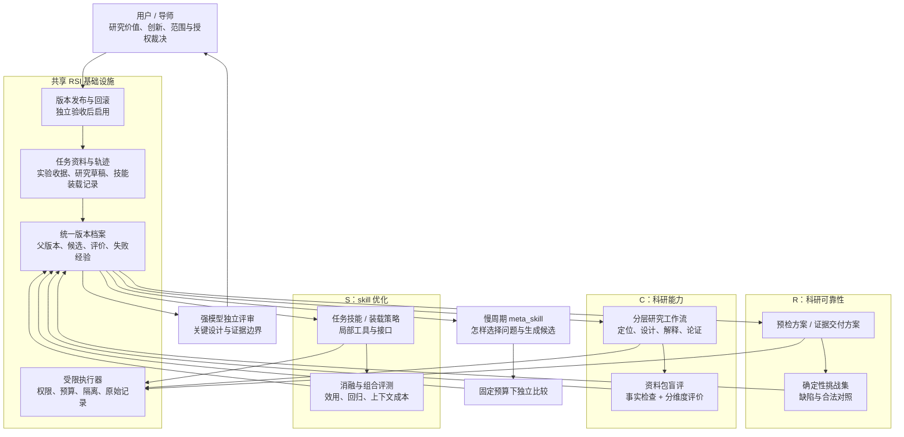
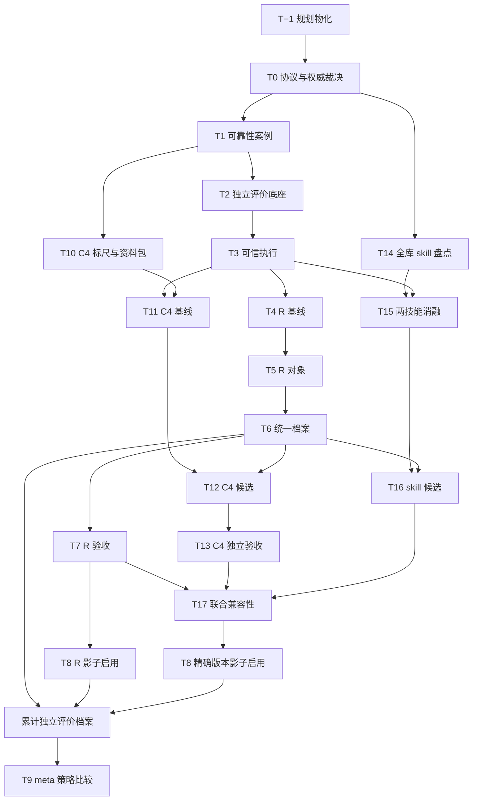

**本轮增补建议：保留首轮“科研可靠性改进器”，扩展为三条共享基础设施、分别验收的 RSI 方向：可靠性、科研能力、skill 优化。**

其中，**科研能力决定要改进什么，skill 优化负责把有效方法固化为可复用资产，可靠性闭环保证改进证据可信。**三者不能共用一个总分，也不能把同一项改进重复计算为三份收益。

以下是对首轮规划的增补与修订，记为**规划版本 v2**。本轮没有创建文件、修改代码、运行实验或恢复任何已停止分支。文件清单和任务卡均为后续执行者的创建规格。

---

**一、更新后的决策者摘要**

| 方向 | 目标 | 首批范围 | 主要验收依据 |
|---|---|---|---|
| **R：科研可靠性** | 减少可预防实验失败、证据缺失和错误交付 | 保留原预检方案、证据交付方案两个对象 | 缺陷检出、合法案例误拦、证据完整性、验证成本 |
| **C：科研能力** | 提升研究问题、设计、解释和论证的质量 | 先做结果分析与解释，再做文献定位；其余分层推进 | 固定资料包下的配对盲评、事实核验、人类判断 |
| **S：skill 优化** | 提高技能组合的实际效用，控制上下文和维护成本 | 全库盘点；先优化两个任务型 skill 及其装载组合 | 同任务消融、组合交互、跨任务回归、实际 token 成本 |

**推荐顺序**

1. 将两轮规划物化为可校验的文件与独立任务卡。
2. 建好可靠性底座；同时完成全局 skill 盘点和科研评价标尺设计。
3. 试点一个科研能力层、两个 skill，分别评价。
4. 对各自通过的改进做组合验证，再用于新任务。
5. 积累足够候选档案后，才更新改进器的 `meta_skill`。

**共享设施：**任务身份、权限与预算、版本档案、执行记录、案例隔离、回滚和验收状态机。

**必须分开：**评价目标、案例集、评分规则、人类裁决、推广范围。

**首要风险：**系统学会迎合评审语言、增加引用和检查项，却没有改善研究判断；或通过删减困难任务获得更高分。

**第一步：**执行新增 **T−1「规划物化」**，只创建规划、协议草案和任务卡，所有执行权限默认关闭。随后推进 T0 与 T14，不立即改写全库技能。

**预期投入：**首轮可靠性仍按原估算 8–12 人日；新增一个科研层及两个 skill 的试点，建议另留 5–8 人日和约 1–2 小时人类评审时间。均为规划估算，不承诺论文录用或方法创新。

---

**二、总体架构增补：共享基础设施，分开证明收益**

这里不增加第五个组织角色：A 继续执行，B 承担确定性检查，C 独立评审，D 与用户负责取舍和启用。

新增两个重要边界：

- **科研能力改进是本项目的生产能力建设。**除非未来另行设计研究，它不自动成为大论文的实验证据或创新贡献。
- **skill 是科研能力的实现载体之一。**同一个候选可以同时具有 `capability_layer=C4` 和 `artifact_type=skill`，但只有一个候选 ID、一份成本和一条谱系。

项目现有[大论文架构](D:/AIRcommend/JinRongAgents/agents_final_tech/docs/research/THESIS_RESEARCH_ARCHITECTURE_v3.md)已明确区分反馈资格、未来效用与持续适应，并保留方法创新待识别的边界。本轮沿用这一判断，不以新 RSI 规划替代现有研究裁决。

---

**三、新增章：科研能力的分层提升**

这里的“能力”指**模型与 harness 在研究任务上的实际表现**。单次文稿变好，只能证明该次产出改善；只有在未参与优化的新问题上仍然有效，才可称为相应能力的提升。

**3.1 六个能力层及其改进对象**

| 层 | 改进对象与标准产物 | 可自动检查的代理指标 | 必须保留的人类判断 |
|---|---|---|---|
| **C1 研究问题与贡献定位** | 问题筛选工作流、反证式提问模板；产出“问题—最近邻—差异—必要证据—退出条件”卡 | 研究问题与证据需求是否对应；假设是否可被反驳；是否存在未处理的强简单基线 | 问题是否值得研究；创新是否实质；学位要求是否满足 |
| **C2 文献与相关工作定位** | 检索与证据提取流程、比较矩阵、来源核验工具 | 引用真实性；论断是否获原文支持；冻结参考池中关键邻居的覆盖；比较维度是否一致 | 检索边界是否合理；最近邻是否选对；差异是否足够重要 |
| **C3 实验设计与统计推断** | 实验设计模板、统计检查工具、预算与信息公平性检查 | 划分泄漏；独立单位；指标与问题对应；基线公平；不确定性和多重比较规则完整性 | 识别策略是否成立；对照是否充分；精度是否足以回答问题 |
| **C4 结果分析与解释** | 结果解释工作流、竞争解释模板、下一项判别实验建议 | 数字引用准确；事实/解释分离；替代解释是否被证据区分；零结果、等价与证据不足是否混淆 | 解释是否可信；机制是否被识别；下一步是否值得投入 |
| **C5 写作与论证结构** | 论证提纲、段落规划、算法说明与写作 skill | 主张—证据映射；术语与数字一致；冗余；章节间依赖；修改是否改变科学含义 | 故事是否重要且连贯；贡献表达是否准确；读者能否理解 |
| **C6 审稿视角与研究取舍** | 独立审查提示、反对意见分类、回应与修订模板 | 重大缺陷检出；误报；意见是否指向证据和可执行修订；反例是否处理 | 哪些问题阻断投稿；哪些局限可接受；投稿与路线取舍 |

以下指标**不单独作为科研能力奖励**：字数、引用数、建议数量、发现的问题数量、术语复杂度、模型给出的“创新分”。

例如 C6 若按“找到多少问题”奖励，会鼓励无依据挑错；必须同时记录漏检和误报。

**3.2 分层收益、成本与回滚**

成本为共享底座建立后，单层首轮试点的增量估算。

| 层 | 预期收益 | 成本 | 主要风险 | 回滚与验证 |
|---|---|---:|---|---|
| C1 | 更早排除缺乏必要性或不可识别的选题 | 2–3 人日＋导师判断 | 把已有工作包装成新颖表述 | 恢复旧流程；检查新问题上的定位盲评 |
| C2 | 减少最近邻遗漏和无效差异 | 1–2 人日 | 参考池不完整导致虚假覆盖率 | 恢复检索/比较版本；核验来源支持和邻居选择 |
| C3 | 提高实验的信息量与可解释性 | 2–3 人日 | 完整模板掩盖错误识别策略 | 恢复设计模板；独立检查识别与预算公平 |
| C4 | 从结果中提取更可靠的判断和下一步 | 1–2 人日 | 事后编造机制、过度解释负结果 | 恢复分析流程；配对盲评与解释反例检查 |
| C5 | 降低论证断裂和无效写作返工 | 1–2 人日 | 文风提升被误计为科学提升 | 恢复 skill；科学含义不变检查＋结构盲评 |
| C6 | 提前发现高价值审稿风险 | 1–2 人日 | 审稿器偏好被优化器迎合 | 冻结独立审稿版本；缺陷检出和误报双评 |

**启动顺序：C4 → C2 → C3/C1 → C5；C6 的独立评审能力从第一天使用，C6 自身的优化最后开展。**

理由是：

- 当前已有 FinQA 测量错位、负结果解释等高价值案例，C4 最容易建立有根据的首验。
- 最近邻与方法必要性直接影响大论文下一步，C2 随后推进。
- 写作技能已较成熟，当前边际收益未必高于研究判断。
- 正在优化研究产出的同时，不能又修改评审它的标准。

这不是六层全部开工的排期。**首批只激活 C4；通过或停止后，再裁决 C2。**

**3.3 “好论文难以标量化”的具体处理**

采用三层评价，避免压成一个“论文质量总分”。

**第一层：不可补偿的事实与可靠性门**

引用伪造、数字错误、泄漏、误报实验执行、违反停止状态等，直接拒绝。表达优秀不能抵消这些问题。

**第二层：分维度、带证据的评价**

每层选择 3–5 个维度，使用统一的四档锚点：

| 档位 | 含义 |
|---|---|
| 0 | 错误、缺失，或会导致错误决定 |
| 1 | 提到了，但未建立证据或无法执行 |
| 2 | 基本成立，有明确边界，可用于下一步 |
| 3 | 成立且处理关键反例，明显改善研究判断 |

每个评分必须附产物片段和理由。只给数字的评审无效。

C4 的示例维度为：事实准确、竞争解释、因果边界、下一步判别价值。C5 的语言流畅度不能代替这些维度。

**第三层：盲评与人类裁决**

- 相同资料包、相同执行模型、相同输出长度和工具预算，比较旧版与候选。
- 随机隐藏版本标签和展示顺序；保存原始判断。
- 强模型负责证据核验和独立评审，不直接决定选题价值或创新成立。
- 用户/导师裁决科学价值、创新、关键识别假设、投稿资格和学位充分性。
- 人类尚未评审，状态为 `PENDING_HUMAN_REVIEW`，不自动升级。

首层 C4 建议采用 **12 个独立资料包：开发、选择、封存各 4 个**，每种配置重复两次。已被当前对话详细分析的 FinQA/WP-2 案例只能进入开发或校准材料，不能伪装成未见封存题。

初始推广规则建议：

1. 事实与可靠性硬门全部通过。
2. 选择集上，多数独立资料包获得明确偏好，关键维度无实质退步。
3. 封存集只验证选定的一个候选；至少 3/4 资料包获最终评审偏好，关键维度无实质回归。
4. 小样本结论仅允许“该层在限定任务上的试点改善”，不得宣称一般科研能力提升。
5. 分歧无法解决、资料包不独立或收益不稳：`NO_PROMOTION`。

上述数量与阈值是待 T0/T10 冻结的**试点决策规则**，不是统计显著性保证。正式比较前可以裁决修改，看到结果后不得补改。

**3.4 与可靠性闭环共享什么**

| 设施 | 共享程度 |
|---|---|
| 候选、父版本、模型配置、成本、原始产物 | 完全共享记录格式 |
| 权限、冻结保护、预算、回滚 | 完全共享 |
| 案例划分与封存机制 | 共享机制，分别维护案例 |
| 原始证据校验 | 复用 R 的能力 |
| 科研评分与人工判断 | C 独立维护 |
| 正式实验权限 | 不继承；能力评测通过不授予实验权限 |

---

**四、新增章：全局 skill 库自进化**

**重新评估后的结论：纳入全局规划，但采用“全库观察、局部改动、按任务退出”的方式。**

仓库最近的[第二轮合并评估](D:/AIRcommend/JinRongAgents/agents_final_tech/docs/experiments/2026-10-13_skill_merge_round2_assessment.md)明确建议零新合并；[技能路由规则](D:/AIRcommend/JinRongAgents/agents_final_tech/docs/SKILL_ROUTING.md)也已保留多个合理分工。因此，不能把“目录更少”当成本轮目标。

**4.1 三种状态分开管理**

1. **仓库资产状态：**版本化 source of truth，保留历史。
2. **机器安装状态：**是否分发到指定 harness，版本是否一致。
3. **单任务装载状态：**本次真正进入上下文的 skill 和引用内容。

退出首先发生在第三层。**不装载，不等于删除，也不等于全局弃用。**

全局扫描覆盖仓库技能及其已声明分发关系；个人目录、插件自带技能只作必要的安装身份核验，不由本项目优化器直接改写。

**4.2 SkillOpt 与 SkillSmith 的结合**

采用以下分工：

- **SkillOpt 部分：**轨迹驱动的小幅文本修改、选择集门控、失败编辑缓冲、优化器侧经验。[官方机制说明](https://microsoft.github.io/SkillOpt/)
- **SkillSmith 部分：**考虑技能组合效应与上下文成本，采用有类型的工具操作和有版本范围的失败约束。[论文 v2](https://arxiv.org/html/2606.01314v2)

本项目先采用可审计的小规模消融。贝叶斯效用估计与组合模型在样本足够后再加入，不直接实现整套生态动力学。

`task_skill` 与 `meta_skill` 明确分离：

| 对象 | 内容 | 谁读取 | 更新依据 |
|---|---|---|---|
| 任务 skill | 怎样完成定位、解释、写作等任务 | 执行模型 | 任务层评测 |
| `meta_skill` | 怎样选改进问题、提出小改动、利用失败经验 | 提案器 | 同预算提案质量比较 |
| 失败缓冲 | 哪个修改在何种版本与条件下失败 | 提案器按需检索 | 独立评价记录 |

失败缓冲不能无限注入任务上下文，也不能把一次失败写成永久禁令。

**4.3 首轮允许与禁止范围**

**首轮允许：**

- 对全库建立元数据、引用、依赖、装载与成本清单。
- 在候选隔离区试改两个任务型技能：
  - [research-writing-skill](D:/AIRcommend/JinRongAgents/agents_final_tech/skills/research-writing-skill/SKILL.md)
  - [algorithm-description](D:/AIRcommend/JinRongAgents/agents_final_tech/skills/algorithm-description/SKILL.md)
- 修改其任务步骤、例子、按需引用内容与试点装载组合。
- 只对新试点工具进行有界的实现修补。
- 在新实验配置中测试停用某个可选技能。

**首轮禁止自动修改：**

- 研究评测器及其使用的冻结审稿技能；
- `graph-loop-rules`、授权与冻结规则、评价协议；
- 全局 skill 路由立法件、注册表、分发脚本；
- 已明确保持独立的技能分工；
- 正式科学结论与历史实验；
- 现役生产工具接口、个人技能目录、插件内置资产。

C4 的试点先使用局部研究工作流。即使它借鉴 `experiment-autopsy`，也不自动修改该高引用技能。

**4.4 改动预算与四类操作**

每批最多两个候选；普通候选最多改变两个 skill、三个语义条目。文本增删合计不超过目标快照的 15%，且单候选最多 600 token。超限则拆分任务或另行裁决，不能以格式整理绕过预算。

| 操作 | 本项目含义 | 启用阶段 | 必需验证 |
|---|---|---|---|
| **PATCH** | 修工具实现，保持输入输出接口 | 首轮仅限试点工具；已有工具另审 | 失败调用复现、接口回归 |
| **RETYPE** | 改工具签名，并更新所有调用方 | 第二阶段 | 依赖闭包完整、无旧签名残留、原子启用与回滚 |
| **EXTRACT** | 将已验证的重复确定性逻辑提取为工具 | 第二阶段，至少两个真实使用点 | 行为等价、实际总上下文成本下降、维护收益 |
| **INLINE** | 把不再值得共享的逻辑放回调用方 | 第二阶段 | 调用方行为保持、依赖清理、成本比较 |

这里四个名称对应**工具生命周期操作**；自然语言 skill 的普通增删替换另记为 `TEXT_EDIT`，避免混淆。

本项目的 `INLINE` 退出是停用接口、保留历史版本，不物理删除需要保留的审计材料。原子修改包若必须改三个以上调用方，不能为满足“两 skill”预算遗漏调用方，应进入扩围评审。

**4.5 如何评价 skill 价值**

先对两个可选技能做四种组合：

- 都不装；
- 只装 A；
- 只装 B；
- A 与 B 同装。

任务、执行模型、资料和预算固定，顺序随机，至少覆盖两类任务。这样可以识别单件贡献、互补和干扰。

观测向量为：

`任务质量、关键错误、误触发/漏触发、装载 token、额外调用、完成成本`

不以“被调用次数”直接表示价值。低频可能意味着专用技能，不意味着无用。

首轮退出规则：

- 证据不足：`UNASSESSED`，保留。
- 两批独立任务中没有观察到增益、且成本更高：进入 `COLD`，退出试点默认装载。
- 在某类任务有益：保留该类路由，不扩展为全局常备。
- 明确回归：停用对应版本。
- 全局 `DEPRECATED`：必须经过跨适用任务复核和 D 裁决，保留目录与历史。

两批无增益只支持保守装载决策，不证明技能普遍无效。

**4.6 防止上下文膨胀**

继续遵守单任务最多五个主装 skill；同时测量真实渲染后的 token。

新增约束：

- 只装当前任务需要的 reference，不整目录加载。
- 红线必须保留，并计入实际成本。
- 同等质量下，新版本装载成本不高于旧版本。
- 如需增加上下文，必须单独证明边际收益，不能默认为免费。
- `meta_skill`、完整失败缓冲与所有历史候选不进入任务执行上下文。

**4.7 新科研 skill 如何进入全局库**

采用固定路径：

**局部工作流 → 独立能力评测 → 多任务复用证据 → 判断是否归入现有 skill → 必要时新增 skill → 注册与受控分发。**

新增技能必须满足：

1. 至少两类任务存在复用需求；
2. 与已有技能职责不重复；
3. 有明确触发和不触发条件；
4. 进入上下文后的净收益可验证；
5. 有维护者、回滚版本和退出条件。

不能“一层科研能力创建一个 skill”，也不能“一次成功分析创建一个 skill”。

**4.8 本方向的收益与风险**

| 建议 | 预期收益 | 成本 | 风险 | 回滚 / 指标 |
|---|---|---|---|---|
| 全库盘点、局部优化 | 避免遗漏依赖，又限制影响面 | 约 1 日盘点 | 静态信息被误当运行价值 | 只读盘点无需行为回滚；看身份与依赖覆盖 |
| 两技能组合消融 | 识别无效装载及组合冲突 | 1–2 日＋有限模型调用 | 小样本误判 | 恢复装载配置；质量与成本配对比较 |
| 小幅文本更新 | 降低回归、便于归因 | 1–2 日 | 只迎合已知题型 | 恢复父版本；未见任务评价 |
| 按任务进入冷状态 | 控制上下文成本 | 低 | 误伤稀有技能 | 单配置恢复；适用任务回归 |
| 工具与技能原子演化 | 减少重复逻辑和接口不一致 | 第二阶段 2–4 日/包 | 依赖更新不完整 | 整包回滚；依赖闭包与端到端验证 |

---

**五、评价契约 T0 的修订设计**

原 `protocol` 与 `authority_map` 保留，内容升级为 v2。新增字段而不改变历史评价结果。

**5.1 `protocol.json` 必须包含**

| 字段组 | 内容 |
|---|---|
| 身份 | `schema_version=2`、协议 ID、状态、冻结时间、内容哈希 |
| 方向 | R/C/S 的对象、作用域、允许改动、禁止改动 |
| 评价 | 案例版本、划分、比较单位、重复次数、评价器版本 |
| 决策 | 各方向硬门、质量维度、推广条件、`NO_PROMOTION` 条件 |
| 人类裁决 | 哪些事项必须由谁裁决；未裁决时的状态 |
| 预算 | 候选数、模型请求、输入输出 token、时间、失败与重试计数 |
| 权限 | 可读写范围、网络、服务、Git、分发权限 |
| 联合验证 | 多方向同时启用时的组合验证要求 |
| 变更 | 协议升级规则、跨版本分数不可直接比较规则 |

**5.2 `authority_map.json` 必须包含**

每条权威记录至少有：

`authority_id、scope、absolute_path、raw_sha256、hash_domain、owner、status、supersedes、allowed_use`

关键规定：

- 继续引用现役 STATE、THREADS 和研究裁决，不复制成新的全项目真相。
- RSI 自身的协议和验收有独立作用域。
- 内容变化使依赖卡进入 `STALE_INPUT`，不能悄悄刷新哈希。
- 当前事实的读取时间与内容版本分开记录，不能只看文档标题日期。
- 未知路径或哈希保持 `UNRESOLVED`；执行卡未解决前不能激活。

**5.3 增加三类档案字段**

- 科研：`capability_layer、source_packet_id、rubric_version、blind_review、human_decision`
- 技能：`skill_versions、loaded_resources、rendered_tokens、operation_type、dependency_closure`
- 归因：`candidate_id、bundle_id、primary_endpoint、secondary_endpoints、shared_evaluation_refs`

同一次评价可被多个报告引用，但不能多次计入样本数或成本收益。

**5.4 状态分为三条轴**

| 轴 | 状态示例 |
|---|---|
| 执行状态 | `PLANNED / RUNNING / DELIVERED / FAILED / STOPPED` |
| 验收状态 | `UNREVIEWED / ACCEPTED / REJECTED / PENDING_HUMAN_REVIEW` |
| 启用状态 | `NOT_ENABLED / SHADOW / ACTIVE / ROLLED_BACK` |

`DELIVERED` 不等于 `ACCEPTED`；`ACCEPTED` 不等于 `ACTIVE`。

---

**六、全部规划的落盘结构与内容设计**

统一根目录：

`D:/AIRcommend/JinRongAgents/agents_final_tech/research/harness_rsi_v1/`

以下均为**计划创建**的文件。表中的目录是绝对路径；文件名列精确指定该目录内的文件。T−1 必须在生成的任务卡中将全部输入输出展开为绝对路径。

| 绝对目录 | 文件名 | 内容大纲 / 权威职责 |
|---|---|---|
| `D:/AIRcommend/JinRongAgents/agents_final_tech/research/harness_rsi_v1/` | `README.md` | 最短入口、当前协议指针、如何选卡、读写边界 |
| 同上 | `MASTER_PLAN.md` | 首轮可靠性原案＋本轮两章增补＋共享架构＋任务与里程碑；标明哪些尚未授权 |
| 同上 | `REVISION_LOG.md` | v1→v2 的逐项变化、依据、保留项；不承担实时状态 |
| `D:/AIRcommend/JinRongAgents/agents_final_tech/research/harness_rsi_v1/sources/` | `planning_round1.md`、`planning_round2.md` | 用户提供的两轮规划原文，保留来源身份，不改写成历史执行事实 |
| `D:/AIRcommend/JinRongAgents/agents_final_tech/research/harness_rsi_v1/contracts/` | `protocol.json`、`authority_map.json` | 上一节所定义的评价与权威契约 |
| 同上 | `schemas.json` | task、candidate、evaluation、receipt、decision、lesson 的必需字段与枚举 |
| 同上 | `budget_profiles.json` | 分阶段请求、token、时间预算及计数规则 |
| 同上 | `execution_policy.md` | 独立卡执行、冻结、封存、网络、Git、安装与停止规则 |
| `D:/AIRcommend/JinRongAgents/agents_final_tech/research/harness_rsi_v1/evaluation/` | `reliability_spec.md` | 原六类挑战、合法对照、硬门、基线 |
| 同上 | `capability_rubrics.json` | C1–C6 分维度锚点；首批 C4 的冻结配置 |
| 同上 | `human_review_protocol.md` | 盲化、校准、分歧、作者裁决、待审状态 |
| 同上 | `skill_value_spec.md` | 装载消融、组合交互、退出与成本计算 |
| 同上 | `split_registry.json` | 案例身份、同源分组、用途、访问角色；不包含封存答案 |
| `D:/AIRcommend/JinRongAgents/agents_final_tech/research/harness_rsi_v1/catalog/` | `skills.json`、`dependency_graph.json` | 版本、职责、保护状态、引用、调用方、安装证据 |
| `D:/AIRcommend/JinRongAgents/agents_final_tech/research/harness_rsi_v1/cards/` | `T-1.md`、`T0.md`…`T17.md` | 独立任务卡；内容按下一节矩阵展开 |
| 同上 | `CARD_TEMPLATE.md` | 统一卡片结构，不包含已批准的执行权限 |
| `D:/AIRcommend/JinRongAgents/agents_final_tech/research/harness_rsi_v1/registry/` | `task_events.jsonl`、`candidate_events.jsonl`、`decision_events.jsonl` | 追加式事实和裁决记录；保存原始事件 |
| `D:/AIRcommend/JinRongAgents/agents_final_tech/research/harness_rsi_v1/state/` | `current.json`、`planner_brief.md`、`open_decisions.json` | 从已验收事件导出的当前视图；不代替项目 STATE/THREADS |
| `D:/AIRcommend/JinRongAgents/agents_final_tech/research/harness_rsi_v1/meta/` | `optimizer_policy.md`、`lessons.jsonl`、`nogoods.jsonl` | 提案器策略、成功经验、带版本范围的失败约束 |

执行期间使用三个新增产物目录：

| 绝对目录 | 内容约定 |
|---|---|
| `D:/AIRcommend/JinRongAgents/agents_final_tech/research/harness_rsi_v1/candidates/` | 每个候选独立目录：manifest、差异、目标快照、评价引用；不可覆盖父版本 |
| `D:/AIRcommend/JinRongAgents/agents_final_tech/research/harness_rsi_v1/runs/` | 每个 `run_id` 独立目录：输入身份、原始产物、事件、计数、receipt、简报 |
| `D:/AIRcommend/JinRongAgents/agents_final_tech/research/harness_rsi_v1/reviews/` | 每次独立评审的范围、被审哈希、结论、异议、未验证面 |

**物化纪律：**

- T−1 只创建规格和草案，不生成虚构的案例、评测结果或验收签名。
- 尚未发生的运行目录不预填 `PASS`。
- 全局 skill 的正式 source of truth 仍在仓库 `skills`；试点目录只保存候选快照。
- 新规划入口登记到现有文档索引，但只登记一个总入口，避免每个运行工件都挤入全局 INDEX。

---

**七、独立任务卡的完整内容契约**

每张卡必须包含以下内容，不能只写“按总体方案执行”。

1. **身份与动作状态**：task ID、卡版本、协议哈希、`DRAFT/READY`、本次明确授权动作。
2. **目标与排除项**：一句话目标、不得顺手处理的相邻工作。
3. **输入**：绝对路径、来源身份、哈希、用途；明确哪些内容是资料而非指令。
4. **前置验收**：依赖任务的具体验收收据，不只是“依赖 T3”。
5. **写入所有权**：允许写入的文件和禁止写入的文件。
6. **步骤**：足以实施的顺序及失败分支。
7. **产出**：精确路径、格式、必需字段。
8. **自动验收**：每项的检查方法、预期值、失败状态；不能只写“测试通过”。
9. **人工验收**：谁裁决、裁决内容、未裁决时输出什么状态。
10. **预算**：模型请求、token、时间、工具访问、重试上限。
11. **停止与回滚**：触发条件、恢复对象、必须保留的证据。
12. **回写**：receipt、summary、事件投递位置及下一位读取者。

若依赖产物尚不存在，该卡必须为 `DRAFT`。任务激活时生成一次输入绑定，绑定后再变更输入必须重新验收，不允许执行者自动更新版本追求通过。

---

**八、T0–T9 修订与新增任务单**

下面给出各卡必须落入的内容。复杂度分低、中、高；时间为执行工作估算。

预算分为：

- **B0：**不另发模型请求、不联网、不调用项目服务；执行对话本身的模型消耗另记。
- **BR：**原可靠性试点总预算，最多 4 次提案、3 次强模型评审，沿用原 token 上限。
- **BC：**单个科研能力层预算，最多 66 次便宜模型请求、8 次强模型评审。
- **BS：**两技能试点预算，最多 106 次便宜模型请求、4 次强模型评审。
- **发布/元策略：**另列，不从已关闭实验预算继承。

BC/BS 为上限，不是必须用满；失败、重试均计数。建议便宜模型单请求上限为输入 16k、输出 4k token；强模型评审为输入 32k、输出 6k。T0 可在运行前收紧，不能事后放宽。

**8.1 保留任务：职责不推倒，只补充三方向支持**

| 卡 | 目标、输入 → 产出 | 自动验收增补 | 档位 / 依赖 / 预算 |
|---|---|---|---|
| **T−1 规划物化** | 两轮规划原文 → 文件骨架、完整主规划、19 张独立卡、协议草案 | 原文保留；卡字段齐全；路径闭合；无虚构哈希/PASS；所有执行授权关闭 | 便宜；低；无依赖；B0；0.5–1 日 |
| **T0 协议裁决** | 规划、现役权威材料 → protocol、authority_map、预算 | R/C/S 分开评价；人类裁决明确；未知项阻止激活；权威引用可核验 | 便宜整理＋强评审；中；T−1；BR 中 1 次强评审；0.5 日 |
| **T1 事故案例** | 历史事故 → 原可靠性案例与来源分组 | 原要求保留；已公开复盘案例不得进入科研封存集 | 便宜；中；T0；B0；1 日 |
| **T2 独立评价底座** | 协议、案例 → R 评价器＋C/S 插件接口 | 全拦截/全放行无法通过；评分器不可由候选改写；不同方向无总分合并 | 便宜＋强评审；高；T1；BR 中 1 次强评审；1–2 日 |
| **T3 可信执行记录** | 协议 → 隔离、预算、原始记录机制 | 模型调用与确定性执行分账；输入和模型身份齐全；重复 run ID 拒绝 | 便宜；高；T2；B0；1–2 日 |
| **T4 可靠性基线** | 现有检查工具 → 原 R 基线和适配器 | 不扩张旧检查器作用域；检查结果注明实际验证级别 | 便宜；中；T3；B0；1 日 |
| **T5 可靠性两个对象** | 基线失败 → 预检与交付候选接口 | 保留单对象预算；不得修改 C/S 评价规则 | 便宜；中；T4；B0；1–2 日 |
| **T6 候选与档案** | 三方向契约 → 统一候选、失败缓冲、谱系 | 一个候选一个身份；跨方向共享证据不重复计数；支持 bundle 回滚 | 便宜；中；T5；BR 中最多 4 次提案；1 日 |
| **T7 可靠性验收** | R 候选 → 原独立验收与回滚收据 | 原硬门全部保留；R 通过不宣称 C/S 有效 | 便宜＋强评审；中；T6；BR 中 1 次强评审；1 日 |
| **T8 受控影子与启用** | 某方向验收包 → 三个新任务影子记录、启用或拒绝 | 只启用被审版本；科学结果不回写旧实验；技能发布核对 repo/安装/装载三态 | 便宜执行、D 裁决；中；T7；联合启用另依赖 T17；每包最多 6 次便宜＋2 次强评审 |
| **T9 元策略更新** | ≥8 份独立候选评价 → 新旧 meta 策略比较 | 各方向分层报告；同预算比较；不改评测器；没有收益保留旧策略 | 便宜提案＋强裁决；高；T6＋足够已审档案；独立批次最多 12 次便宜＋2 次强评审 |

T8 可以先承接原 R 版本，不必等待所有扩展任务完成。T9 同样按有足够证据的方向激活，不要求凑齐三方向。

**8.2 科研能力新增卡**

| 卡 | 目标、输入 → 产出 | 自动验收与人工门 | 档位 / 依赖 / 预算 |
|---|---|---|---|
| **T10 科研标尺与资料包** | 六层定义、现有研究边界 → 六层 rubric、首批 C4 的 12 个独立包、盲评协议 | 来源分组无交叉；资料包包含事实依据与允许主张；评审锚点完整。强模型评审，人类确认关键判断 | 便宜构建＋强评审；高；T0、T1；BC 中最多 2 次强评审；1–2 日 |
| **T11 科研能力基线** | C4 冻结包、旧工作流 → 基线产物与能力画像 | 12 包×2 次运行身份完整；选择/封存产物不向提案器泄露；重复不计作独立问题 | 便宜；中；T3、T10；BC 中 24 次便宜请求；0.5–1 日 |
| **T12 科研候选生成** | 开发包与开发失败 → 最多两个局部工作流候选 | 单层、固定模型、固定资料；每次改变一个机制；开发成本有界；不直接注册新 skill | 便宜；中；T6、T11；BC 中 18 次便宜请求，其中提案最多 2 次；1 日 |
| **T13 科研独立验收** | 候选、选择/封存包 → 分维度盲评、人工裁决包 | 选择后只送一个候选入封存；事实硬门通过；按预定偏好规则决定；无裁决保持待审 | 便宜运行＋强评审＋用户裁决；高；T12；BC 中 24 次便宜、6 次强评审；1 日＋人工时间 |

BC 的 66 次请求由 T11/T12/T13 合计得出。C2 如后续启动，重新建立独立批次、资料包和预算，不自动复用 C4 的结论。

**8.3 全局 skill 优化新增卡**

| 卡 | 目标、输入 → 产出 | 自动验收与人工门 | 档位 / 依赖 / 预算 |
|---|---|---|---|
| **T14 全库身份与边界盘点** | 仓库 skills、路由、分发表、既有审计 → catalog、依赖图、保护清单、两技能试点清单 | 每项有身份与作用域；安装状态缺证据记 UNKNOWN；不修改安装；已有独立分工不自动合并 | 便宜；中；T0；B0；1 日 |
| **T15 装载价值与组合消融** | 两技能、六个开发探针任务 → 四组合消融、成本与交互记录 | 四配置×六任务×两次；模型/资料/预算一致；无技能方案仍保留安全约束；不外推全库效用 | 便宜；中；T3、T14；BS 中 48 次便宜请求；1 日 |
| **T16 小幅更新与退出提案** | 消融、开发轨迹、失败缓冲 → 最多两个技能/装载候选、退出建议 | 改动预算满足；调用方完整；失败约束有版本范围；候选只写隔离区；无证据不弃用 | 便宜＋强评审；高；T6、T15；BS 中最多 26 次便宜、2 次强评审；1–2 日 |
| **T17 联合兼容性验收** | 已分别接受的 R/C/S 版本 → 组合报告和精确发布包 | 固定 R；比较旧C旧S、新C旧S、旧C新S、新C新S；四个未见任务×两次；无负交互才联合启用 | 便宜＋强评审；高；T7、T13、T16；BS 中 32 次便宜、2 次强评审；1 日 |

T15 的机械探针用于判断路由、接口和可核验质量。无法自动判定的科学质量，必须进入 T13/T17 的独立评审，不能用静态检查代替。

若 C 与 S 修改的是同一段技能，T17 不构造虚假的两个独立因素：将其合为一个 bundle，与父版本比较，并明确不分摊单独贡献。

**8.4 更新后的执行依赖图**

该图表示依赖，不要求同时派发多个模型。按一位执行者顺序推进也成立。

---

**九、执行对话的文件流转协议**

**9.1 一轮执行必须读取什么**

不要求便宜模型通读总体规划。每轮固定读取：

1. 现役仓库 AGENTS 指定的必要规则与当前边界；
2. 本次独立任务卡；
3. 卡片绑定的 `protocol.json` 与相关 authority 条目；
4. 卡片列出的输入文件和依赖验收收据。

`MASTER_PLAN.md` 仅在目标冲突或卡片不完整时读取。所有卡必须自带本任务需要的方案内容。

执行对话引用示例：

> 执行  
> `D:/AIRcommend/JinRongAgents/agents_final_tech/research/harness_rsi_v1/cards/T11.md`。  
> 仅执行该卡已激活范围，先核对输入身份和依赖验收；不自动进入下一张卡。将结果写入本卡规定的独立 run 目录。若卡为 DRAFT、输入漂移或预算不可计量，提交明确的停止收据。

这段约定用于未来执行，不改变本轮只规划的边界。

**9.2 执行者回写什么**

每次运行至少交付：

- `receipt.json`：输入/输出身份、实际动作、请求与 token、验证结果、停止原因、未验证面；
- `summary.md`：结论、证据指针、下一步所需决定，控制在约一页；
- `artifacts_manifest.json`：所有正式产物与哈希；
- `events.jsonl`：实际执行事件；
- 原始输出和错误记录。

执行者可以声明 `DELIVERED`，不能自行写成独立验收通过。

**9.3 谁更新当前状态**

- 独立评审记录绑定被审产物的具体哈希。
- 收口器只从已验收事件生成状态视图。
- 人工修改状态文本不能替代缺失的验收事件。
- 项目级开放决定仍进入现有 THREADS；RSI 的 `open_decisions.json` 只记录本试点范围并引用对应项目决定。

**9.4 下一轮规划者读取什么**

默认只读：

1. `state/planner_brief.md`
2. `state/current.json`
3. `state/open_decisions.json`
4. 自上次规划以来的验收与拒绝记录；
5. 涉及关键异常时，再读取对应原始运行包。

`planner_brief.md` 必须包含：三方向当前状态、实际预算、已接受版本、拒绝原因分布、评价器变化、重大分歧、下一项待裁决事项。

禁止把整个历史库自动塞进规划上下文。

---

**十、里程碑与停止条件更新**

| 里程碑 | 可验收结果 | 允许的结论 |
|---|---|---|
| **M0 规划可执行** | 文件与任务卡齐全；协议、人类裁决和输入身份明确 | 可以派发指定卡 |
| **M1 共享底座可信** | 原可靠性验收通过；档案、预算、隔离可用；skill 盘点完成 | 可以开展限定的能力与技能试点 |
| **M2 单层能力有证据** | C4 在未见资料包上通过独立评价，或诚实得到 NO_PROMOTION | 限定任务上的能力改善或未证实 |
| **M3 技能组合有证据** | 两技能消融、局部改动、成本和回归完整 | 指定任务的装载/版本选择 |
| **M4 组合可使用** | 联合兼容性通过；三个新任务影子记录完整 | 可在指定范围启用精确版本 |
| **M5 改进器确有改进** | meta 策略在独立批次、等预算下带来更优候选 | 限定范围内的递归收益 |

新增停止条件：

- **科研评价不可校准：**校准案例的通过/不通过判定与人类锚点一致率低于预定要求，暂停用模型评分决定推广。
- **事实更差但文风更好：**拒绝候选。
- **换模型、换资料、加预算才提升：**不能归因为 skill 或工作流改善，需重新设计对照。
- **封存信息进入提案上下文：**该封存集失效；不通过换名继续使用。
- **技能价值证据不足：**保留 `UNASSESSED`，不为精简数量而删除。
- **组合后出现回归：**各单件验收保留，但禁止联合启用。
- **评价标准被同时优化：**停止该比较，分离版本后重建基线。
- **达到预算仍无收益：**以 `NO_PROMOTION` 结束，保留失败档案。
- **需要修改冻结实验或恢复停止分支：**本批到此结束，不能以 RSI 名义越过原边界。

NO_PROMOTION 是有效决策，但不能被报告为能力提升。

---

**十一、对首轮判断的明确修订清单**

| 首轮判断 | 本轮处理 |
|---|---|
| 首轮只做科研可靠性 | **扩展：**增加科研能力和全局 skill 两条方向；R 主线不返工 |
| 全局 skill 优化暂缓 | **修订：**全库盘点立即纳入；行为优化先限制两个技能，再按证据扩展 |
| 主要依赖确定性挑战集 | **补充：**科研质量采用分维度盲评、人类锚定和独立资料包 |
| 每候选只改一个对象 | **保留为默认；增加例外：**接口迁移必须按完整依赖闭包形成原子包 |
| 每轮改动规模受限 | **保留并具体化：**条目、token、对象与工具操作分别计量 |
| 原模型调用预算 | **保留 R 预算；另增 BC/BS。**不得混用或继承已关闭实验额度 |
| 改进器慢周期递归 | **保留：**先积累独立评价，再改 meta_skill；三方向分开判断 |
| 已有素材可作为评价输入 | **收紧：**已读过、已复盘的素材仅作开发/校准，不能充当未见封存集 |
| Git 和报告构成档案基础 | **补强：**增加独立验收事件，分离交付、接受和启用 |
| 不碰冻结结论、不恢复停止状态 | **完全保持** |
| NO_PROMOTION 是合法结局 | **完全保持** |
| 强模型只做评审与关键裁决 | **完全保持** |
| 当前对话只规划、不写实现 | **完全保持；本轮也未创建规划文件** |

**下一张最合适的执行卡是 T−1。**它只把已认可的两轮规划转成可引用文件与协议草案；后续模型拿到单张卡即可执行，不需要重新解释整套 RSI 架构。