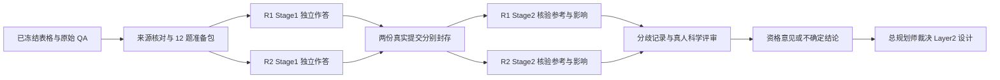

# Paper E task-gold qualification — 人工标注准备包

日期：2026-10-15（Asia/Shanghai）。当前状态：MATERIALS_READY_AWAITING_HUMANS，非科学结果；材料检查见 VALIDATION_REPORT.json。

## 本轮目标与边界

用户授权总规划师裁决并构建人工标注材料。批准：读取/复制已存在的研究数据、建立可追溯诊断样本、准备独立人工标注表与指南。用途首先是 Paper E 升级资格核验；通过后才讨论大论文复用。

禁止：伪造人工意见或签名，修改冻结稿/旧实验，重跑 v4，启动 Layer-2、模型/judge/训练/生产端点调用。SSH/SCP 仅用于取回现有静态文件，不是零网络；不修改远端。

完成条件：材料可读、来源与哈希可核对、问题与表格精确关联、标注者看不到 checker/v4 标签、人工字段留空、缺口显式记录、给 Loop D 可直接使用的交接指令。

停止条件：来源哈希不符、任务关联无法验证、必需证据缺失、覆盖不足。保留缺口，不补造材料，不由模型代填人工 gold。

原始数据与派生数据保留本地，不随文档默认提交。尚未完成任何人工裁决。

## 已构建内容

5 份真实源数据（来源表、全注入表、注入映射、TAT-QA train/dev 原始 QA）和 2 份原获取回执已静态取回。59/59 候选条目可精确关联原始表；首批 12 个真实问题来自 12 张表，四个输入结构层各 3 个。3 张入选表存在多个表头改动，按整表条件判断，不作单列归因。

没有生成真人意见、gold 标签、验收签名或实验指标。官方答案属于原始参考材料，不是本轮人工结论。报告级来源 ID 与 upstream commit 尚未解决，不伪造。

## 协调者阅读顺序

1. [总规划师裁决与协议](DECISION_AND_PROTOCOL.md)
2. [协调操作约定](COORDINATOR_RUNBOOK.md)
3. [标注指南](ANNOTATOR_GUIDE.md)
4. [来源清单](SOURCE_MANIFEST.json)、[准备回执](PREPARATION_RECEIPT.json)、[验证报告](VALIDATION_REPORT.json)
5. [可直接发给 Loop D 的 prompt](LOOP_D_PROMPT.md)
6. [未决项](OPEN_ITEMS.md)

## 文件布局

| 路径 | 内容与访问者 |
|---|---|
| raw/ | 5 份原始数据、2 份既有获取回执；只供协调者 |
| coordinator/ | 59 条输入清单、选择规则、12 题来源与变化定位、空人员表/封存日志；不得随 Stage1 发放 |
| packets/ | 两阶段完整 JSON；只供协调者 |
| exports/R1_stage1/、R2_stage1/ | 每人独立材料：HTML、JSON、指南、空白 CSV/JSON 表单；第一阶段仅发各自目录 |
| exports/R1_stage2/、R2_stage2/ | 原表与官方参考；两人 Stage1 封存后分别发放 |
| annotations/ | 空白分歧/仲裁表与资格状态模板；后续另存真人结果 |
| submissions/ | 收到真人原文件后才建立，不预填，不覆盖 |
| PREPARE_MATERIALS.py | 本次机械整理源码，不运行模型或判标签；拒绝覆盖已有 packets，不需重跑 |
| VERIFY_MATERIALS.py | 本地材料一致性检查，不是独立科学审计 |
| PACKAGE_MANIFEST.json | 交付时静态文件的真实 SHA256 清单；人工填表后原件须另存，不回写准备版清单 |

两阶段各有 12 行，2 人合计 48 行阶段表单；对应 12 个独立表格任务，不能按 48 个样本分析。

当前数据仅在本地，未提交/推送/上传 GB10。目录分离是发放规则，不是权限隔离；必须只把正确阶段导出包发给对应人。整个包不宜给盲态标注者。

## 来源署名

TAT-QA：Fengbin Zhu 等，来源 https://github.com/NExTplusplus/TAT-QA 。按项目已核查的许可记录，数据为 CC BY 4.0；本项目增加表头扰动、诊断抽样与表单。原作者不背书本包。具体引用、哈希与上游版本缺口见 SOURCE_MANIFEST.json；本轮不执行公开发布。

本次使用 paper-review-check、jinrong-docs-sync 做科学边界与索引整理，并按 graph-loop-rules 保留冻结边界、verify-before-done 核对材料。仅执行本地定点材料检查，不运行生产测试或端点探测。
