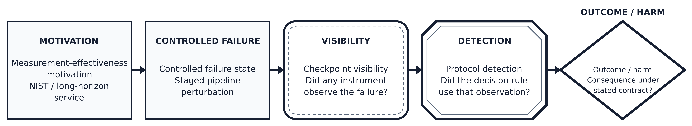

Author names: TBD_OWNER
Affiliations: TBD_OWNER
Corresponding author and contact: TBD_OWNER

## Abstract

**Purpose.** We audit whether reported evaluation scores distinguish observed defects from silent absorption and whether evidence-ranking conclusions survive implementation choices.

**Methods.** We audit three evaluation constructions: a frozen staged document evaluator with controlled header perturbations, instrumentation and a nested FinQA measurement-object probe; FinRank, a public provenance-sensitive evidence-ranking benchmark; and a public retrieval benchmark scored with its own released judgements and metric definitions. We inspect visibility, detection, harmfulness, score algebra, tie policy, identity construction, cutoff choice, and reproduction.

**Results.** In the staged case, at the checkpoint-level evidence surface 96/118 header injections are visible, the OCR-like family is unobserved on the frozen surface (0/13), and flat versus layered scores are affine/rank-equivalent. Explicit instrumentation explains stage separation, while clean-only calibration does not identify a deployment threshold. In FinRank, tie policy changes absolute metrics but preserves the hard-versus-random direction; a post-hoc text-sha1 correction finds 442 overlapping hard-negative occurrences across 305 records and gold loss in 33 records. In-record and pairwise values reproduce exactly, but global and metadata-filtered drift remains unexplained. In the retrieval case a query-level bootstrap separates only three of ten system pairs on one subset and four of ten on another, the reported ordering of near-tied systems is not supported, and changing the cutoff or the tie order reorders systems while the headline score moves by 0.0002.

**Conclusion.** The three cases support a bounded review discipline: bind observations to measurement objects, separate score sensitivity from decision stability, preserve identity contracts, and report unresolved reproduction gaps. We do not claim a universal causal theory, formal acceptance, or generalization beyond these cases.

**Keywords:** evaluation validity; staged evaluation; evidence ranking; score sensitivity; reproducibility

## 1 Introduction

Staged document pipelines are usually reduced to final-answer correctness. That score cannot distinguish an observed defect from silent absorption or an unobservable defect, so it can hide whether the evaluation surface is capable of seeing the failures it claims to assess.
We separate six objects: *visibility* (instrument observation), *detection* (predicate consumption under a threshold), *harmfulness* (outcome change under an equivalence contract), *score sensitivity* (absolute metric movement), *decision stability* (survival of the supported decision), and *reproduction gap* (artifact agreement under a stated environment). These are audit bookkeeping terms, not a causal theory. Confounding them turns score movement into protocol sensitivity, non-response into harm, and metric drift into decision reversal. Figure 1 shows the chain.

This paper audits two evaluation constructions. Case 1 is a frozen staged document evaluator with controlled header perturbations and a stage-aligned instrumentation study. It exposes family-dependent visibility, affine/rank score equivalence, a non-identifiable clean calibration point and an instrumentation attribution boundary. Its FinQA program-perturbation probe is nested inside Case 1 and tests only whether the perturbation and detection predicate refer to causally aligned measurement objects. Case 2 is FinRank, a public provenance-sensitive evidence-ranking benchmark. A source-informed implementation audit examines exact tie handling, first-occurrence text/source mapping, random-negative construction and numerical reproduction. FinRank v1 tie metrics and thresholds are preregistered and unchanged; its corrected source-identity branch is explicitly post-hoc v2. The FinRank hardness ordering remains stable under alternative tie policies, while absolute pairwise values and some ranking metrics are contract-sensitive. The same case also narrows a reproducibility claim: in-record and pairwise values reproduce exactly in the audited environment, but global and metadata-filtered values do not reproduce at raw precision and the cause is unresolved.
Our contributions are:

1. A measurement-object separation for visibility, detection and contract-relative harmfulness in the staged evaluator, with deterministic evidence for score-structure and instrumentation identifiability.
2. Bounded external audits of two public evaluation systems: FinRank, where tie policy and identity construction move absolute metrics without changing the qualitative hard-versus-random decision, and a retrieval benchmark, where a cutoff change or a different tie order reorders near-tied systems while the headline score moves by 0.0002.
3. A proposed six-step review checklist for evaluator authors: bind mutation, observation, score, ranking and reported claim to the same measurement object; report tie and identity contracts; and state the numerical tolerance and environment required for reproducibility. This checklist is not a validated universal method.

The accounting is intentionally narrow: there are three counted cases, with FinQA nested inside Case 1; the third audit reuses a public benchmark and its released judgements rather than a new pipeline. MA-CERD and adaptive revalidation are outside this paper and contribute no case or result. The audit does not establish a universal method, a detector ranking, or a general failure rate. Its external value is narrower but concrete: it changes what should be reported and which comparisons can be interpreted before further experiments are commissioned.
Staged evidence and ranking contracts are also relevant to agent evaluators because an agent score can consume outputs from several tools and decision stages; however, neither counted case evaluates an agent system. The transferable object is the measurement discipline, not an empirical claim about agent behavior. Table 1 states, for each over-reading the audit removes, the evidence that removes it and the reading that replaces it.

Table: Table 1. Interpretation corrections exposed by the audit.

| Naive reading | Audit evidence | Correct reading |
|---|---|---|
| Score gap implies better ranking. | Flat and layered scores are affine/rank-equivalent; the gap is threshold placement. | Report score algebra and threshold identifiability. |
| Non-trigger implies harmful blindness. | OCR-like is `0/13` visible; an existing judge calls the cases equivalent. | Non-response is an observation boundary, not harm. |
| Perfect localization comes from hierarchy. | Direct stage leaves match the full vector; non-direct leaves only partially separate. | Explicit instrumentation explains this construction. |
| Metric movement flips the decision. | Absolute values move, but the hardness gap preserves direction. | Separate score sensitivity from decision stability. |
| A deterministic rerun reproduces the benchmark. | Some metrics reproduce; global and metadata values drift. | Bind claims to environment, tolerance and metric scope. |

## 2 Related Work

### 2.1 Measurement validity and construct validity

Meta-evaluation studies whether metrics separate errors from acceptable variants or local contextual corrections [1,2,3,4]; rankings also move with protocol axes, prompts, seeds and target properties [5,6,7]. LLM-judge work reports position, verbosity, self-preference and perturbation effects [8,9], while NIST asks for meaningful measurement and demonstrated construct validity [10,11]. We ask whether the observation surface can see a controlled defect before interpreting metric differences.
Caban and Bean et al. already provide broad validity frameworks and benchmark checklists [12,13]. FinRank separates retrieval, reranking and hard-negative discrimination on a curated passage pool [14]. Our increment is narrower: bind observation surface, score contract, tie order and source identity to the object that a concrete evaluation claims to measure.
In the ICAART proceedings, Jouseau et al. propose an intrinsic data-quality metric, while Bastos Germano et al. expose hidden biases in synthetic vulnerability data and show that bias-aware data changes a detector's measured accuracy [15,16]. This audit does not propose a universal quality metric or retrain a detector. It audits existing measurement contracts and asks which visibility, harm, score and decision statements remain supportable after the observation and identity objects are made explicit.

### 2.2 Testing, oracles, and diagnosability

Mutation and metamorphic testing inject controlled changes [17]; fault reasoning separates reachability, state change and propagation. Process-level evaluation observes intermediate behavior [18,19]. We decompose non-detection into visibility, predicate and outcome mechanisms and audit the checkpoint instrument itself.

### 2.3 Empirical software evaluation and reproducibility audits

RENE work similarly exposes measurement limits: Python-version identification degrades on realistic files [20]; mining tools can disagree sharply on simple repository metrics [21]; test code alone is weak evidence for flakiness [22]; and a replication reverses part of the original symbolic-execution conclusion [23]. Our scope is exactly two constructions with explicit construct boundaries.

## 3 Method

The conceptual core is a three-way audit of visibility, detection, and harmfulness; the hierarchical checkpoint forest is the evidence instrument that makes the audit reproducible.

### 3.1 Evidence instrument: checkpoint forest

We model the pipeline as two checkpoint trees. The parsing tree covers document ingestion, table structure, field mapping, and arithmetic reconciliation. The QA tree covers retrieval grounding, faithfulness, numeric correctness, citation quality, and appropriate refusal. Together the trees contain 12 scored leaves.
The twelve scored nodes are five in the parsing tree (document status, document throughput, table regression, field hit-rate, reconciliation equations) and seven in the QA tree (retrieval contract, faithfulness judge, numeric contract, number grounding, citation judge, refusal judge, refusal contract), per the frozen checkpoint-tree configuration v0.1.0 (listed in the artifact manifest). The visibility audit exercises the parsing-tree leaves whose evidence is the mapping and regression artifacts; under the frozen drop rule (drop = (H_orig − H_inj) × 10, threshold 2.0) only the field hit-rate leaf responds to header drift, while QA-tree leaves keep their frozen evidence and the QA arm is reported separately (12 calls to the same judge). Additional localization value therefore remains unestablished in the current instantiation. The label *Pruned root drop* used in Section 5.2 denotes exactly this operation: the parsing root is collapsed to its single input-responsive leaf (the field hit-rate leaf) and the drop rule above is applied there.
Each leaf receives a score in [0,10]. Contractible properties use deterministic checks; semantic properties use a 0–5 judge score mapped to [0,10]. Sibling weights are normalized locally before bottom-up aggregation. Missing evidence is explicit: the parsing tree assigns 0, whereas the QA tree assigns a neutral 5. Hinge leaves affect the stability verdict, not the missing-evidence score. Every leaf stores its evidence and degradation reason.
For node n with children C(n), the recursive score is:

S(n) = sum over child nodes c in C(n) of [w(c) / sum of w(j) for j in C(n)] × S(c).

For a leaf, S(n) is the mapped contract or judge score. A tree is stable only when at least 90% of its leaves exceed the selected threshold and every hinge leaf scores at least 7. The implementation is deterministic once the evidence artifacts are fixed.

### 3.2 Separating visibility, detection, and harmfulness

Visibility is defined relative to the selected checkpoint evidence surface, whereas protocol detection may use a different downstream signal.
The primary conceptual structure is the visibility-by-detection matrix in Table 2:

Table: Table 2. Visibility-by-detection matrix for an injected defect. Harmfulness is a separate, equivalence-dependent annotation and is not a cell of this matrix.

| Checkpoint evidence | Protocol detects | Protocol does not detect |
|---|---|---|
| Visible | Detected visible defect | Visible but undetected |
| Not visible | Detection through a different signal or predicate | Silently absorbed or unobservable |

Harmfulness is orthogonal to this matrix and is annotated separately as harmful, equivalent, or unresolved under the selected equivalence criterion.
For an injected defect d, visibility and protocol detection are separate observations:

- **Detected:** the selected protocol satisfies its detection predicate, which may test a mapping change or a score threshold.
- **Visible but not detected:** the checkpoint exposes a difference, but the selected protocol does not satisfy its detection predicate.
- **Silently absorbed:** normalization or matching preserves the canonical correspondence, so that the checkpoint does not expose the perturbation.

Harmfulness is a separate, **equivalence-dependent** judgment, not a mutually exclusive visibility outcome: canonical-form preservation and reader-referent recoverability need not agree.
The defect visibility profile reports visibility separately for each family. This preserves information lost by a single mutation score and distinguishes a missing checkpoint from a genuinely robust stage.

### 3.3 Evaluating the evaluator

We compare four protocols on frozen evidence: end-to-end roots, a flat leaf average, hierarchical expert weights, and hierarchical searched weights. We measure table-level detection, injection-level detection, mean separation between clean and perturbed states, worst-family behavior, localization, and evaluation cost. Because raw thresholds can manufacture differences, we separately audit (i) structural score/ranking equivalence and (ii) whether a matched-FPR operating point is identifiable from clean scores alone.
The audit further varies the injection seed, visibility threshold, matching algorithm, and scoring normalization. A semantic-judge arm is evaluated separately and never substituted for deterministic evidence when a contract exists.

### 3.4 Stage-aligned instrumentation and the nested FinQA boundary probe

The evaluation-track instrument is a two-root checkpoint forest whose twelve leaves map deterministic or judge-derived evidence to a 0–10 score (Section 3.1). To test whether stage-aligned instrumentation carries stage information, we preregister a separate controlled study on the same corpus. Each stage contract perturbs one operation: a header token is replaced (mapping stage M), required source blocks are removed from the retrieval bundle (retrieval stage R), or one numeric operand is broken while labels, schema and identity are preserved (numeric stage N). Every cluster contributes three deterministic injections, and each injection is scored on the same twelve-leaf surface, producing a binary response vector; 24 clusters per stage give 72 clusters and 216 injections. The study is frozen before results (hash receipt) and evaluated leave-one-cluster-out. The same document defines the protocol's deliberate boundary: response predicates are written from the stage contracts, so the construction is explicitly instrumented and its separability must be interpreted within that construction.
FinQA is a nested boundary probe inside Case 1, not a separate counted case. Its program-perturbation corpus acts on a step's operator or argument fields while the downstream result fields are not recomputed; the observation objects are visibility (does the injected change appear in the observed source fields), detection (does the frozen detection predicate move), and outcome (does any downstream outcome field change). The execution contract binds artifact hashes before scoring, and no threshold or convention search is permitted. Section 4.5 states the execution boundary; Section 5.6 reports what happened and what it does and does not establish.

### 3.5 External evidence-ranking audit

Case 2 is FinRank at upstream revision `916dc27e77b90e294ea1b3a2cc5b0abcf07392d1`, with arXiv record `2608.07400v1`, 1,185 released records and the official deterministic baseline implementation. The repository license is CC BY-NC 4.0. The audit follows the complete chain: question and source identity, candidate construction, scoring, global and in-record ranking, pairwise comparison, random-negative sampling, metadata filtering and published claims.
The source code exposes two known, source-informed checkpoints before application: pairwise accuracy counts exact ties for the gold (`score(gold) >= score(negative)`), and pooled-corpus passage text is deduplicated in first-occurrence order so the first occurrence supplies metadata. These probes are not presented as prospective discoveries. FinRank v1 fixed the question, tie metrics and materiality thresholds before pair-level outcomes and remains the preregistered application, but its raw-exact identity rule was wrong for FinRank's canonical contamination identity. V2 is a post-hoc deterministic correction to trimmed `text_sha1` identity and a full reanalysis; it is not a second blind application or a wholly frozen application. The v1 tie metrics and thresholds are unchanged in v2.
The audit compares ties-positive, strict-win and half-credit pairwise policies; gold-first and negative-first ordering for exact ties inside each record; forward and reverse corpus ordering for global ranking ties; the seed-42 random-negative draw; and source-identity loss under the metadata filter. Reproducibility is checked against the released result JSON under the declared dependency versions and a second available environment. The application is deterministic and source-informed, not blind.

### 3.6 Independent public system: retrieval evaluation

The third case audits a public retrieval benchmark instead of a bespoke pipeline. The released corpus, queries, relevance judgements and metric definitions are kept; what the audit changes is only the reporting decision built on top of them.

The objects are the same six. The observation surface is the full ranking a retriever produces. The detection predicate is the metric cutoff k, because nDCG@10 credits only positions 1 to 10. The outcome is the reported ordering of systems. Identity is the query-document binding between judgements and corpus. The tie contract is the order among exactly equal scores, which the official scorer leaves unspecified. Reproduction is checked by re-implementing the metrics twice.

Two subsets of the same benchmark family are used: SciFact (5,183 documents, 300 judged test queries, 339 positive pairs) and NFCorpus (3,633 documents, 323 judged test queries, 12,334 positive pairs). Five deterministic systems are compared, four BM25 configurations and a TF-IDF cosine ranker, all rebuilt from the released corpus with no model. Metrics follow the trec_eval definitions used by the official path (ndcg_cut, map_cut, recall); a second independent implementation agrees on 200 checks per subset with zero mismatches. Uncertainty is a query-level bootstrap with 2,000 resamples.

Two systems have a known answer by construction and act as controls: a duplicate of one BM25 configuration, whose scores are identical and whose correct verdict is *indistinguishable*, and a degraded configuration that pushes the top-ranked document below the cutoff, whose correct verdict is *worse*. They give one false-positive and one false-negative probe for any decision rule. The two subsets are two samples of one benchmark family, not two benchmarks, and no model is called.

## 4 Experimental Setup

### 4.1 Corpus and perturbations

The study uses a frozen public tabular base and contains no client data. The seed-42 primary panel covers 95 source tables and 118 synthetic injections across six header-drift families. Schema and header matching are the perturbation carrier here; the object of study is the evaluation protocol's observation boundary. Each injected record preserves its source table, family, seed, changed field, and expected observation surface.
Concretely, the base is the frozen drift-v0 table set derived from public TAT-QA tables (listed in the artifact manifest by content hash); the corpus was frozen before this study's data gates and no new TAT-QA use is introduced. The perturbations are the fully synthetic injection map (listed in the artifact manifest by content hash; deterministic, seed 42, ratio 0.3). The matcher used in the audited pipeline is the greedy header matcher (listed in the artifact manifest); the cross-matcher audit adds greedy-normalized, Hungarian, and Hungarian-normalized configurations. Semantic leaves are scored by the judge pipeline (listed in the artifact manifest), i.e. Qwen3.6-35B-A3B (Q4_K_M GGUF) served locally, with 0–5 dimension scores mapped to [0,10]. The primary threshold grid is:

Γ = {0.2, 0.3, 0.5, 0.7, 0.9}.

The OCR-like family contains 13 single-token, lowercase Levenshtein-distance-one substitutions with unchanged column values. These properties are mechanically recomputed before interpretation.

### 4.2 Baselines and controls

The protocol baselines are end-to-end scoring, flat leaf scoring, and hierarchical scoring with expert weights. Weight-search controls include equal weights, expert weights, 30 random trials, greedy coordinate ascent, particle-swarm optimization (PSO), and a minimax objective. Assignment controls compare greedy matching with Hungarian global assignment and include a positive solver test.

### 4.3 Statistical discipline

We freeze inputs and decision criteria before reading each result. Per-seed confidence intervals use the injected source-table units in that seed (percentile bootstrap with seed 20260830). For the pooled three-seed sensitivity analysis, repeated source-table UIDs are treated as clusters; the table-run ratio is retained as a descriptive point estimate, while uncertainty is recomputed by source-table UID-cluster bootstrap. With only three injection seeds, seed generalization is summarized by the observed range and leave-one-seed-out values rather than a population-level seed interval. For the clean-only matched-FPR audit, threshold selection may use clean scores only; injected and harmful outcomes are prohibited from calibration. Because the frozen clean supports are degenerate, the registered deployment operating point is left unresolved rather than forced into an empirical equality. The 2,382 clean records are the usable (table_uid, column) rows of the non-injected source tables in the frozen clean-input set, with fold assignment = sorted(table UID) index modulo 5. Null and adverse findings are retained rather than relabeled as improvements.

### 4.4 Multi-leaf stage-aligned protocol

The stage-aligned study uses the same frozen tabular base and the same twelve-leaf surface. Stage contracts and injection generators are deterministic; clusters are selected by an outcome-blind hash rule (seed frozen before results), and the pre-result freeze receipt binds the corpus, the generator, the runner and the environment by hash. Response predicates are contract-derived: for M the directly targeted parse leaves move; for R the retrieval leaf moves; for N the reconciliation leaf moves. Baselines are the metric-specific chance top-1 (1/3) and majority macro-F1 (1/6); uncertainty uses leave-one-cluster-out evaluation with 10,000 cluster-bootstrap resamples and a 10,000-replicate permutation null, both seeds frozen. The ablation re-scores the same rows with (i) the full twelve-leaf vector, (ii) the fixed three-direct-leaf codebook, (iii) non-direct leaves only, and (iv) a single any-response scalar.

### 4.5 Second-dataflow execution boundary

The nested FinQA boundary probe executes a frozen step-perturbation corpus under a hash-bound binding contract: 89 rows over 30 clusters, with per-row runtime bindings and a full trace map verified before scoring. The perturbation writes operator/argument fields; the observation vector records visibility, detection and outcome per row. Because downstream result fields are not recomputed from the mutated program semantics by construction, a zero detection count in this execution is not an estimate of detection ability; Section 5.6 states the resulting measurement-object boundary and the alternatives the evidence does not exclude. No threshold search, convention selection, or source-operator substitution is permitted in this probe. It is nested inside Case 1 and does not increase the case count.

### 4.6 FinRank external audit setup

FinRank contains manually authored questions, reference answers, gold passages and curated hard negatives over 22 companies. The released global pool contains 5,230 unique raw passage texts. The audit uses only the released JSONL, repository code, split/random seed and result files. TF-IDF and BM25 are regenerated from the official script with its released parameters; neural baselines are outside this audit.
The primary proposition was fixed before pair-level outcomes: the tie-positive policy and first-occurrence identity mapping may change absolute metric interpretation, while the paper's narrow curated-pool contract may keep the hard-versus-random conclusion stable. V1 materiality thresholds are 1.0 percentage point for pairwise values or hardness-gap movement and 0.5 point for global tie-order movement, and they remain unchanged after the post-hoc v2 identity correction. The outcome classes are interpretation changed, narrower contract stable, or no substantive impact.

### 4.7 Analysis tooling and AI assistance

Every reported measurement derives from the frozen artifacts and scripts listed in the artifact manifest and was re-executed or re-derived in the audited environment; semantic leaf scores come from the locally served judge pipeline described in Section 4.1, not from a writing assistant. Generative AI assistance was used for manuscript organisation, English editing and consistency checks, and for drafting and revising parts of the offline analysis and reproduction code. The full disclosure is in the Acknowledgments.

## 5 Results

### 5.1 Visibility depends on defect family

Checkpoint-level analysis makes 96/118 injections visible, but the aggregate hides a large family effect. 0/13 OCR-like injections were visible across 11 table clusters under all five thresholds; all 13 were invisible under this observation criterion. On the threshold-free checkpoint surface the other families range from 0.81 to 1.00 (43/47 alias variant is 0.91, 15/17 date variant 0.88, 20/20 mixed language 1.00, 13/16 prefix noise 0.81, and 5/5 unit suffix 1.00). Figure 2 reports the same families conditioned on each score threshold rather than on the threshold-free surface; at the lowest threshold its cells span 0.71 to 1.00, so the two quantities are related but are not the same measurement object. For uncertainty, the injection-level reference estimand is 0/13 with an exact binomial 95% interval of [0, 24.71%] under an independent-injection assumption; the distinct table-level event estimand is 0/11 with an exact binomial interval of [0, 28.49%]. The latter is not a clustered confidence interval for injection-level visibility. Figure 2 reports the full family-by-threshold visibility profile.

The family unobserved on the frozen scored surface remains the same under four edit-distance matcher configurations. However, the ordering of visible families is not invariant: changing the score normalization causes five class flips, all within the date-variation family, whereas switching from greedy to global assignment causes no flips. Thus, the existence of a family unobserved on the frozen scored surface is stable within the tested matcher family, but the full ranking is protocol-dependent.
The harmfulness label is also criterion-dependent, and our record contains two comparison kinds that should not be pooled. In the first kind, seven paired judge-versus-standard comparisons yield four disagreements; the two standards differ in the criterion they apply, with the standard asking whether the canonical form and canonical truth survive and the judge asking whether a reader can recover the same referent. In the second kind, a single visibility-versus-equivalence comparison contrasts deterministic channel evidence with standard equivalence, and that case carries no judge call. Because the two kinds measure different objects, we keep the raw cases and report neither a pooled disagreement rate nor a mechanism that would exclude case-level noise. In particular, the existing single judge, applying its table-context reader-referent contract, classified all 13 OCR-like perturbations as referentially equivalent. That supports benign absorption as an alternative interpretation of the non-response; it is not independent ground truth, and non-response alone does not establish harmful false negatives. We therefore report that this family is unobserved on the frozen scored surface, while treating whether that absence is harmful as a boundary question.

### 5.2 The raw hierarchy gap is a threshold-placement artifact

The raw detection counts are not evidence of protocol discriminability. Table 3 compares three transferable protocols under different decision predicates: end-to-end detection tests whether the final mapping text changes, whereas flat and hierarchical scoring use frozen score-drop thresholds. A changed source-header string can therefore count as end-to-end detection even when the canonical match is preserved, explaining why 112/118 exceeds the 96/118 visibility count. Table-level counts apply all assigned injections together, whereas injection-level counts apply one perturbation at a time; the 20 detected tables and 13 individually detected injections are not nested counts. At the frozen threshold, hierarchical scoring is not a more sensitive detector.

Table: Table 3. Protocol-level detection under different decision predicates.

| Protocol | Detection signal | Tables detected | Injections detected |
|---|---|---|---|
| End-to-end | Final mapping change | 95/95 (1.0000) | 112/118 (0.9492) |
| Flat | Field-hit-rate drop | 75/95 (0.7895; 95% CI [0.6947, 0.8737]) | 85/118 (0.7203) |
| Hierarchical expert | Pruned root drop | 20/95 (0.2105; 95% CI [0.1263, 0.2947]) | 13/118 (0.1102) |

The raw flat-hierarchical gap does not establish inferior ranking quality. In the current single-responsive-leaf construction, the unrounded hierarchical contrastive score is a positive rescaling of the flat contrastive score, with fitted slope approximately 0.375, and the recorded scores retain identical ranks; corresponding decisions, and by implication their ROC geometry, therefore coincide, and corresponding thresholds satisfy θ_H = 0.375·θ_F. This is a structural equivalence of the two protocols' decisions, not a newly calibrated performance estimate; the diagnosis is deliberately narrow: it explains why the raw protocol gap cannot be read as a ranking difference, and it is not offered as a general algebraic result about hierarchical evaluation. Separately, the registered deployment operating point remains unresolved: the derived clean-only reanalysis contains 2,382 usable clean records whose score supports are exactly {0}, so every positive threshold has an observed FPR of zero and the clean panel cannot select a unique operating point. That calibration degeneracy does not negate the structural equivalence, and it is a statement about the current clean-only procedure, not a general claim that matched-FPR comparisons cannot be made; the registered strict predicate FPR = alpha and the tolerance predicate FPR <= alpha also remain distinct. Selecting a threshold by harmful TPR would violate the clean-only contract. Earlier fixed-threshold sensitivity results remain in the project's dated analysis record, but the old [0,0] interval is not a clean-calibrated confirmatory result. When more than one leaf varies with the input, neither affine nor ranking equivalence is guaranteed.
The 118 injections close at the checkpoint level as 96 visible plus 22 silently absorbed; by family (injections / visible / absorbed): alias variant 47/43/4, date variant 17/15/2, mixed language 20/20/0, OCR-like 13/0/13, prefix noise 16/13/3, unit suffix 5/5/0 (family counts are bound by a frozen artifact in the evidence package). The protocol-level counts in Table 3 are measured on different signals and are therefore not a partition of the 96.
We label the affine-equivalence observation a degenerate-case result: it fixes the interpretation of the raw gap under the current single-varying-leaf construction and does not establish affine equivalence of the protocols in general.

### 5.3 Sensitivity and reproducibility

The identity of the family unobserved on the frozen scored surface is stable across the threshold grid. The absolute between-family range shrinks at high thresholds, as expected when one changed header contributes at most 1/n for a table with n canonical headers. The literal preregistered range criterion fails at 0.7 and 0.9, and this failure is reported.
Across three injection seeds, flat table-detection rates are 75/95 = 0.7895, 76/97 = 0.7835, and 68/90 = 0.7556. The denominator-weighted table-run estimate is 219/282 = 0.7766. The per-seed denominators differ from the primary panel's 95 because each seed's injection map selects its own source tables; pooling the three runs therefore covers more tables than any single panel, and these runs map to only 119 unique source-table UIDs: 29 appear in one seed, 17 in two, and 73 in all three. A post-hoc deterministic source-table UID-cluster bootstrap over 20,000 resamples gives a 95% interval of [0.7117, 0.8364] for the table-run ratio. Equal-weighting the source-table UIDs gives a sensitivity estimate of 0.7535 with interval [0.6835, 0.8207]. The observed seed spread is 0.0339; leave-one-seed-out rates are 0.7701, 0.7730 and 0.7865. With only three seeds, we report these sensitivity values rather than a population-level seed interval. The earlier naive interval [0.7270, 0.8227] is retained only in the project's dated reanalysis record and is not presented as source-table uncertainty. The seed-42 run reproduces the frozen artifact byte-for-byte.
Judge calibration covers 120 leaf-state cells; this calibration window is distinct from the semantic boundary analysis over the 28 injection-level judge cases described in Section 5.1. In the control-state comparison, rejudged summaries of historical 0–5 judgments differ from the frozen dimension means by at most 0.5, meeting the preregistered consistency expectation. This checks reproduction of aggregate dimension scores, not agreement between judges re-evaluating the same original answers. On the derived 0–10 root scale, control roots differ by at most 0.22, while individual leaves can move by as much as 7.0. Agreement is therefore an aggregate observation, not evidence of cell-level interchangeability.

### 5.4 Weight search produces an informative null

PSO and greedy coordinate ascent reach the same mean separation of 1.432574. PSO repeats the result on all five seeds but requires 7,650 evaluations, compared with 67 for greedy search. A minimax variant improves worst-case separation to 0.35714 while reducing mean separation to 1.25605. We therefore do not claim PSO superiority. The result instead shows that objective choice matters more than optimizer sophistication in the present search space.

### 5.5 Stage-aligned instrumentation: separable signatures and their boundary

![Figure 3. Multi-leaf localization and ablation. Perfect full-vector and direct-codebook bars are construct-sensitive on the explicitly instrumented controlled M/R/N observation surface. After directly targeted checkpoints are removed, non-direct top-1 equals chance (0.3333); under the frozen tie-as-incorrect rule these leaves still separate mapping from the retrieval and numeric stages without separating retrieval from numeric. Non-direct macro-F1 equals the uniform-class macro-F1 baseline (0.3333); the plotted reference is the majority-class macro-F1 baseline (0.1667). The result reflects stage-aligned instrumentation, not emergent localization from the remaining hierarchy.](figures/art/fig3_localization_ablation_art.png)

The preregistered stage-aligned study separated the three controlled stages perfectly on the explicitly instrumented surface: leave-one-cluster-out macro-F1 and top-1 accuracy are 1.000 with cluster-bootstrap 95% intervals [1.0, 1.0] and permutation p = 1/10001 ≈ 0.0001, with zero ties and zero errors, against metric-specific baselines (chance top-1 1/3; majority macro-F1 1/6). The per-stage response profiles are disjoint within the construction: M moves the field-hit and table-regression leaves, R moves the source-required leaf, and N moves the reconciliation leaf. Figure 3 reports the localization and ablation outcome.
That positive result carries its boundary in the same rows. Re-scoring the identical 216 injections with the fixed three-direct-leaf codebook also yields macro-F1 and top-1 of 1.000; the non-direct leaves alone fall to 0.3333 with a tie rate of 0.6667, which is the three-class chance level and the uniform-class macro-F1 baseline; under the frozen tie-as-incorrect rule they distinguish the mapping stage from the retrieval and numeric stages but do not distinguish retrieval from numeric, so they carry partial rather than no stage information. A single any-response scalar collapses to 0.0 with ties everywhere. Eight of the twelve leaf columns are identically zero over all injections. Perfect separability therefore reflects explicit stage-aligned instrumentation in a contract-derived construction, not emergent localization from the remaining hierarchy, and the positive result is reported together with this ablation. Per-stage estimates are descriptive at this sample size; the population is the frozen controlled injection set, not a natural-failure distribution.

### 5.6 Nested Case 1 boundary probe: measurement-object mismatch

The nested FinQA probe produced V = 89/89, D = 0/89 and O = 0/89: every injected change was observable on the mutated source fields, the frozen detection predicate never moved, and no downstream outcome field changed. The detection predicate here is defined and executable, and these counts are reproducible; what the perturbation does not do is regenerate the downstream result fields that the predicate reads. The zero detection count therefore describes this carrier construction rather than an estimated detection ability, and the mismatch is one of measurement objects, not of predicate definition. The formal result class is a mixed second-flow outcome; the accepted interpretation is a measurement-object mismatch, documented in a separate post-hoc analysis. This is a boundary probe inside Case 1, not a third case. We therefore treat causal alignment of measurement objects as a design requirement for future transfers, not as a validated law. Scorer non-portability, threshold non-transfer and corpus shift are not excluded by this evidence, and no transfer, blindness or semantic-correctness claim is made from this probe.

### 5.7 Case 2: stable hardness decision, sensitive score contract

The compact FinRank result separates score sensitivity from decision stability. Table 4 reports hard/random pairwise accuracy and the random-minus-hard gap in percentage points:

Table: Table 4. FinRank pairwise accuracy (percent) and the random-minus-hard gap under three tie policies.

| Model | Tie policy | Hard | Random | Gap |
|---|---|---|---|---|
| TF-IDF | ties-positive | 77.756 | 91.935 | 14.179 |
| TF-IDF | strict-win | 77.030 | 90.850 | 13.821 |
| TF-IDF | half-credit | 77.393 | 91.393 | 14.000 |
| BM25 | ties-positive | 74.780 | 87.789 | 13.009 |
| BM25 | strict-win | 74.094 | 86.760 | 12.666 |
| BM25 | half-credit | 74.437 | 87.275 | 12.838 |

Exact ties occur in both deterministic score matrices. TF-IDF has 91 hard-pair and 135 random-pair ties; BM25 has 83 and 125. Changing ties-positive to strict-win moves random-negative accuracy by 1.084 points for TF-IDF and 1.029 for BM25, crossing the preregistered 1.0-point materiality threshold. This is score sensitivity. By contrast, the hard-versus-random gap moves by only 0.359 and 0.343 points and retains its direction under strict-win and half-credit scoring. This is decision stability for the narrow qualitative hardness claim. Five of 11,790 seed-42 random draws equal a curated hard negative, too few to explain the gap.
Table values are independently rounded to three decimals from full-precision results. Consequently, subtracting the displayed TF-IDF strict-win cells gives 13.820, while the full-precision gap `13.820514366083984` rounds to the reported 13.821. The two movement figures quoted above are computed the same way, from full precision; subtracting the displayed cells instead gives 1.085 for the TF-IDF random-negative movement and 0.358 for its gap movement, while both BM25 movements reconcile exactly from the displayed cells.
Tie order is a separate sensitivity probe. Inside each record, concatenating gold before negatives makes exact ties gold-first. Reversing tie priority lowers MRR by 0.101-0.108 points and nDCG@5 by 0.572-0.573 points. Forward-versus-reverse corpus order changes top-level global ranking metrics by at most 0.287 point, below the preregistered 0.5-point threshold. Absolute scores and small ranking differences are therefore contract-sensitive, while the qualitative ordering remains stable under the tested alternatives.
The identity audit is explicitly post-hoc v2 after the wrong-identity v1 application. These are corrections to this audit's identity implementation, not corrections to FinRank itself. The canonical `text_sha1` branch reproduces the source-informed, author-disclosed target quantities of 442 hard-negative occurrences across 305 records sharing a canonical text identity with another record's gold. Raw exact matching's 293/220 result is the superseded v1 identity rule. First-occurrence metadata filtering reproduces the known source-informed counts of gold loss in 33 records and all-gold loss in 2. The counts are deterministic post-hoc reproductions, not preregistered observations from a wholly frozen application.
Reproduction remains a separate construct. In-record MRR/nDCG and all pairwise metrics reproduce exactly. Top-level global ranking metrics differ from the bundled result JSON by up to 0.19 point and metadata-filtered metrics by up to 0.16 point in the declared deterministic environment; a second available environment changes some global values by as much as 0.47 point, while slice aggregates drift by as much as 0.51 point. Without the original score matrices or complete execution environment, the residual global and metadata metric drift cannot be attributed uniquely to tie order or dependency drift. Its cause is unresolved, and the result is a reproducibility boundary rather than a benchmark failure.

### 5.8 Case 3: a public leaderboard under the same audit

The official view ranks systems by mean nDCG@10 and asserts an order over every pair. On SciFact that order is BM25(1.5, 0.6) 0.6662, BM25(1.2, 0.75) 0.6622, BM25(0.9, 0.4) 0.6611, BM25(0.5, 0.3) 0.6552 and TF-IDF 0.6329. A paired query-level bootstrap separates three of ten pairs, and all three put a BM25 configuration above TF-IDF (+0.028 to +0.033, intervals excluding zero). No pair of BM25 configurations is separated: the reported internal order rests on differences of 0.001 to 0.011 whose intervals contain zero.

NFCorpus shows the audit is not uniformly conservative. There four of ten pairs are separated and three of those are internal to the BM25 family, so the discipline separates pairs when the sample supports it and declines when it does not.

Two protocol choices move the ordering itself. Changing the cutoff from 10 to 100 reorders the systems on both subsets; on NFCorpus TF-IDF moves from second to fourth. Changing the tie order among exactly equal scores leaves 36.5% of NFCorpus queries with a different top-10 while moving the aggregate by 0.0002, so the perturbation is invisible in the headline number yet present in more than a third of the queries that number is computed from. SciFact has no exact score ties at the cutoff, which is why its tie gap is exactly zero: the same protocol is stable on one subset and unstable on another.

The before/after comparison puts three views on the same runs. The leaderboard view asserts all fifteen pairwise orders, including a strict order between the duplicate pair, which is a false positive. Adding recall@100 as a cheap extra number neither removes that order nor improves the conclusion: TF-IDF ranks first on recall@100 in both subsets while ranking last or second on nDCG@10, so the extra number yields a different unsupported ordering rather than a better one. The audited view asserts 9 of 15 orders on SciFact and 7 of 15 on NFCorpus, reports the duplicate pair as indistinguishable, and still detects the degraded system as worse (SciFact +0.480 with interval [0.414, 0.544]; NFCorpus +0.071 with [0.052, 0.092]).

The cost is countable: four metric sweeps and a 2,000-resample bootstrap over rankings that already exist, about eight seconds of CPU on both subsets, and no model calls. The value is the removal of one unsupported ordering per subset and the exposure of a tie instability the aggregate hides; the limit is that no audit can create evidence for a difference the sample does not contain.

## 6 Discussion and Limitations

The three cases support one measurement discipline: visibility, detection and harmfulness concern instruments, predicates and equivalence contracts; score sensitivity, decision stability and reproduction concern metrics, decisions and execution envelopes.

### 6.1 Scientific limitations

Case 1 uses synthetic perturbations on one public corpus; three seeds cover 119 source-table UIDs but do not estimate a natural failure distribution. Harmfulness is contract-relative: the OCR-like family is unobserved, not proven harmful, and one judge classified its 13 cases as referentially equivalent. The semantic boundary analysis uses one judge on 28 injection-level cases; Section 5.1 reports the paired comparisons drawn from that window. Perfect localization follows explicit stage instrumentation. FinQA does not regenerate downstream result fields, so it establishes a measurement-object boundary, not protocol blindness.
FinRank v2 is a post-hoc correction after v1 used the wrong identity rule; its 442/305 and 33/2 counts are not a second frozen application. The FinRank audit covers TF-IDF and BM25, not neural or generative systems, and the residual global and metadata drift remains unexplained. The retrieval case covers two subsets of one benchmark family and deterministic lexical systems only; it makes no claim about dense retrieval, and its instability is a property of the reporting protocol, not a defect of any system. Work outside these three constructions, including the MA-CERD dependency study, the adaptive revalidation panel and an internal AI-assisted 24-task review, provides no evidence for this paper; it is excluded from the counted cases, the contribution and the reported findings.

### 6.2 Proposed six-step review checklist

The following sequence is a proposed checklist for evaluator authors, not a validated universal method:

1. identify the observation surface and its instruments;
2. bind each perturbation to the recomputed measurement object;
3. inspect score algebra, tie policy and threshold identifiability;
4. preserve source identity and equivalence contracts;
5. test whether the result changes a real report, model-selection or measurement decision;
6. report negative or stable results and the exact reproducibility envelope.

### 6.3 Integrated interpretation

Case 1 rejects three over-readings: score gaps are not automatically performance gaps, non-response is not automatically harm, and hierarchy alone does not explain localization. Case 2 separates score sensitivity from decision stability and leaves an unresolved reproduction gap. Mutation, observation, score, ranking and claim must refer to the same causally updated object.

## 7 Conclusion

Final correctness cannot show whether a staged evaluation observed, consumed or preserved the relevant evidence. Across three cases we separate visibility, detection, harmfulness, score sensitivity, decision stability and reproduction gap. Case 1 removes score-equivalence, non-response and hierarchy over-readings; Case 2 separates metric sensitivity from decision stability; Case 3 shows that on a public leaderboard the same discipline withdraws an ordering that the headline number asserts and keeps a degradation it must still detect. The result is a bounded audit and proposed checklist, not a universal theory or validated method.

## Acknowledgments

Generative AI disclosure: OpenAI Codex [24] assisted manuscript organization,
English editing and consistency checks in the abstract, related-work framing,
interpretation table, discussion, conclusion, acknowledgments and submission
materials, and assisted development and revision of offline analysis and
reproduction code used for deterministic checks. The authors verified all
reported numbers, claims and references against cited artifacts and remain
fully responsible for the manuscript. Experimental evidence includes
evaluated-system and automated-judge outputs under frozen protocols;
deterministic statistics were recomputed with the analysis scripts. These roles
are distinct: no AI-assisted review is presented as human blind review, and no
AI-assisted adjudication is presented as human semantic gold.

## Data Availability

Case 1 uses public TAT-QA tables; frozen perturbation, checkpoint, aggregation and analysis artifacts are prepared for anonymized release. FinQA is nested in Case 1. Case 2 uses FinRank revision `916dc27e77b90e294ea1b3a2cc5b0abcf07392d1`, arXiv `2608.07400v1`, `FinRank.jsonl`, baseline code and results under CC BY-NC 4.0. The wrong-identity v1 application and post-hoc v2 corrections are preserved; raw scores are unchanged. The current private candidate includes the row-level reanalysis input, full-precision and compact FinRank extracts, reproduction scripts and manifests. Historical preregistration, fixtures, application rows and raw score matrices remain in the project evidence store for author-approved release and are not included in this candidate.

## Statements and Declarations

**Author names, affiliations and corresponding details:** TBD_OWNER.

**Funding:** TBD_OWNER.

**Competing interests:** TBD_OWNER.

**Ethics approval:** Not applicable. Both cases use public, non-personal
artifacts only; no human participants, human data or biological material were
involved.

**Consent to participate and consent to publish:** Not applicable, for the same
reason.

**Data and code availability:** see the Data Availability section.

**Authors' contributions:** TBD_OWNER.

**Patent status and inventors:** TBD_OWNER. **Artifact license and release
authorization:** TBD_OWNER. **Submission channel, dates, fees and publication
agreement:** TBD_OWNER.

## References

[1] Amrhein C, Moghe N, Guillou L. *ACES: Translation accuracy challenge sets for evaluating machine translation metrics.* 2022. arXiv:2210.15615.

[2] Amrhein C, Moghe N, Guillou L. *ACES: Translation accuracy challenge sets at WMT 2023.* 2023. arXiv:2311.01153.

[3] Moghe N, Fazla A, Amrhein C, Kocmi T, Steedman M, Birch A, et al. *Machine translation meta evaluation through translation accuracy challenge sets.* 2024. arXiv:2401.16313.

[4] Deviyani A, Diaz F. *Contextual metric meta-evaluation by measuring local metric accuracy.* 2025. arXiv:2503.19828.

[5] Kendiukhov I. *Quantifying ranking instability across evaluation protocol axes in gene regulatory network benchmarking.* 2026. arXiv:2603.03493.

[6] Du S, Liang P, Shen Y, Shi C, Zhang H, Wang L. *On the stability of prompt ranking in large language model evaluation.* 2026. arXiv:2606.24381.

[7] Ross C, Hall M, Soriano AR, Williams A. *What makes a good metric? Evaluating automatic metrics for text-to-image consistency.* 2024. arXiv:2412.13989.

[8] Li Q, Dou S, Shao K, Chen C, Hu H. *Evaluating scoring bias in LLM-as-a-judge.* 2025. arXiv:2506.22316.

[9] Li S, Xu C, Wang J, Gong X, Chen C, Zhang J, et al. *LLMs cannot reliably judge (yet?): A comprehensive assessment on the robustness of LLM-as-a-judge.* 2025. arXiv:2506.09443.

[10] National Institute of Standards and Technology. *Artificial intelligence risk management framework (AI RMF 1.0).* 2023. https://doi.org/10.6028/NIST.AI.100-1.

[11] National Institute of Standards and Technology. *Artificial intelligence risk management framework: Generative artificial intelligence profile.* 2024. https://doi.org/10.6028/NIST.AI.600-1.

[12] Caban W. *Measurement Without Validity: The Compounding Reliability Problem in Agentic AI Evaluation.* 2026. arXiv:2608.00794.

[13] Bean AM, Kearns RO, Romanou A, et al. *Measuring what Matters: Construct Validity in Large Language Model Benchmarks.* 2025. arXiv:2511.04703.

[14] Mansouri S, Saad D, Wahrenburg M, Weissel M, Woebbeking F. *FinRank: An Evidence-Grounded Benchmark for Financial Question Answering and Retrieval over SEC Filings.* 2026. arXiv:2608.07400.

[15] Jouseau R, Salva S, Samir C. *A New Metric for Measuring the Intrinsic Quality in Data Collected for Quantitative Classification.* In *Agents and Artificial Intelligence* 2025. https://doi.org/10.1007/978-3-031-87327-0_11.

[16] Bastos Germano L, Duarte JC, Queiroz Vieira L, Ribeiro Goldschmidt R, Choren Noya R. *Uncovering Hidden Biases in Synthetic Java Vulnerability Data for LLM-Based Detection.* In *Agents and Artificial Intelligence* 2026. https://doi.org/10.1007/978-3-032-25032-2_14.

[17] Cho S, Ruberto S, Terragni V. *Metamorphic testing of large language models for natural language processing.* 2025. arXiv:2511.02108.

[18] Fan S, Ye X, Huo Y, Chen ZY, Guo Y, Yang S, et al. *AgentProcessBench: Diagnosing step-level process quality in tool-using agents.* 2026. arXiv:2603.14465.

[19] Chung J, Byun J, Vineet V, Kim SJ. *Where did it go wrong? Process-level evaluation of web agents with semantic state tracking.* 2026. arXiv:2606.15673.

[20] Gerhold M, Solovyeva L, Zaytsev V. *The limits of the identifiable: Challenges in Python version identification with deep learning.* In *Proc. IEEE Int. Conf. on Software Analysis, Evolution and Reengineering (SANER), RENE Track* 2024. https://doi.org/10.1109/SANER60148.2024.00022.

[21] Hoess N, Paradis C, Kazman R, Mauerer W. *Does the tool matter? Exploring some causes of threats to validity in mining software repositories.* In *Proc. IEEE Int. Conf. on Software Analysis, Evolution and Reengineering (SANER), RENE Track* 2025. https://doi.org/10.1109/SANER64311.2025.00067.

[22] Berndt A, Bekmyradov V, Gemulla R, Kessel M, Bach T, Baltes S. *Can we classify flaky tests using only test code? An LLM-based empirical study.* In *Proc. IEEE Int. Conf. on Software Analysis, Evolution and Reengineering (SANER), RENE Track* 2026. https://doi.org/10.1109/SANER67736.2026.00016.

[23] Kummita S, Schiebel F, Bodden E, Miao M, Wei S. *Static analysis traces can help dynamic symbolic execution: A replication study.* In *Proc. IEEE Int. Conf. on Software Analysis, Evolution and Reengineering (SANER), RENE Track* 2026. https://doi.org/10.1109/SANER67736.2026.00114.

[24] OpenAI. *Codex.* 2026. https://openai.com/codex/.
